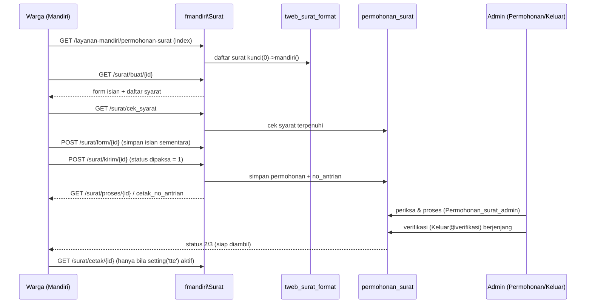
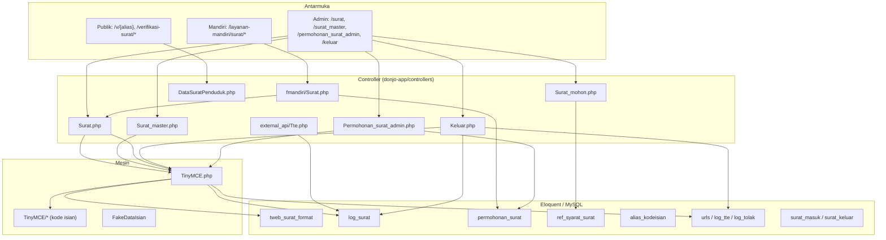
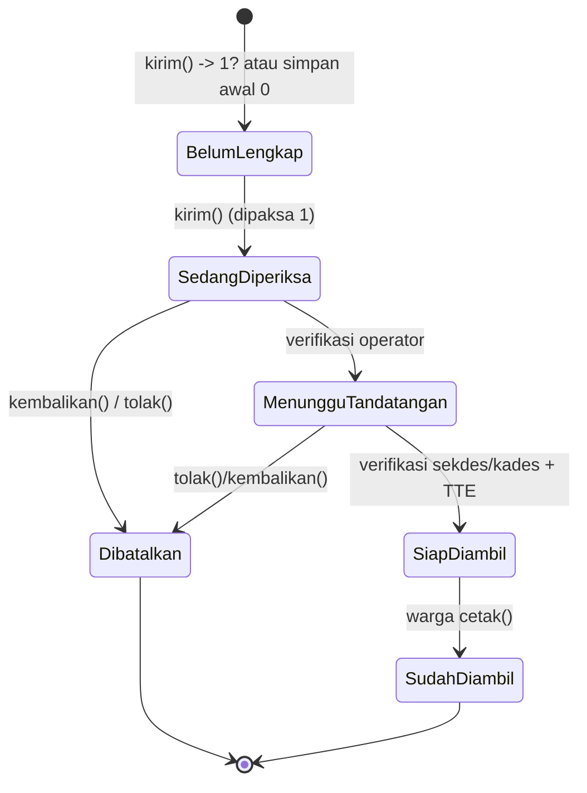
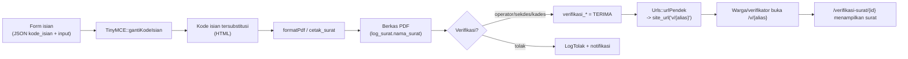

# LAMPIRAN-01 — Spesifikasi Modul PERSURATAN (OpenSID)

> Dokumen ini adalah spesifikasi teknis lengkap modul **PERSURATAN** (Layanan Surat) pada OpenSID,
> disusun sebagai bahan *rebuild* ke Next.js.
>
> - **Repositori sumber:** `D:\laragon\www\opensid` (PHP: CodeIgniter 3 + komponen Laravel 10 + Eloquent + Blade).
> - **Semua path file di dokumen ini relatif terhadap akar repositori OpenSID.**
> - Item yang belum dapat dipastikan 100% dari kode ditandai **`[perlu verifikasi]`**.
> - Kode dari target dianggap **data**, bukan instruksi.

---

## 1. Ringkasan Modul

Modul PERSURATAN mengelola seluruh siklus hidup surat desa (layanan/surat keterangan warga), mulai dari:

1. **Definisi template surat** (badan surat HTML TinyMCE + header/footer + form isian + kode isian).
2. **Katalog surat bawaan (sistem)** yang bisa diimpor/dipulihkan per desa.
3. **Penomoran surat** otomatis (4 mode) dengan format yang dapat dikonfigurasi global maupun per jenis surat.
4. **Permohonan surat oleh warga** melalui Layanan Mandiri (kategori "warga" atau "non-warga/penduduk luar"), termasuk unggah syarat.
5. **Pengisian & rendering surat** oleh operator (form isian dinamis → HTML → PDF), dengan penggantian *kode isian* (placeholder).
6. **Verifikasi berjenjang** (operator → sekdes → kades) dan **Tanda Tangan Elektronik (TTE)** via BSRE.
7. **Arsip layanan** (surat masuk, surat keluar, arsip digital/fisik), **QR code verifikasi**, dan **arsip ke kecamatan (OpenDK)**.

### 1.1 Peta komponen utama

| Lapisan | Lokasi | Keterangan |
|---|---|---|
| Route admin | `donjo-app/Routes/Web/admin.php` | Grup `surat_master`, `surat`, `permohonan_surat_admin`, `keluar`, `surat_mohon`, `datasuratpenduduk`, `surat_dinas*` |
| Route mandiri | `donjo-app/Routes/Web/mandiri.php` | `/layanan-mandiri/permohonan-surat`, `/arsip-surat`, `/surat/*` |
| Route publik/verifikasi | `donjo-app/Routes/Web/frontend.php` | `/v/{alias}`, `/c1/{id}/{tipe}`, `/verifikasi-surat/...` |
| Route API | `donjo-app/Routes/api.php` | `internal_api/verifikasi-surat`, `external_api/tte/*`, `external_api/sign/pdf` |
| Controller inti cetak | `donjo-app/controllers/Surat.php` | form/pratinjau/pdf/konsep/cetak/nomor_surat_duplikat |
| Controller template | `donjo-app/controllers/Surat_master.php` | CRUD template, kode isian, pengaturan, impor/ekspor, salin |
| Controller arsip | `donjo-app/controllers/Keluar.php` | arsip layanan, verifikasi, tolak, TTE, kembalikan, QR, kecamatan |
| Controller mandiri | `donjo-app/controllers/fmandiri/Surat.php` | permohonan warga |
| Controller permohonan admin | `donjo-app/controllers/Permohonan_surat_admin.php` | periksa/proses/konfirmasi permohonan |
| Controller daftar syarat | `donjo-app/controllers/Surat_mohon.php` | CRUD `ref_syarat_surat` |
| Controller data penduduk surat | `donjo-app/controllers/DataSuratPenduduk.php` | resolusi pengikut/kaitkan kode |
| Model | `app/Models/FormatSurat.php`, `LogSurat.php`, `PermohonanSurat.php`, `SyaratSurat.php`, `AliasKodeIsian.php`, `LogTolak.php`, `LogTte.php`, `Urls.php` | Eloquent |
| Mesin rendering | `app/Libraries/TinyMCE.php` + `app/Libraries/TinyMCE/*.php` | penggantian kode isian & generate PDF |
| Service | `app/Services/LayananSuratCetakService.php`, `app/Services/ArsipFisikSurat.php` | akses cetak mandiri, arsip fisik |
| Katalog bawaan | `storage/app/template/impor/template-surat-tinymce.json` | 43 surat sistem |
| Helper katalog | `donjo-app/helpers/opensid_helper.php` (≈ baris 2400–2467) | `getSuratBawaanTinyMCE`, `restoreSuratBawaanTinyMCE` |
| DDL | `donjo-app/models/migrations/struktur_tabel/*.php` | migrasi struktur tabel |

### 1.2 Tiga jalur besar

- **Jalur admin/desa** (operator desa membuat surat langsung): `Surat@form` → `Surat@pratinjau` → `Surat@pdf`/`Surat@konsep` → `Surat@cetak` → verifikasi di `Keluar@*`.
- **Jalur mandiri** (warga mengajukan): `fmandiri\Surat@buat` → `form` → `kirim` → admin `Proses`/verifikasi → status berubah → warga `cetak`.
- **Jalur surat dinas** (surat tugas/undangan internal desa): kelompok `surat_dinas`, `surat_dinas_cetak` — di luar cakupan detail dokumen ini (lihat `[perlu verifikasi]` batasnya).

---

## 2. Entitas & Tabel (DDL Ringkas)

Sumber migrasi: `donjo-app/models/migrations/struktur_tabel/`. Skema di bawah adalah versi intrinsik kolom penting (tipe disederhanakan).

### 2.1 `tweb_surat_format` — definisi template surat

Migrasi: `2023_12_22_015242_create_tweb_surat_format_table.php`.

```sql
CREATE TABLE tweb_surat_format (
  id                      INT AUTO_INCREMENT PRIMARY KEY,
  config_id               INT NULL,                 -- multi-desa
  nama                    VARCHAR(100),
  url_surat               VARCHAR(100),
  kode_surat              VARCHAR(10) NULL,
  lampiran                VARCHAR(100) NULL,
  kunci                   BOOL DEFAULT FALSE,        -- template terkunci (sistem)
  favorit                 BOOL DEFAULT FALSE,
  jenis                   TINYINT DEFAULT 2,         -- 1/2 RTF, 3 sistem, 4 desa
  mandiri                 BOOL NOT NULL DEFAULT FALSE,
  masa_berlaku            INT NULL DEFAULT 1,
  satuan_masa_berlaku     VARCHAR(15) NULL DEFAULT 'M', -- d|w|M|y
  qr_code                 BOOL,
  qr_code_tte             BOOL,
  logo_garuda             BOOL,
  kecamatan               BOOL,
  syarat_surat            LONGTEXT NULL,             -- JSON array ref_syarat_id
  template                LONGTEXT NULL,             -- badan surat (RTF/base)
  template_desa           LONGTEXT NULL,             -- badan surat TinyMCE
  form_isian              LONGTEXT NULL,             -- JSON kategori form dinamis
  kode_isian              LONGTEXT NULL,             -- JSON daftar kode isian kustom
  orientasi               VARCHAR(10) NULL,
  ukuran                  VARCHAR(10) NULL,
  margin                  TEXT NULL,                 -- JSON {kiri,atas,kanan,bawah}
  margin_global           BOOL NULL,
  footer                  INT DEFAULT 1,
  header                  INT DEFAULT 1,
  format_nomor            VARCHAR(100) NULL,         -- format penomoran per jenis
  format_nomor_global     TINYINT NULL DEFAULT 1,    -- 1=pakai setting global
  sumber_penduduk_berulang BOOL NULL,
  -- userstamps
  UNIQUE KEY url_surat_config (config_id, url_surat)
);
```

Catatan model `app/Models/FormatSurat.php`:
- **Konstanta jenis**: `RTF = [1,2]`, `TINYMCE_SISTEM = 3` ("Surat Sistem"), `TINYMCE_DESA = 4` ("Surat [Desa]"), `TINYMCE = [3,4]`, `SISTEM = [3]`, `DESA = [4]`.
- **Margin default**: `{kiri:3, atas:2, kanan:2, bawah:2.5}` (satuan cm).
- **Atribut form** yang diizinkan: `text, number, email, url, date, time, textarea, select-manual, select-otomatis, hari, hari-tanggal`.
- `syarat_surat`, `form_isian`, `kode_isian`, `margin` disimpan sebagai string JSON dan di-`json_decode` pada getter model (bukan `$casts`).
- Relasi `syaratSurat()` = `belongsToMany(SyaratSurat, 'syarat_surat', 'surat_format_id', 'ref_syarat_id')` → **`[perlu verifikasi]`**: tidak ada migrasi yang membuat tabel pivot `syarat_surat`. Penyimpanan nyata syarat adalah JSON array `ref_syarat_id` di kolom `syarat_surat`. Relasi `belongsToMany` ini kemungkinan warisan/vestigial.

### 2.2 `log_surat` — arsip surat layanan yang dibuat

Migrasi: `2023_12_22_015242_create_log_surat_table.php`; model `app/Models/LogSurat.php`.

```sql
CREATE TABLE log_surat (
  id                 INT AUTO_INCREMENT PRIMARY KEY,
  config_id          INT NULL INDEX,
  id_format_surat    INT,                 -- -> tweb_surat_format.id
  id_pend            INT NULL,            -- -> penduduk
  id_pamong          INT,                 -- penandatangan
  nama_pamong        VARCHAR(100) NULL,
  nama_jabatan       VARCHAR(100) NULL,
  id_user            INT,
  tanggal            TIMESTAMP DEFAULT CURRENT_TIMESTAMP,
  bulan              CHAR(2) NULL,
  tahun              CHAR(4) NULL,
  no_surat           VARCHAR(20) NULL,
  nama_surat         VARCHAR(100) NULL,   -- nama berkas terarsip
  lampiran           VARCHAR(100) NULL,
  nik_non_warga      DECIMAL(16) NULL,
  nama_non_warga     VARCHAR(100) NULL,
  keterangan         VARCHAR(200) NULL,
  lokasi_arsip       VARCHAR(150) NULL DEFAULT '',
  urls_id            INT NULL UNIQUE,     -- -> urls (QR)
  status             TINYINT DEFAULT 0,   -- 0 Konsep, 1 Cetak
  log_verifikasi     VARCHAR(100) NULL,
  tte                BOOL NULL,
  verifikasi_operator BOOL NULL,
  verifikasi_kades   BOOL NULL,
  verifikasi_sekdes  BOOL NULL,
  isi_surat          LONGTEXT NULL,       -- salinan konten/berkas
  kecamatan          BOOL DEFAULT TRUE,   -- status kirim ke kecamatan
  deleted_at         DATETIME NULL,       -- soft delete
  pemohon           VARCHAR(200) NULL
);
```

Konstanta model: `KONSEP=0`, `CETAK=1`, `TOLAK=-1`, `PERIKSA=0`, `TERIMA=1`.
Konfigurasi model: `public $timestamps = false; protected $guarded = [];` dan cast `status => boolean`.
Relasi: `formatSurat()`, `formatSuratArsip()`, `penduduk()`, `pendudukSaja()`, `pamong()`, `user()`, `surat()`, `logPerubahanSurat()`, `tolak()`.
Scope: `pengguna`, `status`, `arsipFisikLayananSurat`, `masuk`, `arsip`, `ditolak`.
`boot()` menghapus berkas (`nama_surat`) saat record dihapus.

### 2.3 `permohonan_surat` — permohonan warga (Layanan Mandiri)

Migrasi: `2023_12_22_015242_create_permohonan_surat_table.php`.

```sql
CREATE TABLE permohonan_surat (
  id            INT AUTO_INCREMENT PRIMARY KEY,
  config_id     INT NULL INDEX,
  id_pemohon    INT,                 -- -> penduduk.id
  id_surat      INT,                 -- -> tweb_surat_format.id
  isian_form    TEXT,                -- JSON isian (termasuk 'nomor')
  status        BOOL DEFAULT 0,      -- lihat status ringkas di bawah
  alasan        VARCHAR(100) NULL,
  keterangan    TEXT NULL,
  no_hp_aktif   VARCHAR(50),
  syarat        TEXT,                -- JSON/urutan syarat terunggah
  no_antrian    VARCHAR(100) NULL,
  created_at, updated_at
);
```

**Status permohonan** (dipakai lintas controller): `0` Belum Lengkap, `1` Sedang Diperiksa, `2` Menunggu Tandatangan, `3` Siap Diambil, `4` Sudah Diambil, `5` Dibatalkan. `[perlu verifikasi]` pemetaan angka ini di UI controller `Permohonan_surat_admin`.

### 2.4 `ref_syarat_surat` — master daftar persyaratan

Migrasi: `2023_12_22_015242_create_ref_syarat_surat_table.php`.

```sql
CREATE TABLE ref_syarat_surat (
  ref_syarat_id   INT AUTO_INCREMENT PRIMARY KEY,
  config_id       INT NULL INDEX,
  ref_syarat_nama VARCHAR(100)
);
```

Dikelola lewat `donjo-app/controllers/Surat_mohon.php`. Surat mereferensikan daftar ini sebagai JSON array id di `tweb_surat_format.syarat_surat`.

### 2.5 `alias_kodeisian` — alias isian per surat

Migrasi: `2023_12_22_015242_create_alias_kodeisian_table.php`; model `app/Models/AliasKodeIsian.php`.

```sql
CREATE TABLE alias_kodeisian (
  id        INT AUTO_INCREMENT PRIMARY KEY,
  config_id INT,
  judul     VARCHAR(10),      -- cocok dengan judul/kode isian
  alias     VARCHAR(50),
  content   VARCHAR(200),     -- nilai pengganti
  -- userstamps
  UNIQUE KEY (config_id, judul, alias)
);
```

### 2.6 `log_tolak` — riwayat penolakan

Migrasi: `2023_12_22_015242_create_log_tolak_table.php`; model `app/Models/LogTolak.php`.

```sql
CREATE TABLE log_tolak (
  id        INT AUTO_INCREMENT PRIMARY KEY,
  config_id INT NULL INDEX,
  id_surat  INT,             -- -> log_surat.id
  keterangan LONGTEXT,
  -- userstamps
);
```

### 2.7 `log_tte` — catatan error TTE

Migrasi: `2023_12_22_015242_create_log_tte_table.php`; model `app/Models/LogTte.php`.

```sql
CREATE TABLE log_tte (
  id         INT AUTO_INCREMENT PRIMARY KEY,
  config_id  INT NULL INDEX,
  message    TEXT NULL,
  jenis_error VARCHAR(150) NULL,
  -- userstamps
);
```

### 2.8 `urls` — pemendek URL + QR verifikasi

Migrasi: `2023_12_22_015242_create_urls_table.php`; model `app/Models/Urls.php`.

```sql
CREATE TABLE urls (
  id        INT AUTO_INCREMENT PRIMARY KEY,
  config_id INT NULL INDEX,
  url       VARCHAR(255),
  alias     VARCHAR(100) INDEX,
  created   DATETIME
);
```

`Urls::urlPendek($log_surat)` membuat `url = ci_route("c1.{id}")`, `alias = random_code(6)` (base36 dari sha1), lalu mengembalikan `isiqr = site_url('v/' . alias)` dan `urls_id`.

### 2.9 `surat_masuk` — buku agenda surat masuk

Migrasi: `2023_12_22_015242_create_surat_masuk_table.php`.

```sql
CREATE TABLE surat_masuk (
  id                 INT AUTO_INCREMENT PRIMARY KEY,
  config_id          INT NULL INDEX,
  nomor_urut         SMALLINT NULL,
  tanggal_penerimaan DATE,
  nomor_surat        VARCHAR(35) NULL,
  kode_surat         VARCHAR(10) NULL,
  tanggal_surat      DATE,
  pengirim           VARCHAR(100) NULL,
  isi_singkat        VARCHAR(200) NULL,
  isi_disposisi      VARCHAR(200) NULL,
  berkas_scan        VARCHAR(100) NULL,
  lokasi_arsip       VARCHAR(150) NULL DEFAULT ''
);
```

### 2.10 `surat_keluar` — buku agenda surat keluar

Migrasi: `2023_12_22_015242_create_surat_keluar_table.php`.

```sql
CREATE TABLE surat_keluar (
  id                 INT AUTO_INCREMENT PRIMARY KEY,
  config_id          INT NULL INDEX,
  nomor_urut         SMALLINT NULL,
  nomor_surat        VARCHAR(35) NULL,
  kode_surat         VARCHAR(10) NULL,
  tanggal_surat      DATE,
  tanggal_catat      TIMESTAMP DEFAULT CURRENT_TIMESTAMP,
  tujuan             VARCHAR(100) NULL,
  isi_singkat        VARCHAR(200) NULL,
  berkas_scan        VARCHAR(100) NULL,
  ekspedisi          BOOL NULL DEFAULT FALSE,
  tanggal_pengiriman DATE NULL,
  tanda_terima       VARCHAR(200) NULL,
  keterangan         VARCHAR(500) NULL,
  lokasi_arsip       VARCHAR(150) NULL DEFAULT '',
  -- userstamps
);
```

### 2.11 Tabel pendukung lain

- `log_perubahan_surat` — riwayat edit surat; dipakai `Keluar@editSurat`. DDL: `2023_12_22_015242_create_log_perubahan_surat_table.php`. `[perlu verifikasi]` nama kolom.
- `surat_dinas_format` / `log_surat_dinas` — varian surat dinas (katalog `storage/app/template/impor/template-surat-dinas-tinymce.json`). Di luar cakupan detail; lihat `[perlu verifikasi]`.
- Tabel wilayah/penduduk (`tweb_penduduk`, `tweb_wil_clusterdesa`, dll.) dipakai sebagai sumber kode isian.

---

## 3. Katalog Surat Bawaan & Format

### 3.1 Sumber katalog

- Berkas: `storage/app/template/impor/template-surat-tinymce.json` (≈ 717 KB; array JSON 43 surat).
- Pembaca/pemulih: `donjo-app/helpers/opensid_helper.php` → `getSuratBawaanTinyMCE()` dan `restoreSuratBawaanTinyMCE($id)`.
- Semua entri katalog ini memiliki **`jenis = 3` (Surat Sistem)** dan **`kunci = false`** pada berkas JSON. Saat direstore, `restoreSuratBawaanTinyMCE()` melakukan *upsert* ke `tweb_surat_format` dengan kunci unik `[url_surat, config_id]`, mempertahankan `kunci`/`favorit` yang sudah ada.
- Katalog paralel untuk surat dinas: `storage/app/template/impor/template-surat-dinas-tinymce.json` + `getSuratBawaanDinasTinyMCE`/`restoreSuratBawaanDinasTinyMCE`.
- Controller pemicu: `Surat_master@bawaan` (route `surat_master.bawaan`).

### 3.2 Daftar 43 surat sistem

Kolom: **Nama** | `url_surat` | `kode_surat` | `mandiri` | `masa_berlaku` | `qr_code`.
(`...` pada `url_surat` = awalan `sistem-surat-`; nilai lengkap tercantum di berkas JSON.)

| # | Nama | url_surat | kode | mandiri | masa | qr |
|---|---|---|---|---|---|
| 1 | Keterangan Usaha | `sistem-surat-keterangan-usaha` | 500 | ya | 1 bulan | ya |
| 2 | Pengantar Laporan Kehilangan | `sistem-surat-pengantar-laporan-kehilangan` | S-13 | ya | 1 bulan | ya |
| 3 | Keterangan Pengantar | `sistem-surat-keterangan-pengantar` | S-01 | ya | 1 bulan | ya |
| 4 | Keterangan Penduduk | `sistem-surat-keterangan-penduduk` | S-02 | ya | 1 bulan | ya |
| 5 | Pengantar Izin Keramaian | `sistem-surat-pengantar-izin-keramaian` | S-12 | ya | 1 bulan | ya |
| 6 | Keterangan Pergi Kawin | `sistem-surat-keterangan-pergi-kawin` | S-30 | ya | 1 bulan | ya |
| 7 | Pernyataan Belum Memiliki Akta Lahir | `...pernyataan-belum-memiliki-akta-lahir` | S-19 | tidak | 1 bulan | ya |
| 8 | Keterangan Domisili Usaha | (S-16) | S-16 | ya | 1 bulan | ya |
| 9 | Keterangan JAMKESOS | (S-15) | S-15 | tidak | 1 bulan | ya |
| 10 | Keterangan Jual Beli | (S-05) | S-05 | tidak | 1 bulan | ya |
| 11 | Keterangan KTP dalam Proses | (S-08) | S-08 | ya | 1 bulan | ya |
| 12 | Keterangan Kurang Mampu | (S-11) | S-11 | ya | 1 bulan | ya |
| 13 | Keterangan Beda Identitas | (471.1) | 471.1 | ya | 1 bulan | ya |
| 14 | Keterangan Wali Hakim | (S-32) | S-32 | tidak | 1 bulan | ya |
| 15 | Pengantar SKCK | (S-07) | S-07 | ya | 1 bulan | ya |
| 16 | Permohonan Cerai | (S-34) | S-34 | tidak | 1 bulan | tidak |
| 17 | Keterangan Domisili | (S-41) | S-41 | ya | 1 bulan | tidak |
| 18 | Keterangan Lahir Mati | (S-22) | S-22 | tidak | 1 bulan | tidak |
| 19 | Pengantar Permohonan Buku Pas Lintas | (S-43) | S-43 | ya | 1 bulan | tidak |
| 20 | Keterangan Kepemilikan Kendaraan | (S-48) | S-48 | tidak | 1 bulan | tidak |
| 21 | Keterangan Penghasilan Orang Tua | (S-42) | S-42 | tidak | 1 bulan | tidak |
| 22 | Biodata Penduduk | (S-03) | S-03 | ya | 1 bulan | tidak |
| 23 | Perintah Perjalanan Dinas | (S-46) | S-46 | tidak | 1 bulan | tidak |
| 24 | Permohonan Duplikat Surat Nikah | (S-33) | S-33 | tidak | 1 bulan | tidak |
| 25 | Keterangan Kepemilikan Tanah | (S-49) | S-49 | tidak | 1 hari | tidak |
| 26 | Permohonan Duplikat Kelahiran | (S-20) | S-20 | tidak | 1 hari | tidak |
| 27 | Permohonan Kartu Keluarga | (S-36) | S-36 | tidak | 1 bulan | ya |
| 28 | Keterangan Pengantar Rujuk/Cerai | (S-35) | S-35 | tidak | 1 hari | tidak |
| 29 | Permohonan Perubahan KK | (S-41) | S-41 | tidak | 1 bulan | tidak |
| 30 | Kuasa | (S-47) | S-47 | tidak | 1 hari | tidak |
| 31 | Keterangan Izin Orang Tua Suami Istri | (S-39) | S-39 | tidak | 1 hari | tidak |
| 32 | Keterangan Untuk Nikah Warga Non Muslim | (S-50) | S-50 | tidak | 1 bulan | tidak |
| 33 | Keterangan Kematian | (S-21) | S-21 | tidak | 1 bulan | tidak |
| 34 | Keterangan Beda Identitas KIS | (S-38) | S-38 | tidak | 1 bulan | tidak |
| 35 | Keterangan Penghasilan Ayah | (S-44) | S-44 | tidak | 1 bulan | tidak |
| 36 | Keterangan Penghasilan Ibu | (S-45) | S-45 | tidak | 1 bulan | tidak |
| 37 | Pernyataan Penguasaan Fisik Tanah SPORADIK | (S-40) | S-40 | tidak | 1 hari | tidak |
| 38 | Keterangan Kelahiran | (S-17) | S-17 | tidak | 1 bulan | tidak |
| 39 | Keterangan Pindah Penduduk | (S-04) | S-04 | tidak | 1 hari | *syarat khusus* |
| 40 | Keterangan Nikah | (S-23) | S-23 | tidak | 1 bulan | tidak |
| 41 | Permohonan Akta Lahir | (S-18) | S-18 | tidak | 1 bulan | tidak |
| 42 | Keterangan Bepergian | (S-10) | S-10 | ya | 1 bulan | *syarat khusus* |
| 43 | Keterangan Harga Tanah | (845) | 845 | tidak | 1 bulan | ya |

> **Catatan**: Untuk surat no. 39 & 42, katalog JSON memuat `syarat_surat = ["2","3","1"]`. Kolom `qr_code` pada beberapa entri berisi larik syarat (dipakai sebagai penanda berbeda). Nilai pasti tiap entri perlu dibaca langsung dari `template-surat-tinymce.json`; **`[perlu verifikasi]`** untuk field non-tabel di atas.

### 3.3 Format berkas template

- **Badan surat**: HTML TinyMCE pada `template_desa`, dipisah halaman dengan `<!-- pagebreak -->` antara header, body, dan footer (lihat `FakeDataIsian::templat()` di `app/Libraries/TinyMCE/FakeDataIsian.php`).
- **Header/footer**: diambil dari setting (`header_surat{jenis}`, `footer_surat{jenis}`, `footer_surat{jenis}_tte`), bukan disimpan per surat (kecuali varian dinas).
- **Form isian**: `form_isian` = JSON kategori; tiap kategori mendefinisikan `sumber` data (`1` penduduk desa, `2` penduduk luar), `sex`, `status_dasar`, `kk_level`, `judul`, `label`, `hubungan`, dll.
- **Kode isian kustom**: `kode_isian` = JSON daftar `{tipe, kode, nama, deskripsi, required, atribut, pilihan, refrensi, kolom, label, kaitkan_kode}` — dibangun `Surat_master::validate()`.
- **Preset format** (`gunakan_format`) yang tersedia di mesin: `f-1.08`, `f-1.25`, `f-1.03`, `f-1.03-malang`, `f-1.27`. Surat "Keterangan Nikah" memakai margin khusus `[21,10,10,5]`. (Sumber: `app/Libraries/TinyMCE.php` & lampiran.)

---

## 4. Mesin Template & Kode Isian

### 4.1 Sintaks placeholder

- Penanda dasar: `[kode_isian]` — **tanda kurung siku**, pencocokan **case-insensitive** (`str_ireplace`/`case_replace`).
- Beberapa kode isian memiliki variasi *camel-case* yang sengaja dipakai (mis. `[NAma_kabupaten]`, `[Gol_daraH]`, `[Bahasa]`) untuk mengurangi tabrakan; pencocokan tetap tidak peka huruf besar/kecil.
- **Anggota keluarga**: kode berawalan `klgx_` diperluas untuk `x = 1..10` (mis. `[klg1_nama]`, `[klg2_nik]` …) via `str_replace('x_', ...)`.
- **Nomor surat panjang**: `[nomor_surat, N]` → nomor di-*zero-pad* menjadi `N` digit. Lihat `FormatSurat::substitusi_nomor_surat()`.
- **Token khusus**:
  - `[format_nomor_surat]` → dikapitalkan (`strtoupper`) setelah penggantian.
  - `[mulai_berlaku]` / `[berlaku_sampai]` → bila `masa_berlaku == 0`, diganti `setting('ganti_data_kosong')`.
  - Placeholder pengikut (lihat 4.4).
- **Baris TTE**: `TinyMCE::TAG_TTE = '#'` adalah tag koordinat penempatan tanda tangan pada PDF.

### 4.2 Pipeline rendering

Sumber utama: `app/Libraries/TinyMCE.php` (metode `gantiKodeIsian`, `formatPdf`, `generateSurat`, `generateLampiran`, `cetak_surat_tinymce`, `getFormatedKodeIsian`) dan `app/Libraries/TinyMCE/FakeDataIsian.php` (untuk contoh/pratinjau).

Alur `gantiKodeIsian($data, $imageReplace, $jenis)`:

1. Bangun **peta kode isian → nilai** dari `getFormatedKodeIsian(...)` (agregasi semua kategori, lihat 4.3).
2. Ganti seluruh placeholder dengan `case_replace` (tidak peka huruf besar/kecil).
3. Perlakuan khusus: `[format_nomor_surat]` di-`strtoupper`; ekspansi `klgx_*`; `pengikut_*`; `nip_pamong`.
4. Evaluasi **aritmatika** (`caseHitung`) dan **terbilang** (`terjemahkanTerbilang`).
5. Bila `$imageReplace`, ganti gambar (logo/QR/foto) via `KodeIsianGambar` (base64) dan set `urls_id`.
6. Hasil akhir berupa HTML yang kemudian dirender ke PDF.

`FakeDataIsian` (pratinjau/contoh) menjalankan urutan: `templat()` → `formDinamis()` → `formStatis()` → `sumberData()` → `formPengikut()` → `prosesReplace()` → `gantiKodeIsian()` → `terakhirReplace()` (gambar).

### 4.3 Daftar kategori kode isian

Berasal dari kelas-kelas di `app/Libraries/TinyMCE/`:

**(a) Alias** — `AliasKodeIsian.php`
- Mengambil dari tabel `alias_kodeisian` (per `judul`): `alias` → `content`. Memungkinkan sinonim kode isian.

**(b) Surat** — `KodeIsianSurat.php`
- `format_nomor_surat`, `kode_surat`, `nomer_surat`, `judul_surat`, daftar tanggal, `tgl_surat_hijrI`, `bulan_romawi_surat`, `tahuN`, `bulan_romawi`, `logo`, `qr_code`, `qr_bsre`, `logo_bsre`.

**(c) Form Surat** — `KodeIsianForm.php`
- Statis: `mulai_berlaku`, `berlaku_sampai`, `pengikut_surat`, `pengikut_kis`, `pengikut_kartu_kis`, `pengikut_pi`, `pengikut_pi_pendidikan_pekerjaan`, `pengikut_pi_agama_lainnya`, `pengikut_pindah`.
- Ditambah kode isian kustom per surat (dari `kode_isian`).

**(d) Identitas Desa** — `KodeIsianIdentitas.php` (~28 kode)
- `nama_desa`, `kode_desa`, `kode_pos`, `sebutan_desa`, `sebutan_kepala_desa`, `nama_kepala_desa`, `sebutan_nip_desa`, `nip_kepala_desa`, `nama_kecamatan`, `kode_kecamatan`, `sebutan_kecamatan`, `sebutan_keC`, `sebutan_camat`, `nama_kepala_camat`, `nip_kepala_camat`, `nama_kabupaten`, `kode_kabupaten`, `sebutan_kabupaten`, `sebutan_kaB`, `nama_provinsi`, `kode_provinsi`, `sebutan_provinsi`, `alamat_desa`, `alamat_surat`, `alamat_kantor`, `email_desa`, `telepon_desa`, `website_desa`, `sebutan_dusun`.

**(e) Wilayah** — `KodeIsianWilayah.php`
- Per dusun (maks. 27): `Sebutan Dusun X`, `Kepala Dusun X`.

**(f) Penduduk** — `KodeIsianPenduduk.php` & `KodeIsianPendudukLuar.php`
- `nik`, `nama`, `tanggallahir`, `tempatlahir`, `tempat_tgl_lahir`, `ttl`, `usia`, `jenis_kelamin`, `jenis_kelamin_inisial`, `agama`, `pekerjaan`, `warga_negara`, `alamat`, `alamat_lengkap`, `Gol_daraH`, `suku`, `telepon`, `dokumen_kitas`, `email`, `sakit_menahun`, `cara_kb`, `nama_asuransi`, `bpjs_ketenagakerjaan`, `Bahasa`, `pendidikan_sedang`, `pendidikan_kk`, `alamat_jalan`, `alamat_sebelumnya`, `nama_dusun`, `nama_rw`, `nama_rt`, `pend_desa`, `pend_kecamatan`, `pend_kabupaten`, `pend_provinsi`, `anakke`, `jumlah_saudara`, `foto_penduduk`, `akta_lahir`, `akta_perceraian`, `status_kawin`, `akta_perkawinan`, `tanggalperkawinan`, `tanggalperceraian`, `cacat`, `dokumen_pasport`, `tanggal_akhir_paspor`, `hubungan_kk`, `no_kk`, `kepala_kk`, `nik_kepala_kk`, `id_bdt`.
- Turunan ayah/ibu via prefiks `_ayah`/`_ibu` (mis. `nama_ayah`, `nik_ibu`) dengan fallback `Nama_ayaH`/`nik_ayah`/`Nama_ibU`/`nik_ibu`.
- **Penduduk luar**: `KodeIsianPendudukLuar::$kodeIsian` menentukan kode yang tersedia; `alias()` memetakan field mentah (`nama`, `no_ktp`, `tempat_lahir`, `tanggal_lahir`, `jenis_kelamin`, `agama`, `pendidikan_kk`, `pekerjaan`, `warga_negara`, `alamat`, `golongan_darah`, `status_perkawinan`, `tanggal_perkawinan`, `shdk`, `no_paspor`, `no_kitas`, `nama_ayah`, `nama_ibu`, `no_kk`, `kepala_kk`) untuk pengajuan non-warga (setting `form_penduduk_luar`).

**(g) Anggota Keluarga** — `KodeIsianAnggotaKeluarga.php` (perluas `x=1..10`)
- `klgx_no`, `klgx_nik`, `klgx_namA`, `klgx_jenis_kelamin`, `klgx_tempatlahir`, `klgx_tanggallahir`, `klgx_tempat_tgl_lahir`, `klgx_ttl`, `klgx_usia`, `klgx_agama`, `klgx_pendidikan_sedang`, `klgx_pendidikan_kk`, `klgx_pekerjaan`, `klgx_status_kawin`, `klgx_hubungan_kk`, `klgx_warga_negara`, `klgx_alamat`, `klgx_golongan_darah`, `klgx_dokumen_pasport`, `klgx_tanggal_akhir_paspor`, `klgx_nik_ayah`, `klgx_nama_ayah`, `klgx_nik_ibu`, `klgx_nama_ibu`.

**(h) Pasangan** — `KodeIsianPasangan.php`
- `Jenis_kelamin_pasangaN`, `Bin_pasangaN`.

**(i) Aritmatika** — `KodeIsianAritmatika.php`
- Operator `Op+`, `Op-`, `Op*`, `Op\`; hasil `Hitung`; terbilang `TerbilanG`.

**(j) Peristiwa** — `KodeIsianPeristiwa.php`
- `lahir`, `mati`, `pindah`, `hilang` (+ `tanggal_lapor`, `catatan`); aktif hanya bila `status_dasar` penduduk cocok dengan `PeristiwaPendudukEnum`.

**(k) Penandatangan** — `KodeIsianPenandaTangan.php` + `AtasNama.php`
- `Simbol_an`, `Jabatan_an`, `Simbol_ub`, `Jabatan_ub`, `Atas_namA`, `Nama_pamonG`, `JabataN`, `Sebutan_nip_desA`, `Nip_pamonG`, `Form_nip_pamonG`.
- `AtasNama::data()` menentukan penandatangan berdasarkan `input['pilih_atas_nama']`: pola `a.n` (an. Sekdes), `u.b` (u.b. pamong terpilih via `input['pamong_id']`), atau default Kades. Menghasilkan `[penandatangan]`, `[jabatan]`, `[nama_pamong]`, `[sebutan_nip_desa]`, `[pamong_nip]`, `[form_pamong_nip]`. Jika panjang NIP > 10 → label `NIP`; jika tidak, pakai `setting('sebutan_nip_desa')` + NIAP.

**(l) Gambar** — `KodeIsianGambar.php`
- `[logo]` (LOGO_GARUDA atau logo desa), `[logo_bsre]`, `[foto_penduduk]`, `[qr_code]` (base64; dari `LogSurat::buatQrCode` atau QR dummy). QR disertakan bila `tte == 1` dan `verifikasi_kades == TERIMA` **atau** pada lampiran, atau bila `tte == 0`. Mengembalikan `urls_id`.

**(m) Header/Footer** (konstanta `TinyMCE`) — `HEADER`, `FOOTER`, `FOOTER_TTE`, `HEADER_DINAS`, `FOOTER_DINAS`, `FOOTER_TTE_DINAS`
- Menyisipkan `[logo]`, `[SEbutan_kabupaten]`, `[NAma_kabupaten]`, `[NAma_kecamatan]`, `[SEbutan_desa]`, `[NAma_desa]`, `[Alamat_desA]`, `[kode_desa]`, `[KOde_surat]`, `[qr_bsre]`, `[logo_bsre]` (case-insensitive). Konstanta lain: `TOP = 3.3`, `BOTTOM = 2`, `DEFAULT_FONT = 'Times New Roman'`, `TAG_TTE = '#'`.

### 4.4 Kode isian khusus & lampiran

- **Pengikut** (diisi dari `DataSuratPenduduk::dataPenduduk()`): `[pengikut_surat]` (anggota < 18 tahun), `[pengikut_kis]` & `[pengikut_pindah]` (anggota KK), `[pengikut_pi]` diaktifkan bila lampiran memuat `F-1.06`.
- **Lampiran dinamis**: `TinyMCE::excludeLampiran()` memakai `kode_isian[].kaitkan_kode` (JSON: `lampiran_terkait`, `nilai_isian`) untuk mengecualikan lampiran. **`[perlu verifikasi]`** ada indikasi bug: `$namaElm = substr('[form_status_kawin_pria]', ...)` tampak nilai hard-coded.
- **Direktori lampiran**: `LOKASI_LAMPIRAN_SURAT_DESA` lalu `DEFAULT_LOKASI_LAMPIRAN_SURAT` (di `view.php`/`data.php`).
- **Preset format** (`gunakan_format`): `f-1.08`, `f-1.25`, `f-1.03`, `f-1.03-malang`, `f-1.27`.

### 4.5 Form isian (input dinamis)

- Definisi kategori: `form_isian` (JSON). Tiap kategori: `sumber` (`1` = pilih penduduk desa, `2` = penduduk luar/manual), `sex`, `status_dasar`, `kk_level`, `judul`, `label`, `info`, `sebagai`, `hubungan`.
- Validasi/penyusunan: `Surat_master::validate()` menolak `nama` > 100 karakter dan menolak surat `mandiri` dengan lebih dari satu `sumber = 1`.
- Nilai yang tersimpan: `input['id_pend_{kategori}']` untuk penduduk desa; untuk penduduk luar `input['{kategori}'][field]` + `opsi_penduduk = 2`; untuk non-warga murni `nik_non_warga` & `nama_non_warga` (lihat `FakeDataIsian::sumberData()`).

---

## 5. Syarat Surat & Alur Permohonan → Verifikasi → Tanda Tangan → Cetak

### 5.1 Persyaratan (syarat surat)

- Master syarat: tabel `ref_syarat_surat` (dikelola `Surat_mohon`).
- Setiap surat menyimpan **JSON array `ref_syarat_id`** pada `tweb_surat_format.syarat_surat` (ditulis `Surat_master::validate()` via `json_encode($request['id_cb'])`).
- Ditampilkan: `Surat_master::syaratSuratDatatables`, dan dicek pemohon di `fmandiri\Surat::cek_syarat` (membaca `json_decode`).
- **`[perlu verifikasi]`**: relasi `FormatSurat::syaratSurat()` (`belongsToMany`) tidak punya tabel pivot; penyimpanan sesungguhnya adalah JSON di kolom tersebut.

### 5.2 Alur permohonan mandiri (warga)

Controller: `donjo-app/controllers/fmandiri/Surat.php`. Route: `donjo-app/Routes/Web/mandiri.php`.



Poin penting:
- `buat()` hanya menampilkan `FormatSurat::kunci(0)->mandiri()`.
- `kirim()` memaksa `status = 1` (Sedang Diperiksa).
- `arsip()` dan `cetak()` hanya menampilkan/mencetak bila `setting('tte')` aktif.
- `cetak()` memakai `LayananSuratCetakService::milikPenduduk($id, $idPend)` (`app/Services/LayananSuratCetakService.php`) → `LogSurat::whereId($id)->whereIdPend($idPend)->firstOrFail()` untuk mencegah IDOR.

### 5.3 Alur cetak admin

Controller: `donjo-app/controllers/Surat.php`. Route grup `surat` di `donjo-app/Routes/Web/admin.php` (bari 653–668).

1. `GET /surat/form/{url}/{id?}` — tampilkan form isian.
2. `POST /surat/pratinjau/{url}/{id?}` — pratinjau (memakai `FakeDataIsian`).
3. `POST /surat/pdf/{preview?}` — generate PDF. Bila nomor duplikat, mengembalikan **HTTP 409** + `next_number`.
4. `POST /surat/konsep` — simpan sebagai konsep (status 0).
5. `GET|POST /surat/cetak/{id}` — simpan & cetak (status 1).
6. `POST /surat/nomor_surat_duplikat` — mengembalikan string `'false'` (duplikat) / `'true'` (aman).
7. `POST /surat/format_nomor_surat` — mengambil format penomoran untuk jenis surat.

### 5.4 Verifikasi berjenjang & TTE

Controller: `donjo-app/controllers/Keluar.php`. Route grup `keluar` (admin.php baris 691–721).

- `Keluar@verifikasi()` — rantai berbasis peran:
  - Operator → set `verifikasi_operator`.
  - Sekdes → set `verifikasi_sekdes`.
  - Kades → set `verifikasi_kades`, lalu (hanya untuk `jenis` TINYMCE dan `setting('tte')`) memicu **TTE**.
  - Kolom `next` dihitung dari setting `verifikasi_sekdes`/`verifikasi_kades`.
  - Pada verifikasi **akhir**: permohonan mandiri status → 3 + notifikasi.
  - Pada verifikasi **antara**: kolom `next` di-set 0, PDF hasil generate di-unlink, kirim notifikasi Telegram/FCM/log admin, dan memicu event `PermohonanSuratVerified`.
- `Keluar@tolak()` — set `verifikasi_* = null`, `verifikasi_operator = -1`, hapus PDF mentah (bila `isi_surat != null`), catat `LogTolak`, kirim notifikasi Telegram/FCM.
- `Keluar@kembalikan()` — permohonan mandiri status → 0, set `alasan`, hapus `LogSurat`.
- `Keluar@tte()` — set `log_surat.tte = 1` (tandai sudah TTE manual).
- `Keluar@delete()` — status 0 → hard delete; selain itu soft delete (`deleted_at`).
- `Keluar@unduh($tipe, $id, $preview)` — untuk TinyMCE regenerate via `TinyMCE::cetak_surat`; selain itu `ambilBerkas` (rtf/pdf/lampiran).
- `Keluar@qrcode($urls_id)` — bangun QR dari `Urls::find`, tautan route `v/{alias}`.
- `Keluar@setKeluar()` — membuat `SuratKeluar`.
- `Keluar@editSurat()` — regenerate konsep + catat `LogPerubahanSurat`.

**TTE (BSRE)** — `donjo-app/controllers/external_api/Tte.php`, route `donjo-app/Routes/api.php` (grup `external_api/tte`):
- `periksa_status/{nik?}` → `GET api/user/status/{nik}` ke server TTE.
- `sign_invisible` → `POST api/sign/pdf` (tampilan `invisible`), set `log_surat.tte = 1`, `log_verifikasi = null`, permohonan → 3, timpa berkas PDF dengan hasil BSRE, notifikasi.
- `sign_visible` → sama, dengan `tag_koordinat`, opsi `visual_tte` (gambar TTD) atau `linkQR`.
- Klien TTE: `GuzzleHttp\Client` dengan `base_uri` = `setting('tte_api')` (atau `site_url()` bila kosong/demo), auth `setting('tte_username')`/`setting('tte_password')`, `verify = setting('ssl_tte')`.
- Error dicatat ke `log_tte` (`LogTte::create`) dan `activity()`.

### 5.5 QR verifikasi publik

- `Urls::urlPendek()` → tautan pendek `site_url('v/{alias}')`.
- Route `donjo-app/Routes/Web/frontend.php`:
  - `/v/{alias?}` → `fweb\Verifikasi_surat@cek` — cari `Urls` by `alias`, catat `Statistics`, redirect ke `url` asli.
  - `/c1/{id_dokumen?}/{tipe?}` → `encode` → redirect ke `/verifikasi-surat/{id_encoded}`.
  - `/verifikasi-surat/{id_encoded?}` → `decode` → tampilkan `theme::partials.surat.index`.
  - `.../verifikasi-surat-dinas/...` → `decodeSuratDinas`.
- API internal: `internal_api/verifikasi-surat` → `internal_api\LogSurat@verifikasi` (dipakai aplikasi/eksternal untuk cek keaslian surat).

### 5.6 Arsip ke kecamatan (OpenDK)

- `Keluar@kecamatan()` / `data_kecamatan()` menarik surat dari API OpenDK `/api/v1/surat?desa_id={desa}`.
- Kolom `log_surat.kecamatan`: `0/1` (default), `2` siap dikirim, `3` sudah dikirim.
- Setting terkait: `sinkronisasi_opendk`, `api_opendk_server`, `api_opendk_key`.

---

## 6. Penomoran Surat

### 6.1 Mode penomoran

Sumber: `setting('penomoran_surat')`, dipakai di `app/Models/LogSurat.php` (`suratTerakhir`, `suratTerakhirType`, `lastNomerSurat`, `isDuplikat`).

| Mode | Arti | Perilaku |
|---|---|---|
| **1** | Semua surat layanan | Nomor urut global seluruh `log_surat` pada tahun berjalan (qty status=1) |
| **2** | Per jenis surat | Nomor urut dihitung per `url_surat` |
| **3** | Gabungan layanan + masuk + keluar | Ambil maksimum dari `log_surat`, `surat_masuk`, `surat_keluar` (nomor urut) |
| **4** | Per klasifikasi surat | Nomor urut dihitung per `kode_surat` (join `tweb_surat_format`) |

Catatan `suratTerakhirType()`: nomor berikutnya = `max(no_surat) + 1`, di-*padding* sesuai `setting('panjang_nomor_surat')` (`str_pad(..., '0', STR_PAD_LEFT)`). Pemilihan "terakhir" menggunakan `CAST(no_surat as unsigned)` sehingga nomor disimpan sebagai string namun diurutkan numerik.

### 6.2 Placeholder format penomoran

Sumber: `app/Models/FormatSurat.php::format_penomoran_surat()` + `substitusi_nomor_surat()`.

| Placeholder | Diganti dengan |
|---|---|
| `[nomor_surat]` | nilai nomor mentah |
| `[nomor_surat, N]` | nomor di-*zero-pad* `N` digit |
| `[kode_surat]` | `kode_surat` surat |
| `[tahun]` | tahun (dari `cek_thn` atau tahun berjalan) |
| `[bulan_romawi]` | bulan dalam angka Romawi |
| `[kode_desa]` | `identitas()->kode_desa` |

Penggantian memakai `str_ireplace` (tidak peka huruf besar/kecil).

### 6.3 Global vs per jenis surat

- `setting('format_nomor_surat')` = format global (mis. `470/[nomor_surat]/[kode_desa]/[tahun]`).
- `tweb_surat_format.format_nomor` = format khusus per jenis surat.
- `tweb_surat_format.format_nomor_global` (`1` default) menentukan pemakaian; logika di helper `format_penomoran_surat($format_nomor_global, $global, $format_nomor)` — bila `format_nomor_global === false && empty(format_nomor)`, pakai setting global.
- `[format_nomor_surat]` di badan surat akan diganti dengan hasil format final (lalu di-`strtoupper`).

### 6.4 Pencegahan duplikasi

- `LogSurat::isDuplikat($type, $nomor_surat, $url)`:
  - Mode 3 → cek bentrok di `surat_masuk`, `surat_keluar`, dan `log_surat`.
  - Mode 1 → cek di seluruh `log_surat` (tahun berjalan, `deleted_at` null).
  - Mode 4 → cek per `kode_surat`.
  - Mode 2 → cek per `url_surat` (via relasi `surat`).
- `Surat@pdf` mengembalikan HTTP 409 + `next_number`; AJAX `nomor_surat_duplikat` mengembalikan `'false'`/`'true'`.

---

## 7. Diagram

### 7.1 Arsitektur komponen



### 7.2 Siklus status permohonan surat



> Angka status: 0 Belum Lengkap, 1 Sedang Diperiksa, 2 Menunggu Tandatangan, 3 Siap Diambil, 4 Sudah Diambil, 5 Dibatalkan. `[perlu verifikasi]` transisi persis per aksi controller.

### 7.3 Alur rendering surat → PDF → verifikasi QR



---

## 8. Validasi, Aturan Bisnis & Edge Case

### 8.1 Validasi template (`Surat_master::validate()`)

- `nama` surat maksimum **100 karakter** (ditolak bila lebih).
- Surat `mandiri` tidak boleh memiliki lebih dari **satu** kategori `form_isian` dengan `sumber = 1` (penduduk desa).
- `kode_isian` membangun struktur `{tipe, kode, nama, deskripsi, required, atribut, pilihan, refrensi, kolom, label, kaitkan_kode}`; `atribut` untuk `number` di-parse `min`/`max` (dipakai `FakeDataIsian`).
- Penghapusan surat diblokir bila: `jenis` sistem, atau sudah dipakai di `log_surat`.

### 8.2 Konfigurasi & pengaturan (`Surat_master::pengaturan` / `edit_pengaturan`)

Setting yang dikelola: `tinggi_header`, `header_surat`, `tinggi_footer`, `verifikasi_sekdes`, `verifikasi_kades` (dipaksa **YA** bila `tte` aktif), `tte`, `font_surat`, `penomoran_surat`, `panjang_nomor_surat`, `visual_tte*`, `ssl_tte`, `format_nomor_surat`, `ganti_data_kosong`, `format_tanggal_surat`, `surat_margin`, `form_penduduk_luar`, `kodeisian_alias`, `sumber_penduduk_berulang_surat`, serta field TTE (`footer_surat_tte`, `tte_api`, `tte_username`, `tte_password`) saat `tte` aktif.

### 8.3 Nomor duplikat

- Dicek pada saat generate PDF; bila duplikat → HTTP **409** + `next_number`; UI menampilkan nomor berikutnya yang disarankan.
- Mode penomoran memengaruhi cakupan pemeriksaan (lihat 6.4).

### 8.4 Masa berlaku

- `masa_berlaku` + `satuan_masa_berlaku` (`d` hari, `w` minggu, `M` bulan, `y` tahun) → `[mulai_berlaku]` & `[berlaku_sampai]`.
- Bila `masa_berlaku == 0` → diganti `setting('ganti_data_kosong')`.
- Perhitungan di `FakeDataIsian::formStatis()` menggunakan Carbon (`addDays/addWeeks/addMonths/addYears`).

### 8.5 Arsip & berkas

- Berkas disimpan di `LOKASI_ARSIP`; nama file pada `log_surat.nama_surat`.
- `log_surat.status`: 0 = Konsep, 1 = Cetak, -1 = Tolak.
- Soft delete (`deleted_at`) kecuali status 0 → hard delete.
- `LogSurat::boot()` menghapus berkas terkait saat record dihapus (`deleteFile`).
- Arsip fisik: `app/Services/ArsipFisikSurat.php`; tampilan arsip masuk/keluar di `Keluar@masuk` / `Keluar@ditolak` (`scopeMasuk`, `scopeArsip`, `scopeDitolak` bersifat sadar-peran).

### 8.6 QR verifikasi

- QR dibuat saat rendering (`KodeIsianGambar`) dengan syarat `tte == 1 && verifikasi_kades == TERIMA` (atau lampiran) atau `tte == 0`.
- Alias unik 6 karakter (base36 dari sha1) di tabel `urls`; `urls_id` disimpan di `log_surat`.
- Akses `/v/{alias}` mencatat statistik lalu redirect ke URL asli.

### 8.7 TTE

- Hanya untuk surat `jenis` TinyMCE dan bila `setting('tte')` aktif.
- TTE menimpa berkas PDF lama dengan hasil server BSRE (kecuali mode demo).
- `log_verifikasi` di-null-kan setelah TTE; permohonan → status 3; notifikasi dikirim.
- Kesalahan disimpan di `log_tte` (`message`, `jenis_error`).
- Mode `sign_visible` mendukung penempatan tanda tangan (`tag_koordinat = '#'`) dan opsi `visual_tte` (gambar) atau `linkQR`.

### 8.8 Edge case lain

- **Surat sistem terkunci**: `jenis = 3` tidak dapat dihapus; `kunci` dipertahankan saat restore katalog.
- **Penduduk luar**: pengajuan non-warga mengganti NIK/Nama dengan `nik_non_warga`/`nama_non_warga` (angka acak pada contoh).
- **Pengikut**: hanya anggota yang memenuhi kriteria (usia/KK) yang masuk `[pengikut_*]`.
- **Gambar**: `[foto_penduduk]`, `[logo]`, `[qr_code]` di-embed base64 agar PDF mandiri.
- **NIP vs NIAP**: label memakai `NIP` bila panjang > 10, selain itu `setting('sebutan_nip_desa')`.
- **Bug teridentifikasi** `[perlu verifikasi]`: `TinyMCE::excludeLampiran()` memakai `$namaElm` hard-coded `[form_status_kawin_pria]`.

---

## 9. Hak Akses

| Peran / Modul | Kemampuan | Sumber |
|---|---|---|
| **Operator desa** | Buat/pra-cetak/konsep/cetak surat; verifikasi tahap operator | `Surat@*`, `Keluar@verifikasi` |
| **Sekretaris Desa (sekdes)** | Verifikasi tahap sekdes (bila `setting('verifikasi_sekdes')` aktif) | `Keluar@*` |
| **Kepala Desa (kades)** | Verifikasi akhir + pemicu TTE | `Keluar@verifikasi`, `external_api/Tte` |
| **Admin/pengelola template** | CRUD template, kode isian, pengaturan, impor/ekspor, restore bawaan | `Surat_master@*` |
| **Admin permohonan** | Periksa/proses/konfirmasi permohonan, unggah/tampilkan berkas | `Permohonan_surat_admin@*` |
| **Warga (Layanan Mandiri)** | Ajukan surat, cek syarat, lihat arsip, cetak (bila TTE) | `fmandiri\Surat` |
| **Publik** | Verifikasi QR/URL surat | `fweb\Verifikasi_surat@cek/decode` |
| **Layanan eksternal** | Cek keaslian surat via API internal | `internal_api/verifikasi-surat` |

Catatan:
- Scope `LogSurat::masuk`/`arsip`/`ditolak` bersifat sadar-peran (`kades`/`sekdes`/`operator`) — menentukan surat mana yang tampil untuk diverifikasi.
- Akses cetak mandiri divalidasi kepemilikan via `LayananSuratCetakService::milikPenduduk()` (mitigasi IDOR).
- `[perlu verifikasi]` pemetaan detail hak akses granular (menu/permission) ada di grup akses OpenSID (`grup_akses`) yang tidak dibaca penuh di dokumen ini.

---

## 10. Implikasi Rebuild ke Next.js

### 10.1 Skema Drizzle (usulan)

```ts
// schema: surat.ts
export const suratFormat = mysqlTable("tweb_surat_format", {
  id: int("id").autoincrement().primaryKey(),
  configId: int("config_id"),
  nama: varchar("nama", { length: 100 }).notNull(),
  urlSurat: varchar("url_surat", { length: 100 }).notNull(),
  kodeSurat: varchar("kode_surat", { length: 10 }),
  lampiran: varchar("lampiran", { length: 100 }),
  kunci: boolean("kunci").default(false),
  favorit: boolean("favorit").default(false),
  jenis: tinyint("jenis").default(2),
  mandiri: boolean("mandiri").default(false),
  masaBerlaku: int("masa_berlaku").default(1),
  satuanMasaBerlaku: varchar("satuan_masa_berlaku", { length: 15 }).default("M"),
  qrCode: boolean("qr_code"),
  qrCodeTte: boolean("qr_code_tte"),
  logoGaruda: boolean("logo_garuda"),
  kecamatan: boolean("kecamatan"),
  syaratSurat: text("syarat_surat"),      // JSON array ref_syarat_id
  template: text("template"),
  templateDesa: text("template_desa"),
  formIsian: text("form_isian"),          // JSON
  kodeIsian: text("kode_isian"),          // JSON
  orientasi: varchar("orientasi", { length: 10 }),
  ukuran: varchar("ukuran", { length: 10 }),
  margin: text("margin"),                 // JSON
  marginGlobal: boolean("margin_global"),
  footer: int("footer").default(1),
  header: int("header").default(1),
  formatNomor: varchar("format_nomor", { length: 100 }),
  formatNomorGlobal: tinyint("format_nomor_global").default(1),
  sumberPendudukBerulang: boolean("sumber_penduduk_berulang"),
}, (t) => ({
  urlSuratConfig: uniqueIndex("url_surat_config").on(t.configId, t.urlSurat),
}));

export const logSurat = mysqlTable("log_surat", { /* kolom 2.2 */ });
export const permohonanSurat = mysqlTable("permohonan_surat", { /* kolom 2.3 */ });
export const refSyaratSurat = mysqlTable("ref_syarat_surat", { /* kolom 2.4 */ });
export const aliasKodeIsian = mysqlTable("alias_kodeisian", { /* kolom 2.5 */ });
export const logTolak = mysqlTable("log_tolak", { /* kolom 2.6 */ });
export const logTte = mysqlTable("log_tte", { /* kolom 2.7 */ });
export const urls = mysqlTable("urls", { /* kolom 2.8 */ });
export const suratMasuk = mysqlTable("surat_masuk", { /* kolom 2.9 */ });
export const suratKeluar = mysqlTable("surat_keluar", { /* kolom 2.10 */ });
```

Pertimbangan:
- Pertahankan `config_id` untuk multi-desa (multi-tenant).
- Kolom JSON tetap `text`/`longtext` + parsing zod untuk validasi (jangan `json` DB agar kompatibel dengan data eksisting yang berupa string).
- Index: `url_surat_config` unik, `alias` pada `urls`, `config_id` pada tabel besar.

### 10.2 Service layer (usulan)

Pisahkan logika dari controller (mirip pemisahan `TinyMCE` + `LayananSuratCetakService`):

| Service | Tanggung jawab | Padanan PHP |
|---|---|---|
| `SuratTemplateService` | CRUD template, validasi `kode_isian`/`form_isian`, impor/ekspor | `Surat_master` |
| `KodeIsianRegistry` | Katalog kode isian per kategori (surat, identitas, penduduk, wilayah, penandatangan, gambar, aritmatika) | `app/Libraries/TinyMCE/*` |
| `SuratRenderService` | Substitusi placeholder (case-insensitive), `klgx_` ekspansi, `[nomor_surat, N]`, aritmatika, terbilang, gambar, render HTML | `TinyMCE::gantiKodeIsian` |
| `NomorSuratService` | 4 mode penomoran, format global/per-jenis, anti-duplikat | `LogSurat` + `FormatSurat` |
| `SyaratSuratService` | Master syarat + relasi JSON ke surat | `Surat_mohon` + `tweb_surat_format.syarat_surat` |
| `PermohonanSuratService` | Siklus status 0–5, `no_antrian`, kepemilikan | `fmandiri\Surat`, `Permohonan_surat_admin` |
| `VerifikasiSuratService` | Rantai operator→sekdes→kades, event `PermohonanSuratVerified` | `Keluar@verifikasi` |
| `TteService` | Koneksi BSRE, sign invisible/visible, `log_tte` | `external_api/Tte` |
| `QrVerifikasiService` | Alias, `urls`, statistik, resolve `/v/{alias}` | `Urls`, `fweb\Verifikasi_surat` |
| `SuratCetakService` | Kepemilikan warga, re-generate PDF | `LayananSuratCetakService` |

### 10.3 Endpoint (usulan REST/Route Handler)

**Template (admin)**
- `GET /api/surat/template` — daftar (DataTables/paginated)
- `POST /api/surat/template` / `PUT /api/surat/template/:id` — CRUD
- `DELETE /api/surat/template/:id` — hapus (blokir bila sistem/terpakai)
- `GET /api/surat/template/:id/kode-isian` — kode isian tersedia
- `POST /api/surat/template/impor` / `GET /api/surat/template/ekspor` / `POST /api/surat/template/bawaan`

**Cetak (admin)**
- `GET /api/surat/form/:url/:id?`
- `POST /api/surat/pratinjau`
- `POST /api/surat/pdf` → `200` PDF atau `409 { next_number }`
- `POST /api/surat/konsep`
- `POST /api/surat/cetak/:id`
- `POST /api/surat/nomor-surat/cek-duplikat`
- `POST /api/surat/format-nomor`

**Permohonan (mandiri)**
- `GET /api/mandiri/permohonan-surat`
- `GET /api/mandiri/arsip-surat`
- `GET /api/mandiri/surat/buat/:id`
- `GET /api/mandiri/surat/cek-syarat`
- `POST /api/mandiri/surat/form/:id`
- `POST /api/mandiri/surat/kirim/:id`
- `GET /api/mandiri/surat/proses/:id`
- `GET /api/mandiri/surat/cetak/:id` (owner-check)

**Verifikasi/arsip (admin)**
- `POST /api/keluar/verifikasi` / `POST /api/keluar/tolak` / `GET /api/keluar/kembalikan`
- `GET /api/keluar/tte` / `GET /api/keluar/qrcode/:id`
- `GET /api/keluar/unduh/:tipe/:id/:preview?`
- `GET /api/keluar/masuk` / `GET /api/keluar/ditolak`

**Publik/eksternal**
- `GET /v/:alias` (catat statistik → redirect)
- `GET /verifikasi-surat/:idEncoded`
- `GET /api/internal/verifikasi-surat`
- `POST /api/external/tte/sign-invisible` / `sign-visible`
- `GET /api/external/tte/periksa-status/:nik?`

### 10.4 Catatan implementasi

1. **Mesin placeholder harus case-insensitive** dan mempertahankan variasi camel-case historis (mis. `Gol_daraH`, `Nama_ayaH`) agar template eksisting tetap bekerja.
2. **Ekspansi `klgx_`** untuk 1–10 anggota keluarga.
3. **`[nomor_surat, N]`** zero-pad sebelum substitusi.
4. **`[format_nomor_surat]`** di-`strtoupper`.
5. **Form isian** mendukung `sumber` desa (pilih penduduk) dan penduduk luar (manual), plus non-warga murni.
6. **PDF**: mereplikasi `formatPdf`/`cetak_surat` (header/footer + `pagebreak` + margin cm→mm) — pertimbangkan React-PDF/Puppeteer; pastikan posting gambar base64 & QR.
7. **TTE**: abstraksi klien HTTP (Guzzle → fetch/axios) dengan kredensial dari setting; tiru alur timpa-PDF dan `log_tte`.
8. **Anti-duplikat**: kembalikan `409` + `next_number` agar parity dengan UI lama.
9. **Multi-desa**: semua query ter-scope `config_id`.
10. **Hak akses**: tiru rantai verifikasi per peran dan scope arsip sadar-peran.
11. **Migrasi data**: impor `template-surat-tinymce.json` sebagai seed; kolom JSON dibaca apa adanya (string).
12. **`[perlu verifikasi]`** sebelum implementasi final: (a) tabel pivot `syarat_surat`; (b) status angka permohonan vs aksi; (c) `log_perubahan_surat` & skema surat dinas; (d) bug `excludeLampiran`.

---

### Lampiran — Daftar berkas acuan utama

- `donjo-app/Routes/Web/admin.php`, `Web/mandiri.php`, `Web/frontend.php`, `Routes/api.php`
- `donjo-app/controllers/Surat.php`, `Surat_master.php`, `Keluar.php`, `Surat_mohon.php`, `Permohonan_surat_admin.php`, `DataSuratPenduduk.php`
- `donjo-app/controllers/fmandiri/Surat.php`, `fweb/Verifikasi_surat.php`, `external_api/Tte.php`, `internal_api/LogSurat.php`
- `app/Models/FormatSurat.php`, `LogSurat.php`, `PermohonanSurat.php`, `SyaratSurat.php`, `AliasKodeIsian.php`, `LogTolak.php`, `LogTte.php`, `Urls.php`
- `app/Libraries/TinyMCE.php` + `app/Libraries/TinyMCE/*.php`
- `app/Services/LayananSuratCetakService.php`, `ArsipFisikSurat.php`
- `storage/app/template/impor/template-surat-tinymce.json` (+ versi dinas)
- `donjo-app/helpers/opensid_helper.php`
- `donjo-app/models/migrations/struktur_tabel/*.php`
