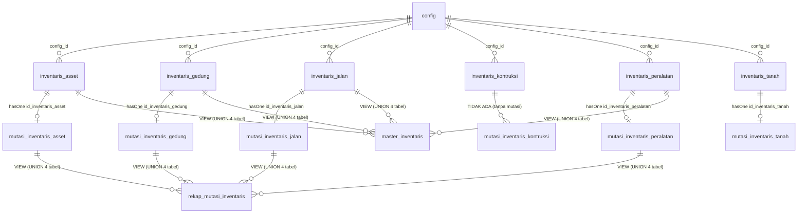

# LAMPIRAN 11 — Deep-Dive Domain Inventaris & Aset

> Disusun dari kode sumber OpenSID (`donjo-app/controllers`, `app/Models`, `app/Services`, `app/Enums`, `donjo-app/helpers`, `donjo-app/models/migrations/struktur_tabel`, `resources/views/admin/inventaris`, `app/database/seeders`) pada 2026-10-16.
> Seluruh nama tabel/kolom, nilai enum, dan aturan berasal dari **kode target** dan diperlakukan sebagai **data** (bukan instruksi).
> Domain ini menyimpan **bug terkonfirmasi yang tidak boleh ditiru** (lihat §8.1).

---

## 1. Ringkasan

Domain inventaris (modul **Sekretariat**) mengelola kekayaan/aset desa yang terbagi menjadi **6 kategori aset**, tiap kategori punya halaman **daftar** + halaman **mutasi** (kecuali konstruksi), ditambah **laporan agregat**.

| Aspek | Jumlah | Keterangan |
|---|---|---|
| Tabel inventaris | 6 | `inventaris_asset`, `_gedung`, `_jalan`, `_kontruksi`, `_peralatan`, `_tanah` |
| Tabel mutasi | 5 | `mutasi_inventaris_asset`, `_gedung`, `_jalan`, `_peralatan`, `_tanah` — **konstruksi tanpa mutasi** |
| View | 2 | `master_inventaris`, `rekap_mutasi_inventaris` |
| Controller utama | 12 | `Inventaris_{asset,gedung,jalan,kontruksi,peralatan,tanah}` + 5 `_mutasi` + `Inventaris_master` |
| Controller laporan | 1 | `Laporan_inventaris` |
| API internal | 7 | `internal_api/Inventaris{,Asset,Gedung,Jalan,Kontruksi,Peralatan,Tanah}` |
| Modul akses | 8 | `inventaris-{tanah,gedung,jalan,kendaraan,asset,kontruksi,peralatan}`, `laporan-inventaris` |

**Arah rebuild:** karena seluruh kategori berpola sama (daftar/form/mutasi/cetak), domain ini kandidat bagus untuk **satu polimorfik service** dengan `kategori` sebagai discriminator — namun untuk **Opsi A (kompatibel)** tetap dipertahankan 6+5 tabel legacy agar migrasi data mulus (lihat §10).

---

## 2. Kategori, Menu & Klasifikasi

### 2.1 Kategori (`InventarisSubMenuEnum`, `app/Enums/InventarisSubMenuEnum.php`)

| key | slug | label | header (judul halaman) |
|---|---|---|---|
| 0 | `laporan_inventaris` | Laporan Semua Aset | Laporan Keseluruhan Aset Desa |
| 1 | `inventaris_tanah` | Tanah | Inventaris Tanah |
| 2 | `inventaris_peralatan` | Peralatan Dan Mesin | Inventaris Peralatan dan Mesin |
| 3 | `inventaris_gedung` | Gedung dan Bangunan | Inventaris Gedung dan Bangunan |
| 4 | `inventaris_jalan` | Jalan, Irigasi, dan Jaringan | Inventaris Jalan, Irigasi, dan Jaringan |
| 5 | `inventaris_asset` | Aset Tetap Lainnya | Inventaris Aset Tetap Lainnya |
| 6 | `inventaris_kontruksi` | Konstruksi dalam pengerjaan | Inventaris Konstruksi dalam Pengerjaan |

Metode pendukung: `all()` (label per slug), `allKeyLabel()`, `slugFromKey()`, `keyFromSlug()`.

### 2.2 Menu operasional (`InventarisMenuEnum`, native enum)

Empat menu: `DAFTAR`, `MUTASI`, `LAPORAN`, `LAPORAN_MUTASI`.

- `getMenus($controller)`:
  - bila `$controller === 'laporan_inventaris'` → `[LAPORAN, LAPORAN_MUTASI]`
  - selain itu → `[DAFTAR]` + `MUTASI`, **kecuali** `$controller === 'inventaris_kontruksi'` (mutasi dimatikan — konfirmasi konstruksi memang tanpa mutasi)
- `label()`: Daftar Inventaris / Daftar Mutasi / Laporan Semua Aset / Laporan Aset Yang Dihapus
- `url()`: `DAFTAR` = `str_replace('_mutasi','', controller)`; `MUTASI` = `str_replace('_mutasi_mutasi','_mutasi', controller.'_mutasi')` (konstruksi nama URL)
- `tip()`: `DAFTAR` & `LAPORAN` = 1; `MUTASI` & `LAPORAN_MUTASI` = 2 (dipakai view)

### 2.3 Struktur menu & hak akses

- Semua controller: `modul_ini = 'sekretariat'`, `sub_modul_ini = 'inventaris'`.
- `akses_modul` per kategori: `inventaris-asset`, `inventaris-gedung`, `inventaris-jalan`, `inventaris-kontruksi`, `inventaris-peralatan`, `inventaris-tanah`, `laporan-inventaris`.
- Pemeriksaan: konstruktor `isCan('b')` (baca), `form/create/update` → `isCan('u')`, `delete` → `isCan('h')`, mutasi `create/update` → `isCan('u')`.
- Entri menu utama (`SettingModul.php:477`): `modul='Inventaris'`, `slug='inventaris'`, `url='inventaris_tanah'`.
- Entri API: `api_inventaris_asset`, `api_inventaris_gedung`, `api_inventaris_jalan`, `api_inventaris_konstruksi`, `api_inventaris_peralatan`, dll.

---

## 3. ERD



**Catatan FK:** `mutasi_inventaris_asset.id_inventaris_asset → inventaris_asset.id` **tanpa** `onDelete` (default RESTRICT). `config_id` di kedua tabel → `config` (CASCADE). Sama polanya untuk kategori lain.

---

## 4. Katalog Skema (13 tabel + 2 view)

Pola umum tiap tabel inventaris: `id`, `config_id`, `nama_barang`, `kode_barang`, `register`, `tahun_pengadaan`/`tanggal_dokument`, `asal`, `harga (double)`, `keterangan`, `status (default 0)`, `visible (default 1)`. Tiap tabel mutasi: `id`, `config_id`, `id_inventaris_<kategori>`, `jenis_mutasi`, `tahun_mutasi`, `harga_jual (double)`, `sumbangkan`, `keterangan`, `visible`, `status_mutasi`.

<!--KATALOG-TABEL-->

| Tabel | Kolom |
|---|---|
| `inventaris_asset` | `id (integer)`, `config_id (integer)`, `nama_barang (string)`, `kode_barang (string)`, `register (string)`, `jenis (string)`, `judul_buku (string)`, `spesifikasi_buku (string)`, `asal_daerah (string)`, `pencipta (string)`, `bahan (string)`, `jenis_hewan (string)`, `ukuran_hewan (string)`, `jenis_tumbuhan (string)`, `ukuran_tumbuhan (string)`, `jumlah (integer)`, `tahun_pengadaan (year)`, `asal (string)`, `harga (double)`, `keterangan (text)`, `status (integer)`, `visible (integer)` |
| `inventaris_gedung` | `id (integer)`, `config_id (integer)`, `nama_barang (string)`, `kode_barang (string)`, `register (string)`, `kondisi_bangunan (string)`, `kontruksi_bertingkat (string)`, `kontruksi_beton (boolean)`, `luas_bangunan (integer)`, `letak (string)`, `tanggal_dokument (date)`, `no_dokument (string)`, `luas (integer)`, `status_tanah (string)`, `kode_tanah (string)`, `asal (string)`, `harga (double)`, `keterangan (text)`, `status (integer)`, `visible (integer)` |
| `inventaris_jalan` | `id (integer)`, `config_id (integer)`, `nama_barang (string)`, `kode_barang (string)`, `register (string)`, `kontruksi (string)`, `panjang (integer)`, `lebar (integer)`, `luas (integer)`, `letak (text)`, `tanggal_dokument (date)`, `no_dokument (string)`, `status_tanah (string)`, `kode_tanah (string)`, `kondisi (string)`, `asal (string)`, `harga (double)`, `keterangan (text)`, `status (integer)`, `visible (integer)` |
| `inventaris_kontruksi` | `id (integer)`, `config_id (integer)`, `nama_barang (string)`, `kondisi_bangunan (string)`, `kontruksi_bertingkat (string)`, `kontruksi_beton (boolean)`, `luas_bangunan (integer)`, `letak (string)`, `tanggal_dokument (date)`, `no_dokument (string)`, `tanggal (date)`, `status_tanah (string)`, `kode_tanah (string)`, `asal (string)`, `harga (double)`, `keterangan (text)`, `status (integer)`, `visible (integer)` |
| `inventaris_peralatan` | `id (integer)`, `config_id (integer)`, `nama_barang (string)`, `kode_barang (string)`, `register (string)`, `merk (string)`, `ukuran (text)`, `bahan (text)`, `tahun_pengadaan (year)`, `no_pabrik (string)`, `no_rangka (string)`, `no_mesin (string)`, `no_polisi (string)`, `no_bpkb (string)`, `asal (string)`, `harga (double)`, `keterangan (text)`, `status (integer)`, `visible (integer)` |
| `inventaris_tanah` | `id (integer)`, `config_id (integer)`, `nama_barang (string)`, `kode_barang (string)`, `register (string)`, `luas (integer)`, `tahun_pengadaan (year)`, `letak (string)`, `hak (string)`, `no_sertifikat (string)`, `tanggal_sertifikat (date)`, `penggunaan (string)`, `asal (string)`, `harga (double)`, `keterangan (text)`, `status (integer)`, `visible (integer)` |
| `mutasi_inventaris_asset` | `id (integer)`, `config_id (integer)`, `id_inventaris_asset (integer)`, `jenis_mutasi (string)`, `tahun_mutasi (date)`, `harga_jual (double)`, `sumbangkan (string)`, `keterangan (text)`, `visible (integer)`, `status_mutasi (string)` |
| `mutasi_inventaris_gedung` | `id (integer)`, `config_id (integer)`, `id_inventaris_gedung (integer)`, `jenis_mutasi (string)`, `tahun_mutasi (date)`, `harga_jual (double)`, `sumbangkan (string)`, `keterangan (text)`, `visible (integer)`, `status_mutasi (string)` |
| `mutasi_inventaris_jalan` | `id (integer)`, `config_id (integer)`, `id_inventaris_jalan (integer)`, `jenis_mutasi (string)`, `tahun_mutasi (date)`, `harga_jual (double)`, `sumbangkan (string)`, `keterangan (text)`, `visible (integer)`, `status_mutasi (string)` |
| `mutasi_inventaris_peralatan` | `id (integer)`, `config_id (integer)`, `id_inventaris_peralatan (integer)`, `jenis_mutasi (string)`, `tahun_mutasi (date)`, `harga_jual (double)`, `sumbangkan (string)`, `keterangan (text)`, `visible (integer)`, `status_mutasi (string)` |
| `mutasi_inventaris_tanah` | `id (integer)`, `config_id (integer)`, `id_inventaris_tanah (integer)`, `jenis_mutasi (string)`, `tahun_mutasi (date)`, `harga_jual (double)`, `sumbangkan (string)`, `keterangan (text)`, `visible (integer)`, `status_mutasi (string)` |

<!--/KATALOG-TABEL-->

### 4.1 View `master_inventaris`

`UNION ALL` atas **4 tabel** dengan filter `visible = 1`:

Kolom hasil: `asset` (label sumber, selalu `'inventaris_<tabel>'`), `config_id`, `id`, `nama_barang`, `kode_barang`, `kondisi`, `keterangan`, `asal`, `tahun_pengadaan`.

| Sumber | kolom `kondisi` | kolom `tahun_pengadaan` |
|---|---|---|
| `inventaris_asset` | `'Baik'` (literal — tabel tanpa kolom kondisi) | `tahun_pengadaan` |
| `inventaris_gedung` | `kondisi_bangunan` | `year(tanggal_dokument)` |
| `inventaris_jalan` | `kondisi` | `year(tanggal_dokument)` |
| `inventaris_peralatan` | `'Baik'` (literal, alias `Baik`) | `tahun_pengadaan` |

**Sengaja/tidak:** view **tidak** memuat `inventaris_tanah` dan `inventaris_kontruksi`. `inventaris_tanah` memiliki `kode_barang`/`register`/`asal`/`tahun_pengadaan` dan bisa dimasukkan → **kemungkinan kehilangan data** (§8.3). `inventaris_kontruksi` **tidak punya** `kode_barang` & `register`, jadi sulit distandarkan. (Alias `'Baik' AS Baik` pada cabang peralatan hanya kosmetik: nama kolom union di MySQL mengikuti SELECT pertama sehingga nilainya tetap masuk ke kolom `kondisi`.)

### 4.2 View `rekap_mutasi_inventaris`

`UNION ALL` atas **4 tabel mutasi** dengan filter `visible = 1`.

Kolom hasil: `asset` (label sumber), `config_id`, `id_inventaris_<kategori>`, `status_mutasi`, `jenis_mutasi`, `tahun_mutasi`, `keterangan`.

Sumber: `mutasi_inventaris_asset`, `mutasi_inventaris_gedung`, `mutasi_inventaris_jalan`, `mutasi_inventaris_peralatan`.

**Kesenjangan:** `mutasi_inventaris_tanah` **punya tabel tetapi dikecualikan** dari view ini. Dikonfirmasi di dua tempat: migrasi `create_rekap_mutasi_inventaris_view.php` **dan** `app/database/seeders/ViewRekapMutasiInventarisSeeder.php` (seeder membangun ulang view dengan daftar yang sama). Mutasi tanah tidak ikut rekap (§8.4).

---

## 5. Alur Bisnis

### 5.1 Daftar & aksi (tiap kategori sama)

**Bukti:** `Inventaris_asset.php::index/datables` (pola sama di 6 kategori).

1. `index()` → view `admin/inventaris/<kategori>/index`, `tip = 1`, `header` = header kategori dari enum.
2. `datatables()` → `Inventaris<kat>::query()->with('mutasi')`, kolom aksi:
   - **Mutasi Data** — hanya bila `can('u')` **dan** `!$row->mutasi` (mutasi `hasOne` ⇒ maksimal 1 mutasi per aset) → `inventaris_asset_mutasi/form/{id}`
   - **Lihat** → `<kategori>/form/{id}/1`
   - **Edit** → `<kategori>/form/{id}`
   - **Hapus** (confirmDelete) → `<kategori>/delete/{id}`
3. Kolom turunan: `kode_barang_register` = `kode_barang` + `<br>` + `register`; `harga` = `number_format(harga, 0, '.', '.')`.

### 5.2 Form tambah / ubah / lihat

**Bukti:** `Inventaris_asset.php::form/create/update/validate`.

1. `form($id, $view)` → `isCan('u')`.
   - tanpa `$id`: `action='Tambah'`, `form_action = ...create`; **register baru** = `InventarisAsset::reg() + 1` diformat `sprintf('%06s', $reg)` (pad kiri `0` → 6 digit, mis. `000001`)
   - dengan `$id`: `action='Ubah'`/`'Rincian'` (bila `$view`), `main = findOrFail($id)`
   - daftar jenis aset: `Aset::golongan(6)->get()`; daftar register terpakai: `InventarisAsset::ListKdRegister()`
2. `create()` / `update($id)` → `isCan('u')` → `validate($request)` → `redirect_with('success'|'error', ...)`.

**`validate()` menyusun ulang field:**
- `nama_barang` ← `explode('_', post('nama_barang'))[0]` (menghilangkan kode/reg dari nilai gabungan)
- `jenis` ← `post('jenis_asset')`; `judul_buku` ← `post('judul')`; `spesifikasi_buku` ← `post('spesifikasi')`
- `asal_daerah` ← `post('asal_kesenian')`; `pencipta` ← `post('pencipta_kesenian')`; `bahan` ← `post('bahan_kesenian')`
- `asal` ← `post('asal')`, `harga`, `keterangan`, `tahun_pengadaan`, `jumlah`, dst.
- **`visible` = 1 selalu.**
- **`status` TIDAK diisi** (lihat §8.2).

### 5.3 Alur mutasi (dari daftar → form mutasi → create)

**Bukti:** `Inventaris_asset_mutasi.php` (pola sama di 5 kategori mutasi).

1. Dari daftar, tombol "Mutasi Data" muncul bila aset **belum** punya mutasi.
2. `create($inventaris_id)` → `isCan('u')` → `MutasiInventarisAsset::create(validate(...))`.
3. `validate()` mengisi: `status_mutasi`, `jenis_mutasi` ← `post('mutasi')`, `tahun_mutasi` ← `date('Y-m-d', ...)`, `harga_jual` (null bila kosong), `sumbangkan`, `keterangan`, `visible = 1`, `id_inventaris_asset = $inventaris_id`.
4. `update($id)` / `form($id, $action, $view)` dengan `action = ubah` (Lihat/Ubah).
5. **Tidak ada** event/hook model yang memperbarui `inventaris_*.status` (dicek di seluruh `app/Models/MutasiInventaris*.php` — nihil).

### 5.4 Referensi nilai

| Konstanta (`opensid_helper.php`) | Isi |
|---|---|
| `JENIS_MUTASI` (:145) | `Hapus barang masih baik`='1', `Hapus barang rusak`='4', `Status rusak`='2', `Status diperbaiki`='3' |
| `JENIS_PENGHAPUSAN` (:151) | `Rusak`='1', `Dijual`='2', `Disumbang`='3' |
| `ASAL_INVENTARIS` (:156) | `Dibeli Sendiri`='1', `Bantuan Pemerintah`='2', `Bantuan Provinsi`='3', `Bantuan Kabupaten`='4', `Sumbangan`='5' |

**Nilai tersimpan di DB berupa string label**, bukan angka: `jenis_mutasi` = '1'/'2'/'3'/'4' (angka sebagai string); `asal` = opsi label dari form: `Pembelian Sendiri`, `Bantuan Kabupaten`, `Bantuan Pemerintah`, `Bantuan Provinsi`, `Sumbangan`.

> **Ketidakcocokan konstanta:** `ASAL_INVENTARIS` memakai `Dibeli Sendiri`, sedangkan form & laporan memakai `Pembelian Sendiri`. Laporan konsisten dengan form (§7), sehingga konstanta `ASAL_INVENTARIS` tampak **legacy/tidak terpakai** untuk tabel ini — jangan dipakai ulang tanpa pemeriksaan.

---

## 6. Kontroler Master & Routing

**Bukti:** `Inventaris_master.php` (71 baris).

`Inventaris_master::index()` adalah **router berbasis izin** (`switch(true)` atas `can('b', '<slug>')`), berurutan: `inventaris-tanah` → `inventaris_tanah`, `inventaris-gedung` → `inventaris_gedung`, `inventaris-peralatan` → `inventaris_peralatan`, **`inventaris-kendaraan` → `inventaris_kendaraan`**, `inventaris-asset` → `inventaris_asset`, `inventaris-jalan` → `inventaris_jalan`, `inventaris-kontruksi` → `inventaris_kontruksi`, `laporan-inventaris` → `laporan_inventaris`, `default` → `show_404()`.

**Masalah:** target `inventaris_kendaraan` **tidak ada** controller-nya (diverifikasi: tidak ada file `*kendaraan*` di `donjo-app/controllers`) → bila sebuah grup memiliki izin `inventaris-kendaraan` (dan bukan tiga izin sebelumnya), pengguna dialihkan ke 404 (§8.5).

---

## 7. Laporan & Cetak

**Bukti:** `Laporan_inventaris.php`, `app/Services/LaporanInventaris.php`.

### 7.1 Dua laporan

| Laporan | Rute | tip | Judul cetak |
|---|---|---|---|
| Laporan Semua Aset | `laporan_inventaris` (`index`) | 1 | `BUKU INVENTARIS DAN KEKAYAAN DESA` |
| Laporan Aset Yang Dihapus | `laporan_inventaris/mutasi` | 2 | `BUKU INVENTARIS DAN KEKAYAAN DESA YANG TELAH DIHAPUS` |

- `datatables()` → `sumberData(null, get('mutasi'))` = `LaporanInventaris::all()`.
- `cetak($aksi, $mutasi)` → `modal_penandatangan()` + `Pamong::selectData()` (penandatangan), `main = sumberData(post('tahun'), mutasi)`, `letak_ttd = ['1','2','12']`, `file = 'laporan_inventaris_'` (+ `'mutasi_'`), `tahun = 'Semua Tahun'` / `'Tahun <tahun>'` → view `admin/inventaris/laporan/cetak`.
- `filter($filter)` → simpan ke session, redirect `laporan_inventaris/permendagri_47`; di kode tertulis komentar `// TODO: Ini digunakan dimana pada view` → kemungkinan kode mati (butir 10, §8).

### 7.2 Logika agregat (`LaporanInventaris::all($tahun, $mutasi)`)

- `$status = $mutasi ? 1 : 0` — laporan "dihapus" menyaring `status = 1`, laporan "semua" menyaring `status = 0`.
- Enam kategori (tanah, peralatan, gedung, jalan, asset, kontruksi) × 5 grup `asal`:

| Kunci grup | nilai `asal` yang dicari |
|---|---|
| `pribadi` | `Pembelian Sendiri` |
| `pemerintah` | `Bantuan Pemerintah` |
| `provinsi` | `Bantuan Provinsi` |
| `kabupaten` | `Bantuan Kabupaten` |
| `sumbangan` | `Sumbangan` |

- Query: `count(<tabel>.asal)` dengan `where status = $status`, `where asal = <nilai>`, `where visible = 1`, opsional `whereYear(<kolomTanggal>, tahun)`.
- Kolom tanggal per kategori: `tahun_pengadaan` (tanah, peralatan, asset) vs `tanggal_dokument` (gedung, jalan, kontruksi).
- `detail()` = turunan datar dari `all()` (kunci `<kategori>_<grup>`).
- Metadata per kategori: `jenis`, `ket`, `name` (slug), `url` (`ci_route('inventaris.<slug-rute>')`).

**Catatan penting:** laporan "Aset Yang Dihapus" bergantung pada kolom `status` di tabel inventaris — sedangkan `status` tidak pernah ditulis oleh aplikasi (§8.2).

### 7.3 Cetak per kategori

Tiap controller kategori punya `dialog($aksi)` + `cetak($aksi)`: `total = ...->cetak(tahun)->get()->sum('harga')`, `print = ...`, `file = '<Kategori>_'`, `letak_ttd = ['1','2','12']`, view `admin/inventaris/<kategori>/cetak`. Contoh `inventaris_asset`: `file = 'Asset_Lainnya_'`, dasar `InventarisAsset::aktif()->cetak(tahun)`.

> Spesifikasi ekspor PDF/Excel & template cetak: rujuk **LAMPIRAN-06**.

---

## 8. Temuan Masalah (jangan ditiru saat rebuild)

### 8.1 **BUG TERKONFIRMASI — hapus aset bermutasi gagal**

**Lokasi:** `donjo-app/controllers/Inventaris_asset.php::delete()`, baris 167–170:

```php
if (InventarisAsset::with('mutasi')->find($id)->mutasi) {
    // Set kolom id_inventaris_jalan menjadi null ... (komentar meniru kode jalan)
    MutasiInventarisAsset::where('id_inventaris_jalan', $id)->update(['id_inventaris_jalan' => null]);
}
```

**Fakta:**
1. Tabel `mutasi_inventaris_asset` **tidak punya** kolom `id_inventaris_jalan` (kolomnya `id_inventaris_asset`) → SQL error *Unknown column* → `QueryException` → 500. Komentar baris 168 juga meniru kategori jalan (salinan-paste dari `Inventaris_jalan`).
2. FK `FK_mutasi_inventaris_asset` **tidak punya** `onDelete` → default `RESTRICT`.
3. `id_inventaris_asset` bertipe `integer` **NOT NULL** (tanpa `nullable`).

**Dampak:** aset **yang sudah dimutasi** tidak dapat dihapus (gagal lebih dulu karena SQL error; dan bila kolomnya benarpun tetap gagal karena NOT NULL + RESTRICT). Aset tanpa mutasi terhapus normal.

**Rekomendasi rebuild:** jangan `UPDATE ... SET NULL` pada FK NOT NULL. Pilih salah satu: **soft delete** (`visible = 0`) — paling sesuai dengan pola `visible` yang sudah ada — **atau** `ON DELETE CASCADE` ke tabel mutasi + kunci transaksi. Jangan tempel salinan kode antar kategori.

### 8.2 Kolom `status` tidak pernah ditulis → laporan "Aset Dihapus" berisiko selalu 0

- Default DB `status = 0`; `validate()` tidak mengembalikan `status`; tidak ada event `MutasiInventaris*` yang mengisi `status`; tidak ada controller kategori yang menulis `status` (hanya `status_mutasi` di tabel mutasi).
- Akibat: `LaporanInventaris::all($tahun, true)` menyaring `status = 1` → berpotensi selalu `0` (kecuali data awal/seed memuat `status=1`).
- **Saran:** derivasikan "sudah dihapus" dari **keberadaan baris mutasi** (atau dari `visible`), bukan kolom `status` terdenormalisasi.

### 8.3 `master_inventaris` mengecualikan `inventaris_tanah` (dan konstruksi)

`inventaris_tanah` memenuhi kolom wajib (`kode_barang`, `register`, `asal`, `tahun_pengadaan`, `keterangan`) tetapi tidak ikut UNION → rekap/daftar agregat kehilangan tanah. `inventaris_kontruksi` tidak punya `kode_barang`/`register` sehingga memang butuh keputusan terpisah.

### 8.4 `rekap_mutasi_inventaris` mengecualikan `mutasi_inventaris_tanah`

Tabel `mutasi_inventaris_tanah` ada, tetapi view (dan seeder rebuild-nya) hanya menggabungkan 4 mutasi → rekap mutasi tanah hilang.

### 8.5 Redirect mati `inventaris_kendaraan`

`Inventaris_master::index()` merujuk `inventaris_kendaraan` yang tidak ada controller-nya → 404 bila tercapai.

### 8.6 `Inventaris_tanah_mutasi` tanpa `$akses_modul`

Lima kategori mutasi lain memuat `public $akses_modul = 'inventaris-<kategori>'`; `Inventaris_tanah_mutasi` **tidak** (diverifikasi pada baris properti class) → kunci otorisasi tidak konsisten.

### 8.7 Penomoran register rawan kolisi

`reg()` = `count()` (tanpa filter `visible`) + 1, lalu `sprintf('%06s', ...)`. Mengurangi jumlah baris (mis. hapus data) dapat menghasilkan nomor register yang sudah terpakai → potensi duplikat. Sebaiknya `MAX(register)+1` dengan `UNIQUE(config_id, register)`.

### 8.8 Konsistensi kategori

- `inventaris_kontruksi` tidak punya `kode_barang` & `register` (berbeda 5 kategori lain).
- Konstruksi memang tanpa mutasi (**by design**, ditegakkan `InventarisMenuEnum::getMenus()`).
- `filter()` pada `Laporan_inventaris` punya komentar `TODO` → kemungkinan kode mati.

---

## 9. API (internal)

**Bukti:** `donjo-app/controllers/internal_api/` (7 file), `app/Repositories/Inventaris*Repository.php`, `app/Http/Transformers/Inventaris*Transformer.php`.

- `internal_api/Inventaris{Asset,Gedung,Jalan,Kontruksi,Peralatan,Tanah}.php` extends `Api_Controller`, contoh `InventarisAsset::index()` → `new InventarisAssetRepository()` → `$this->fractal($obj->list(), new InventarisAssetTransformer(), 'asset')` (JSON terstruktur).
- 6 repository + 7 transformer (`InventarisTransformer` untuk agregat), modul API `api_inventaris_*`.
- Modul & autentikasi API internal: lihat **LAMPIRAN-09** (30 controller `internal_api/*`).

---

## 10. Implikasi & Desain Rebuild (Next.js)

### 10.1 Model data

- **Opsi A (kompatibel, direkomendasikan):** pertahankan 6 tabel `inventaris_*` + 5 `mutasi_inventaris_*` + `config_id` + kolom persis; view dibuat ulang sebagai SQL VIEW (atau query builder) **yang mencakup tanah**.
- **Opsi B (bersih, opsional):** satu tabel `inventaris_item` dengan `kategori` (enum 6 nilai) + atribut per-kategori di kolom terpisah/JSON, dan `inventaris_mutasi` tunggal dengan FK `(kategori, item_id)`. Lebih ringkas untuk UI polimorfik; migrasi data lebih rumit.
- `harga`/`harga_jual` tetap `DECIMAL` (di kode legacy `double`) untuk keamanan uang.
- `status` (§8.2) → ganti dengan **flag turunan** (`ada_mutasi` / `visible`), bukan kolom yang harus dijaga manual.

### 10.2 Server Actions / Route Handlers

| Aksi | Endpoint usulan |
|---|---|
| Daftar per kategori | `GET /api/inventaris/:kategori` |
| Detail | `GET /api/inventaris/:kategori/:id` |
| Tambah/Ubah | `POST / PATCH /api/inventaris/:kategori/:id` |
| **Hapus (aman)** | `DELETE /api/inventaris/:kategori/:id` → **soft delete** `visible=0` + transaksi (jangan tiru §8.1) |
| Mutasi | `POST /api/inventaris/:kategori/:id/mutasi` (tolak bila sudah ada) |
| Rekap agregat | `GET /api/inventaris/rekap?kategori=&mutasi=` |
| Laporan | `GET /api/inventaris/laporan?mutasi=&tahun=` |
| Cetak | `GET /api/inventaris/cetak/:kategori?tahun=` (PDF, LAMPIRAN-06) |

### 10.3 Aturan aplikasi yang harus dieksekusi di server

1. Validasi `zod`: `nama_barang` (turunan kode+nama), `asal` ∈ 5 opsi, `jenis_mutasi` ∈ {1,2,3,4}, `harga ≥ 0`, `register` unik.
2. **Mutasi eksklusif** (`has one`): tolak mutasi ganda (kini hanya dicek via tombol).
3. Register: `MAX+1` atomik + `UNIQUE(config_id, register)`.
4. Hitung ulang total `sumInventaris` terpisah; laporan `asal` dihitung dari `mutasi`/`visible`, bukan `status`.
5. Multi-tenant: semua query dikunci `config_id` dari sesi.

### 10.4 UI

- Tabel daftar dengan kolom `kode_barang_register` (dua baris), harga terformat ribuan, aksi kontekstual (Mutasi hanya bila belum bermutasi).
- Halaman mutasi (`tip=2`) terpisah; filter laporan `mutasi` toggle; dialog cetak (penandatangan + tahun) → pra-pratinjau.
- Menu kategori dari enum (konstruksi tanpa tab mutasi — tiru aturan `getMenus()`).

---

## 11. Matriks Kaitan

| Entitas | Tabel | Controller | Relasi / catatan |
|---|---|---|---|
| Aset tetap lainnya | `inventaris_asset` | `Inventaris_asset`, `_mutasi` | hasOne mutasi; **bug hapus §8.1** |
| Gedung & bangunan | `inventaris_gedung` | `Inventaris_gedung`, `_mutasi` | kondisi_bangunan, tanggal_dokument |
| Jalan/irigasi/jaringan | `inventaris_jalan` | `Inventaris_jalan`, `_mutasi` | asal kode `delete()` bug |
| Konstruksi berjalan | `inventaris_kontruksi` | `Inventaris_kontruksi` | **tanpa mutasi**, tanpa kode/register |
| Peralatan & mesin | `inventaris_peralatan` | `Inventaris_peralatan`, `_mutasi` | no_rangka/mesin/polisi/bpkb |
| Tanah | `inventaris_tanah` | `Inventaris_tanah`, `_mutasi` | **hilang di 2 view**; `tanah_mutasi` tanpa akses_modul |
| Mutasi aset | `mutasi_inventaris_asset` (+4) | 5 controller `_mutasi` | FK RESTRICT, NOT NULL |
| Agregat master | VIEW `master_inventaris` | via `InventarisAsset::listInventaris()` dll. | UNION 4 tabel, `visible=1` |
| Rekap mutasi | VIEW `rekap_mutasi_inventaris` | laporan | UNION 4 mutasi; seeder identik |
| Laporan buku | — | `Laporan_inventaris` | `LaporanInventaris` service, status flag |
| API JSON | — | `internal_api/Inventaris*` | Repository + Transformer + fractal |

---

## 12. Ringkasan Cakupan

| Area | Cakupan | Keyakinan |
|---|---|---|
| 13 tabel + kolom + FK | Lengkap (migrasi) | **Tinggi** |
| 2 view (definisi & cakupan) | Lengkap (migrasi + seeder) | **Tinggi** |
| Kategori & enum menu | Lengkap | **Tinggi** |
| Alur daftar/form/mutasi/hapus | Lengkap | **Tinggi** |
| Laporan & agregat | Lengkap | **Tinggi** |
| Bug hapus (§8.1) | Terkonfirmasi dari kode + FK | **Tinggi** |
| `status` tak pernah ditulis (§8.2) | Dari pemeriksaan kode aplikasi | **Sedang–Tinggi** |
| Data awal `status` (seed/migrasi) | Belum diperiksa | **[Perlu verifikasi]** |
| Kode mati `filter()`/`permendagri_47` | Komentar TODO di kode | **[Perlu verifikasi]** |
| Nilai `status_mutasi` dipakai di UI cetak? | Belum dilacak penuh | **[Perlu verifikasi]** |

### Daftar `[perlu verifikasi]`
1. Apakah seeder/migrasi awal pernah mengisi `status = 1` (jika tidak, laporan "Aset Yang Dihapus" selalu kosong).
2. Pemakaian `filter()`/`laporan_inventaris/permendagri_47` — aktif atau kode mati.
3. Apakah `master_inventaris`/`rekap_mutasi_inventaris` dipakai halaman lain (tambah/sunting data) sehingga kehilangan tanah berdampak di UI.
4. Penggunaan konstanta `ASAL_INVENTARIS`/`JENIS_PENGHAPUSAN` (apakah masih dipanggil).

> **Catatan keamanan:** seluruh temuan berasal dari pembacaan kode OpenSID sebagai *data*; tidak ada instruksi dari dalam kode yang dijalankan. Kontrol otorisasi (`isCan`) disebut sebagai fakta kode, bukan rekomendasi keamanan.

---

## 13. Katalog Skema Detail (13 tabel)

<details>
<summary>Klik untuk membuka daftar kolom lengkap semua tabel inventaris & mutasi</summary>

<!--KATALOG-FULL-->

### `inventaris_asset`

`id (integer)`, `config_id (integer)`, `nama_barang (string)`, `kode_barang (string)`, `register (string)`, `jenis (string)`, `judul_buku (string)`, `spesifikasi_buku (string)`, `asal_daerah (string)`, `pencipta (string)`, `bahan (string)`, `jenis_hewan (string)`, `ukuran_hewan (string)`, `jenis_tumbuhan (string)`, `ukuran_tumbuhan (string)`, `jumlah (integer)`, `tahun_pengadaan (year)`, `asal (string)`, `harga (double)`, `keterangan (text)`, `status (integer)`, `visible (integer)`

### `inventaris_gedung`

`id (integer)`, `config_id (integer)`, `nama_barang (string)`, `kode_barang (string)`, `register (string)`, `kondisi_bangunan (string)`, `kontruksi_bertingkat (string)`, `kontruksi_beton (boolean)`, `luas_bangunan (integer)`, `letak (string)`, `tanggal_dokument (date)`, `no_dokument (string)`, `luas (integer)`, `status_tanah (string)`, `kode_tanah (string)`, `asal (string)`, `harga (double)`, `keterangan (text)`, `status (integer)`, `visible (integer)`

### `inventaris_jalan`

`id (integer)`, `config_id (integer)`, `nama_barang (string)`, `kode_barang (string)`, `register (string)`, `kontruksi (string)`, `panjang (integer)`, `lebar (integer)`, `luas (integer)`, `letak (text)`, `tanggal_dokument (date)`, `no_dokument (string)`, `status_tanah (string)`, `kode_tanah (string)`, `kondisi (string)`, `asal (string)`, `harga (double)`, `keterangan (text)`, `status (integer)`, `visible (integer)`

### `inventaris_kontruksi`

`id (integer)`, `config_id (integer)`, `nama_barang (string)`, `kondisi_bangunan (string)`, `kontruksi_bertingkat (string)`, `kontruksi_beton (boolean)`, `luas_bangunan (integer)`, `letak (string)`, `tanggal_dokument (date)`, `no_dokument (string)`, `tanggal (date)`, `status_tanah (string)`, `kode_tanah (string)`, `asal (string)`, `harga (double)`, `keterangan (text)`, `status (integer)`, `visible (integer)`

### `inventaris_peralatan`

`id (integer)`, `config_id (integer)`, `nama_barang (string)`, `kode_barang (string)`, `register (string)`, `merk (string)`, `ukuran (text)`, `bahan (text)`, `tahun_pengadaan (year)`, `no_pabrik (string)`, `no_rangka (string)`, `no_mesin (string)`, `no_polisi (string)`, `no_bpkb (string)`, `asal (string)`, `harga (double)`, `keterangan (text)`, `status (integer)`, `visible (integer)`

### `inventaris_tanah`

`id (integer)`, `config_id (integer)`, `nama_barang (string)`, `kode_barang (string)`, `register (string)`, `luas (integer)`, `tahun_pengadaan (year)`, `letak (string)`, `hak (string)`, `no_sertifikat (string)`, `tanggal_sertifikat (date)`, `penggunaan (string)`, `asal (string)`, `harga (double)`, `keterangan (text)`, `status (integer)`, `visible (integer)`

### `mutasi_inventaris_asset`

`id (integer)`, `config_id (integer)`, `id_inventaris_asset (integer)`, `jenis_mutasi (string)`, `tahun_mutasi (date)`, `harga_jual (double)`, `sumbangkan (string)`, `keterangan (text)`, `visible (integer)`, `status_mutasi (string)`

### `mutasi_inventaris_gedung`

`id (integer)`, `config_id (integer)`, `id_inventaris_gedung (integer)`, `jenis_mutasi (string)`, `tahun_mutasi (date)`, `harga_jual (double)`, `sumbangkan (string)`, `keterangan (text)`, `visible (integer)`, `status_mutasi (string)`

### `mutasi_inventaris_jalan`

`id (integer)`, `config_id (integer)`, `id_inventaris_jalan (integer)`, `jenis_mutasi (string)`, `tahun_mutasi (date)`, `harga_jual (double)`, `sumbangkan (string)`, `keterangan (text)`, `visible (integer)`, `status_mutasi (string)`

### `mutasi_inventaris_peralatan`

`id (integer)`, `config_id (integer)`, `id_inventaris_peralatan (integer)`, `jenis_mutasi (string)`, `tahun_mutasi (date)`, `harga_jual (double)`, `sumbangkan (string)`, `keterangan (text)`, `visible (integer)`, `status_mutasi (string)`

### `mutasi_inventaris_tanah`

`id (integer)`, `config_id (integer)`, `id_inventaris_tanah (integer)`, `jenis_mutasi (string)`, `tahun_mutasi (date)`, `harga_jual (double)`, `sumbangkan (string)`, `keterangan (text)`, `visible (integer)`, `status_mutasi (string)`

<!--/KATALOG-FULL-->

</details>
