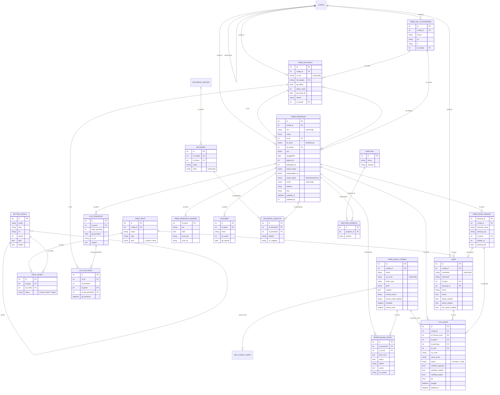

# Analisis Sistem Acuan & Rencana Rebuild ke Next.js 15+

> Objek analisis: sebuah aplikasi SID berbasis PHP (repositori sumber tempat kerja).
> Tujuan dokumen: requirements + arsitektur target (Next.js App Router), bukan salinan kode PHP.

---

## 1. Overview

**Sistem Acuan** (Sistem Informasi Desa) adalah aplikasi manajemen pemerintahan desa yang dikembangkan terbuka dan kolaboratif sejak 2009. Awalnya berbasis SID CRI, sejak Mei 2016 dikelola terbuka di GitHub. Aplikasi ini mengelola seluruh siklus administrasi desa: kependudukan, keluarga, surat-menyurat, keuangan, aset, publikasi web desa, hingga layanan mandiri warga.

**Tujuan:** membuat kantor desa efisien/efektif, mendorong transparansi & akuntabilitas, meningkatkan layanan publik, dan membuka akses informasi desa.

**Target pengguna (aktor):**
- **Administrator** – kelola sistem, pengguna, grup, modul.
- **Operator** – entry data kependudukan, keluarga, surat.
- **Kepala Desa (Kades)** – verifikasi/ttd surat, laporan, kebijakan.
- **Sekretaris Desa (Sekdes)** – verifikasi surat, administrasi umum.
- **Pamong/perangkat desa** – modul sesuai jabatan.
- **RT/RW, Kepala Dusun** – umumnya akses terbatas wilayah.
- **Warga (Layanan Mandiri)** – portal mandiri (cek data, ajukan surat).
- **Publik** – situs web desa (artikel, statistik, transparansi APBDes).

**Core domain:** Kependudukan → Keluarga/KK → Wilayah (RT/RW/Dusun) → Persuratan → Keuangan/Anggaran → Aset/Inventaris → Publikasi & Layanan Mandiri. Semua berupa **multi-desa dalam satu basis data** (kolom `config_id` di hampir semua tabel = tenant/desa).

---

## 2. Teknologi Saat Ini

| Aspek | Kondisi aktual |
|---|---|
| Bahasa | PHP **`^8.1`** (composer.json `require.php`) |
| Framework utama | **CodeIgniter 3** (`codeigniter/framework ^3.1`) — routing, controller, config, session |
| Framework tambahan | **Komponen Laravel 10** (`illuminate/* ^10`) — database/Eloquent, view (Blade), auth, validation, queue, notifications |
| ORM | **Laravel Eloquent** di layer `app/Models` (172 model) + query builder CI3 di `donjo-app/models` (legacy) |
| Router | Package eksternal **`sid/router ^2403`** + file route gaya Laravel di `donjo-app/Routes/*` |
| Template/view | **Hybrid**: Blade (`resources/views/**`, folder `admin/`, `web/`, `layanan_mandiri/`) + view PHP lama (`donjo-app/views/`: `header.php`, `footer.php`, `print/`) |
| Database | **MySQL / MariaDB** (default). Driver CI mendukung `mysql, mysqli, pgsql, sqlite, sqlsrv`. Query memakai backtick & fitur MySQL → praktis terikat MySQL/MariaDB |
| Multi-desa | Kolom `config_id` (tabel `config`) di hampir seluruh tabel + `ConfigIdScope` (tenant scoping) |
| Frontend assets | jQuery + **AdminLTE/Bootstrap** (skin `skin-purple`), **DataTables** (`yajra/laravel-datatables-oracle`), **TinyMCE 7**, Select2, dll. |
| Export/PDF | `spipu/html2pdf`, `karriere/pdf-merge`, `openspout/openspout`, `rap2hpoutre/fast-excel` |
| Integrasi | Google API (Drive/Script), Firebase FCM, Telegram, WhatsApp/OTP, TTE (tanda tangan elektronik), SMS |
| Auth | Komponen Laravel `illuminate/auth` + 2FA, OTP, layanan mandiri (pin) |
| Tooling | php-cs-fixer, Rector, PHPUnit 9, Prettier (blade), Playwright (e2e) |
| Skala | ~438 file migrasi tabel, ratusan tabel domain |

> Catatan penting: meski "CodeIgniter", aplikasi ini sebenarnya **hybrid CI3 + Laravel components + Blade + Eloquent**, dijembatani oleh `sid/router`, helper global (`ci_auth()`, `setting()`, `identitas()`), dan base controller `donjo-app/core/*` (sebagian ter-obfuscate).

---

## 3. Struktur Repo

| Path | Peran |
|---|---|
| `index.php`, `artisan`, `bootstrap/` | Entry point web & CLI; bootstrap aplikasi |
| `donjo-app/` | **Inti aplikasi**: `config/`, `controllers/`, `core/` (base controller), `helpers/`, `libraries/`, `models/` (legacy + `migrations/`), `Routes/`, `views/` |
| `donjo-app/controllers/` | ~168 controller: `Penduduk.php`, `Keluarga.php`, `Surat*.php`, `Keuangan_*.php`, dll. Subfolder: `auth/`, `fmandiri/` (layanan mandiri), `fweb/` (web publik), `internal_api/`, `external_api/`, `buku_umum/` (Bumindes) |
| `app/` | Layer **Laravel-style modern**: `Models/` (172 Eloquent), `Enums/`, `Services/`, `Repositories/`, `Http/`, `Rules/`, `Scopes/`, `Traits/`, `Exports/`, `Imports/`, `Jobs/`, `database/seeders/` |
| `Modules/` | **Modul tambahan (plugin)**: `Analisis`, `Anjungan`, `BukuTamu`, `Kehadiran`, `Lapak`, `Pelanggan` (masing-masing HMVC-like: `Http/`, `Models/`, `Routes/`, `Views/`, `Providers/`, `module.json`) |
| `resources/views/` | Blade views modern |
| `assets/` | Aset statis: `bootstrap/`, `css/`, `js/` (TinyMCE), `front/`, `fonts/`, `installer/` |
| `config/` | Config gaya Laravel: `auth.php`, `database.php` (bridge ke CI), `activitylog.php`, dll. |
| `donjo-app/config/` | Config CI3: `database.php`, `routes.php`, `config.php` |
| `storage/` | Upload, cache, tema (`app/themes/{natr,a,esensi}`) |
| `tests/`, `playwright.config.ts` | PHPUnit + Playwright |
| `vendor/` | Dependensi Composer |

**Pola arsitektur:** Hybrid — controller MVC gaya CodeIgniter3 + ORM Eloquent + view Blade, dengan modul plugin berstruktur HMVC. Bukan MVC murni; ada lapisan service/repository modern di `app/`.

**Konvensi penamaan:**
- Tabel: prefix warisan **`tweb_`** untuk tabel inti lama (`tweb_penduduk`, `tweb_keluarga`, `tweb_surat_format`), tanpa prefix untuk tabel baru (`user`, `user_grup`, `grup_akses`, `log_surat`, `kelompok`, `keuangan_*`, `setting_modul`). Nama berbahasa Indonesia + `snake_case`.
- Controller: `Pascal_case` (`Penduduk.php`, `Surat_master.php`); model legacy `X_model.php`; model baru `Singular.php`.
- Fungsi: `snake_case`. Helper global: `setting()`, `identitas()`, `ci_auth()`.
- Enum: `App\Enums\*Enum` dengan konstanta integer (`StatusDasarEnum::HIDUP = 1`).

**Routing & view saat ini:**
- Route didefinisikan di `donjo-app/Routes/web.php`, `api.php`, `console.php`, dan subfolder `Routes/Web/{admin,frontend,install,mandiri,playwright}.php`.
- Publik: URL bersih (`/artikel`, `/first/...`, `/sitemap.xml`).
- **Admin (SITEMAN):** `/siteman` (login) lalu modul dgn URL seperti `penduduk`, `keluarga/clear`, `surat_master`, `keuangan_laporan`, dll.
- Layanan mandiri: `/layanan-mandiri/*`.
- View: controller menyiapkan data → render Blade (`view('admin.xxx')`) atau view PHP legacy.

---

## 4. Fitur Utama per Modul

Daftar modul dari seeder `SettingModul` (dan controller terkait), dikelompokkan:

**A. Kependudukan & Sosial**
- **Penduduk** (`penduduk`): CRUD warga, NIK/KK, biodata lengkap (agama, pendidikan, pekerjaan, kawin, asuransi, cacat, KB, akta, dll.), foto, dokumen, pencarian/filter, ekspor/impor, cetak biodata.
- **Keluarga** (`keluarga`, KK): CRUD KK, anggota keluarga, kepala keluarga, hubungan (SHDK), cetak KK.
- **Rumah Tangga** (`rtm/clear`): RTM & hubungan RTM.
- **Kelompok** (`kelompok`) & **Data Suplemen** (`suplemen`): kelompok sasaran (PKK, LPM, dll.) + anggota; suplemen (mis. penyandang disabilitas, penerima bantuan).
- **Calon Pemilih / DPT** (`dpt`): data pemilih.
- **Statistik Kependudukan** (`statistik`): statistik per kategori, chart GIS per dusun/RW/RT.
- **Laporan Bulanan** (`laporan`), **Laporan Kelompok Rentan** (`laporan_rentan`), **Laporan Penduduk**.
- **Log Penduduk / Mutasi** (`penduduk_log`): kelahiran, kematian, pindah, datang, hilang, tidak valid.

**B. Persuratan**
- **Pengaturan Surat** (`surat_master`): definisi jenis surat, template, kode surat, syarat, format nomor, QR, TTE.
- **Cetak Surat** (`surat`): buat surat layanan dari data penduduk, isi kode-isian, pratinjau, cetak PDF, arsip.
- **Arsip Layanan** (`keluar`): arsip surat keluar/layanan.
- **Surat Masuk** (`surat_masuk`) & **Surat Keluar** (`surat_keluar`) + disposisi.
- **Klasifikasi Surat** (`klasifikasi`).
- **Permohonan Surat** (`permohonan_surat_admin`): permohonan dari layanan mandiri → verifikasi/approve.
- **Daftar Persyaratan** (`syarat_surat` / ref syarat).
- **Buku Ekspedisi**, **Surat Dinas**, **Arsip Desa**.

**C. Keuangan**
- **Laporan APBDes** (`laporan_apbdes`), **Keuangan** (anggaran, kegiatan, jurnal umum, pajak, mutasi, triwulan).
- **Keuangan Manual** (input manual), **Laporan** keuangan, **Siskeudes-style** ref rekenings 1–4, bidang, kegiatan, sumber dana.
- **Laporan Manual** keuangan.

**D. Aset / Inventaris**
- **Inventaris**: Asset, Gedung, Jalan, Kontruksi, Peralatan, Tanah (+ mutasi tiap jenis), **Master Inventaris**, **Laporan Inventaris**.
- **Tanah Desa** & **Tanah Kas Desa**, **Data Persil**, **C-Desa** (+ mutasi).

**E. Pembangunan**
- **Admin Pembangunan**, **Kegiatan Pembangunan**, **Rencana Kerja Pembangunan** (RKP), **Hasil-hasil Pembangunan**, dokumentasi.

**F. Pemerintahan & Administrasi**
- **Identitas Desa**, **Pemerintah Desa** (Pamong/perangkat), **Wilayah Administratif** (Dusun/RW/RT).
- **Bumindes (Buku Umum)**: Administrasi Umum, Penduduk Induk, KTP & KK, Mutasi Penduduk, Rekapitulasi, Penduduk Sementara, Tanah Kas Desa, Inventaris Kekayaan, Kader, Lembaga, Klasifikasi.

**G. Publikasi Web**
- **Artikel**, **Kategori**, **Menu**, **Widget**, **Slider**, **Galeri**, **Media Sosial**, **Komentar**, **Teks Berjalan**, **Produk Hukum**, **Informasi Publik**, **Pengaduan**, **Statistik Web**, **Peta (GIS)**, **Lembaga Desa**, **Sinergi Program**, **Pendapat**, **Bantuan**.

**H. Bantuan Sosial & Kesehatan**
- **Program Bantuan**, **Peserta Bantuan** (DTKS), **Stunting**, **Vaksin Covid**, **Posyandu/PAUD/Kader** (sasaran).

**I. Pengguna & Sistem**
- **Pengguna**, **Pengaturan Grup** (role & hak akses), **Modul**, **Aplikasi** (setting), **Database** (backup/restore), **Info Sistem**, **Periksa** (health check), **Sinkronisasi**, **Impor Data**, **Optimasi Gambar**, **QR Code**.

**J. Layanan Mandiri & Anjungan**
- **Layanan Mandiri** warga: login PIN/e-KTP, profil, ajukan surat, pesan, bantuan, cetak biodata/KK, pendapat.
- **Anjungan** (kiosk desa), **Buku Tamu**, **Kehadiran** perangkat desa, **Lapak** (UMKM desa), **DTKS**, **Pelanggan** (modul tambahan).

---

## 5. Database Schema (Tech-Agnostic)

Fokus tabel inti (bukan seluruh ~438 file migrasi). Semua tabel domain memiliki `config_id` (kecuali tabel referensi global) sebagai **tenant desa**.

### 5.1 Tabel kunci & peran

| Tabel | Peran |
|---|---|
| `config` | Identitas tenant/desa + identitas wilayah (kode & nama desa/kecamatan/kabupaten/provinsi), app_key |
| `tweb_penduduk` | Master warga. PK `id`; business key `nik` (unik per `config_id`); `id_kk` → keluarga; `id_cluster` → wilayah; `status_dasar` → status hidup/mati/pindah |
| `tweb_keluarga` | Kartu Keluarga. PK `id`; business key `no_kk` (unik per config); `nik_kepala` (FK logis → penduduk.id); `id_cluster` → wilayah |
| `tweb_wil_clusterdesa` | Wilayah administratif DRT/RW/Dusun; unik (`config_id`,`rt`,`rw`,`dusun`); `id_kepala` → penduduk |
| `tweb_desa_pamong` | Perangkat desa/pamong; `id_pend` → penduduk; `jabatan_id` |
| `user` | Akun admin/pamong. Unik (`config_id`,`username`), (`config_id`,`pamong_id`), (`config_id`,`email`); `id_grup` → user_grup |
| `user_grup` | Role/grup pengguna; unik (`config_id`,`slug`), (`config_id`,`nama`); `jenis` (1 sistem, 2 desa) |
| `setting_modul` | Daftar modul/menu (slug, url, parent, ikon, urut, hidden) |
| `grup_akses` | **RBAC**: hak akses per (grup × modul); `akses` = 1/3/7 (baca/ubah/hapus) |
| `tweb_surat_format` | Definisi jenis surat (template, kode_surat, syarat, format_nomor, jenis, mandiri, qr_code) |
| `log_surat` | Surat layanan yang diterbitkan/dicetak (arsip + nomor + verifikasi + isi) |
| `permohonan_surat` | Permohonan surat dari layanan mandiri (isian, syarat, status, no_antrian) |
| `ref_syarat_surat` | Master persyaratan surat (pivot `syarat_surat` menghubungkan surat ↔ syarat) |
| `surat_masuk` / `surat_keluar` | Agenda surat masuk/keluar |
| `log_penduduk` | **Audit** peristiwa penduduk (kelahiran/mati/pindah/datang) |
| `log_keluarga` | **Audit** peristiwa keluarga (pecah/anggota keluar/masuk) |
| `log_perubahan_penduduk` | Jejak perubahan field data penduduk |
| `kelompok` / `kelompok_master` / `kelompok_anggota` | Kelompok & keanggotaan (banyak-ke-banyak penduduk) |
| `tweb_penduduk_mandiri` | Akun layanan mandiri warga (pin, scan ktp/kk, status aktif) |
| `dokumen` | Dokumen unggahan (syarat surat, KTP/KK) |
| `bantuan` / `bantuan_peserta` | Program bantuan & pesertanya |
| `keuangan_ta_anggaran` / `_rinci`, `keuangan_ta_kegiatan`, `keuangan_ta_jurnal_umum` / `_rinci`, `keuangan_ref_rek1..4` | Keuangan/APBDes |
| `cdesa`, `persil`, `tanah_desa`, `tanah_kas_desa` | Pertanahan |
| Inventaris: `inventaris_asset`, `inventaris_gedung`, `inventaris_jalan`, `inventaris_kontruksi`, `inventaris_peralatan`, `inventaris_tanah` (+ `mutasi_*`) | Aset desa |
| `setting_aplikasi` | Konfigurasi aplikasi (key-value, termasuk `penomoran_surat`, `format_nomor_surat`) |

### 5.2 Relasi & business key/constraint

- `tweb_penduduk.id_kk` → `tweb_keluarga.id` (many-to-one). Kepala keluarga: `tweb_keluarga.nik_kepala` → `tweb_penduduk.id`.
- `tweb_penduduk.id_cluster` / `tweb_keluarga.id_cluster` → `tweb_wil_clusterdesa.id`.
- Unik: `tweb_penduduk` (`config_id`,`nik`), (`config_id`,`email`), (`config_id`,`telegram`), (`config_id`,`tag_id_card`); `tweb_keluarga` (`config_id`,`no_kk`); `user` (`config_id`,`username`).
- `log_surat.id_format_surat` → `tweb_surat_format.id`; `log_surat.id_pend` → `tweb_penduduk.id`; `log_surat.id_user` → `user.id`; `log_surat.id_pamong` → `tweb_desa_pamong`.
- `grup_akses` many-to-many antara `user_grup` dan `setting_modul` (dengan atribut `akses`).
- `kelompok_anggota` many-to-many antara `kelompok` dan `tweb_penduduk` (unik `config_id`+`id_kelompok`+`id_penduduk`).
- FK nyata umumnya hanya ke `config`; relasi domain ditegakkan di aplikasi (soft constraint).

### 5.3 Enum/status yang sering dipakai

- `tweb_penduduk.status_dasar` (StatusDasarEnum): **1 Hidup, 2 Mati, 3 Pindah, 4 Hilang, 6 Pergi, 9 Tidak Valid**.
- `kk_level` (SHDKEnum): **1 Kepala Keluarga, 2 Suami, 3 Istri, 4 Anak, 5 Menantu, 6 Cucu, 7 Orangtua, 8 Mertua, 9 Famili lain, 10 Pembantu, 11 Lainnya**.
- `status_kawin` (StatusKawinEnum): **1 Belum Kawin, 2 Kawin, 3 Cerai Hidup, 4 Cerai Mati**.
- `warganegara_id`: 1 = WNI (default).
- `log_surat.status`: **0 Konsep, 1 Cetak**; kolom verifikasi: `verifikasi_operator`, `verifikasi_kades`, `verifikasi_sekdes`, `tte`.
- `permohonan_surat.status`: 0 belum diproses / 1 diproses (plus `alasan`, `no_antrian`).
- `grup_akses.akses`: **1 baca, 3 ubah, 7 hapus**.

### 5.4 ERD (Mermaid)



---

## 6. Alur Bisnis Utama

### 6.1 Pendaftaran / Perubahan Data Penduduk

- **Aktor:** Operator, (opsional) Warga (Layanan Mandiri).
- **Pre-condition:** Login; pengguna punya akses `penduduk` minimal level baca/ubah; wilayah & referensi (agama, pekerjaan, pendidikan) tersedia.
- **Steps:**
  1. Operator buka form tambah/ubah penduduk (`penduduk/form`).
  2. Isi biodata; NIK dikosongkan → sistem bisa generate **NIK sementara** `0[kode_desa][5 digit]`.
  3. **Validasi** (`Penduduk::validasi`):
     - Format NIK (16 digit / pola NIK sementara).
     - **NIK unik** per desa; bila sudah ada → tolak; bila pemilik berstatus **PERGI** → arahkan ke Log Penduduk.
     - Validasi NIK ayah/ibu; **email unik**, **telegram unik**, **tag_id_card unik**.
     - Cek duplikasi NIK sementara (nama+tgl lahir+tempat lahir+sex).
  4. Simpan → data penduduk tersimpan; bila menyangkut peristiwa (lahir/mati/pindah/datang), tercatat di **`log_penduduk`** & **`log_keluarga`**.
  5. **Audit:** `created_by`/`updated_by` (userstamps) + `log_perubahan_penduduk` (jejak perubahan field).
- **Post-condition:** Data penduduk tersimpan, unik, terhubung ke KK & wilayah; statistik otomatis ter-update.

### 6.2 Pembuatan Surat Keterangan

- **Aktor:** Warga (mandiri, opsional) → Operator → Sekdes/Kades (verifikasi) → Operator (cetak).
- **Pre-condition:** Jenis surat (`tweb_surat_format`) aktif dengan template, kode surat, syarat, dan aturan format nomor; data penduduk valid.
- **Steps:**
  1. **Permohonan:** warga ajukan via Layanan Mandiri → tersimpan di `permohonan_surat` (isian form + syarat + `no_antrian`). Atau operator buat langsung (`surat/form`).
  2. **Verifikasi permohonan:** operator/sistem cek kelengkapan syarat (dokumen), set `status`.
  3. **Penyusunan surat:** operator pilih jenis surat + penduduk; isi kode-isian (`[nomor_surat]`, `[nama]`, dll.); sistem menyusun nomor surat dari format.
  4. **Penomoran & cek duplikat** (`LogSurat::isDuplikat`): bergantung setting `penomoran_surat`:
     - **1** = nomor berurutan per surat masuk/keluar; semua surat layanan satu seri.
     - **2 (default)** = nomor berurutan per jenis surat layanan (per `url_surat`) per tahun.
     - **3** = satu seri gabungan surat layanan + masuk + keluar.
  5. **Simpan konsep (`log_surat.status=0`)/cetak (=1)** dengan `no_surat`, `bulan`, `tahun`, `id_format_surat`, `id_pamong`, `id_user`.
  6. **Verifikasi & TTE:** `verifikasi_operator`, `verifikasi_sekdes`, `verifikasi_kades`, `tte`, `log_verifikasi`; QR code/list penomoran.
  7. **Cetak/Arsip PDF** dan simpan `lokasi_arsip`; opsional kirim ke kecamatan (`external_api/surat_kecamatan`).
- **Post-condition:** Surat bernomor unik tersimpan di arsip (`log_surat`), dapat diverifikasi publik via `internal_api/verifikasi-surat`, jejak dari permohonan → terbit.

### 6.3 Pembuatan Laporan Desa

- **Aktor:** Operator, Sekdes, Kades.
- **Pre-condition:** Hak akses modul laporan; data periode tersedia.
- **Steps:**
  1. Pilih **jenis laporan** (bulanan, penduduk, kelompok rentan, APBDes, inventaris, dsb.).
  2. **Filter periode** (bulan/tahun/rentang) + filter wilayah (dusun/RW/RT) — **auto-scope** bila user `batasi_wilayah`.
  3. Sistem query agregat (repository/service: `LaporanPenduduk`, `LaporanInventaris`).
  4. **Generate** tampilan tabel/statistik + grafik.
  5. **Export** PDF (`html2pdf`/pdf-merge) atau Excel (`openspout`/fast-excel); cetak.
  6. (Opsional) publikasikan ringkasan ke web desa (transparansi APBDes).
- **Post-condition:** File laporan terunduh/tercetak; tercatat di log ekspor (`log_ekspor`).

---

## 7. Routing & API

**Struktur URL saat ini**
- Publik: `https://desa.id/artikel/{id}`, `/first/...`, `/sitemap.xml`, `/feed.xml`.
- Admin (SITEMAN): `https://desa.id/index.php/siteman` (login) → modul: `/index.php/penduduk`, `/index.php/keluarga/clear`, `/index.php/surat_master`, `/index.php/keuangan_laporan`, dll. (gaya CI3 `controller/method/param`, sering dengan segmen `clear`).
- Layanan mandiri: `/layanan-mandiri/{beranda|surat|pesan|...}`.
- Internal API: `internal_api/{wilayah|inventaris|statistik|kelompok|...}` (JSON untuk web publik/statistik).
- External API: `external_api/{surat_kecamatan|tte|sign/pdf}`.
- API publik versi: `api/v1/sdgs` (baru satu endpoint).

**Apakah ada REST API?** Ada **JSON API internal** (untuk konsumsi web desa/anak aplikasi) dan **external API** (kecamatan/TTE), tetapi **bukan RESTful penuh** untuk CRUD data inti (CRUD masih form POST + DataTables server-side). Belum ada kontrak OpenAPI.

**Kontrak RESTful yang direkomendasikan (versi modern)** — ringkas:
- `POST /api/v1/auth/login`, `POST /api/v1/auth/logout`, `GET /api/v1/auth/me`
- `GET|POST /api/v1/penduduk`, `GET|PATCH|DELETE /api/v1/penduduk/{id}`, `POST /api/v1/penduduk/{id}/peristiwa`
- `GET|POST /api/v1/keluarga`, `GET|PATCH|DELETE /api/v1/keluarga/{id}`, `POST /api/v1/keluarga/{id}/anggota`
- `GET /api/v1/surat/jenis`, `POST /api/v1/surat/permohonan`, `GET /api/v1/surat`, `POST /api/v1/surat/{id}/verifikasi`, `POST /api/v1/surat/{id}/terbitkan`, `GET /api/v1/surat/{id}/pdf`
- `GET /api/v1/laporan/{jenis}`, `GET /api/v1/laporan/{jenis}/export?format=pdf|excel`
- `GET|PUT /api/v1/pengaturan`, `GET /api/v1/pengaturan/format-surat`
- `GET|POST /api/v1/users`, `PATCH|DELETE /api/v1/users/{id}`
- `GET /api/v1/roles`, `GET /api/v1/permissions`, `PUT /api/v1/roles/{id}/permissions`
- Semua butuh `Authorization: Bearer <token>` (atau session cookie untuk web).

---

## 8. Autentikasi & Hak Akses

**Login:** Form `/siteman` (`auth/AuthenticatedSessionController`). Dukungan **captcha**, **lupa sandi** (token), **2FA** (`TwoFactorAuthController`), **OTP** (Telegram/email/WhatsApp), **Remember token**. Sesi disimpan; `user.session` menyimpan identitas sesi. Layanan mandiri warga: **login PIN** / **e-KTP** (tabel `tweb_penduduk_mandiri`).

**Role/Grup:** tabel `user_grup`. Bawaan sistem: **administrator, operator, redaksi, kontributor** (`jenis=1` sistem). Desa bisa membuat grup sendiri (`jenis=2`, mis. `kades`, `sekdes`, `rw`, `rt`). Role tidak hard-coded pada kades/sekdes — dibentuk lewat grup + hak akses modul.

**Hak akses per modul & aksi:** tabel **`grup_akses`** memetakan `id_grup × id_modul → akses` dengan nilai **1 = baca, 3 = ubah, 7 = hapus**. Di kode: `AuthServiceProvider` mengubahnya menjadi `baca` (≥1), `ubah` (≥3), `hapus` (≥7). Ada **akses parent** (kalau submodul punya akses, parent dianggap 7).

**Permission matrix sederhana (role vs aksi):**

| Modul \ Role | Administrator | Operator | Kades/Sekdes* | RT/RW* | Warga (Mandiri) |
|---|---|---|---|---|---|
| Kependudukan | C U D | C U D | C | C (wilayah) | C (diri sendiri) |
| Keluarga/KK | C U D | C U D | C | C (wilayah) | C (diri sendiri) |
| Surat – buat/cetak | C U D | C U D | C | – | C (ajukan) |
| Surat – verifikasi/approve | C U D | C | C U | – | – |
| Keuangan/APBDes | C U D | C U D | C | – | – |
| Laporan | C U D | C U | C | C (wilayah) | – |
| Aset/Inventaris | C U D | C U D | C | – | – |
| Pengguna & Grup | C U D | – | – | – | – |
| Pengaturan Aplikasi | C U D | C | – | – | – |

\* role kades/sekdes/rt/rw dibentuk sebagai grup desa, bukan bawaan. C=create/lihat, U=update, D=delete.

**Lock/penyaringan wilayah:** ya. `User.batasi_wilayah` + `User.akses_wilayah` (JSON daftar `id_cluster`) → diterapkan otomatis lewat `AccessWilayahScope` pada model yang memakai `getWilayahColumn()`. Jadi data otomatis terfilter per dusun/RW/RT.

---

## 9. Business Rules Kunci (WAJIB dipertahankan)

1. **Penomoran surat otomatis**
   - Format default: `[kode_surat]/[nomor_surat, 3]/[kode_desa]/[bulan_romawi]/[tahun]`.
   - Placeholder didukung: `[kode_surat]`, `[nomor_surat]`, `[nomor_surat, n]` (padding nol), `[kode_desa]`, `[bulan_romawi]`, `[tahun]`.
   - Mode `penomoran_surat`: **1** (semua surat layanan satu seri; masuk/keluar masing-masing), **2 (default)** (per jenis surat layanan per tahun), **3** (gabungan layanan+masuk+keluar). Tahun sebagai siklus reset.
   - Ada override format per jenis surat (`tweb_surat_format.format_nomor` + `format_nomor_global`).
   - **Cek duplikat nomor** sebelum cetak (`LogSurat::isDuplikat`), menawarkan nomor berikutnya.
2. **Validasi NIK/KK**
   - NIK 16 digit; **unik per desa**; NIK sementara berpola `0[kode_desa][5 digit]` dan dicek duplikat berdasarkan nama+tanggal lahir+tempat lahir+jenis kelamin.
   - `no_kk` unik per desa; NIK kepala keluarga wajib menunjuk penduduk dengan `kk_level` = Kepala Keluarga.
   - Email/telegram/tag_id_card unik.
3. **Status keluarga & hubungan dalam KK**
   - `kk_level` (SHDK) menentukan peran; hanya boleh punya 1 kepala keluarga; hubungan divalidasi terhadap status kawin & jenis kelamin (`SHDKEnum::filterByKawin`).
   - KK "aktif" hanya jika kepala keluarga ber-`status_dasar = HIDUP`.
   - Hapus KK dilarang jika masih punya anggota/bantuan/suplemen/analisis (`Keluarga::bolehHapus`); hapus anggota mencatat `log_keluarga`.
4. **Alur persetujuan penerbitan surat:** permohonan → verifikasi operator → (Sekdes/Kades) → terbit/cetak; status `log_surat.status` (0 konsep, 1 cetak) + flag `verifikasi_operator/sekdes/kades` + `tte`.
5. **Log aktivitas/audit trail:** userstamps (`created_by/updated_by/created_at/updated_at`) di hampir semua tabel; `log_penduduk`, `log_keluarga`, `log_perubahan_penduduk`, `log_surat`, `spatie/laravel-activitylog`, `log_ekspor`, `log_tte`.
6. **Batasan akses data menurut role/wilayah:** `grup_akses` (1/3/7) + `batasi_wilayah`/`akses_wilayah` (scope query otomatis). Administrator & super admin bypass.
7. **Validasi data wajib:** NIK/nama untuk penduduk; kepala KK untuk KK; template & kode surat untuk jenis surat; field bertanda wajib pada kode-isian surat; referensi (agama, pekerjaan, pendidikan, wilayah) harus valid.
8. **Multi-tenant desa:** semua data di-scope `config_id`; unik gabungan `config_id + business_key`.

---

## 10. Rencana Rebuild ke Next.js (App Router)

### 10.1 Arsitektur Frontend

Struktur folder (feature-based):
```
app/
  (auth)/login, (auth)/2fa
  (admin)/
    dashboard/
    kependudukan/{penduduk,keluarga,rtm,kelompok}/
    surat/{jenis,buat,arsip,verifikasi}/
    keuangan/, aset/, laporan/, pengaturan/, pengguna/
  (public)/              # web desa
  (mandiri)/             # layanan mandiri warga
  api/v1/**/route.ts     # Route Handlers
components/  ui/ (shadcn), data-table/, forms/, charts/, layout/
lib/         db/ (drizzle), auth/, rbac/, validators/ (zod), export/, api-client/
hooks/
features/    penduduk/ keluarga/ surat/ laporan/ (colocation logic)
types/       constants/ utils/
```

Strategi rendering per modul:
| Modul | Strategi |
|---|---|
| Dashboard | **SSR** + `revalidate`/ISR untuk widget statistik; angka agregat di-cache |
| Kependudukan (list + form) | **Server Actions** + route dinamis; list pakai server-side pagination/filter; cache revalidate saat mutasi |
| Keluarga & KK | Server Actions + komposisi anggota (transactional); detail dinamis |
| Surat Menyurat | **SSR** (daftar/arsip) + **Server Actions** (buat/verifikasi/terbit); generate PDF via route handler streaming |
| Laporan | **SSR** untuk filter & tabel; **export** via route handler (`/api/v1/laporan/.../export`) streaming PDF/Excel |
| Pengaturan | Client-side ringan (form + Server Action) |
| Web publik | SSG/ISR untuk artikel & statistik |

### 10.2 Backend/API Strategy

**Opsi A — Fullstack Next.js (Route Handlers + Server Actions)**
- ➕ Satu bahasa (TS), type-safety end-to-end, deploy tunggal (standalone), lebih murah & sederhana untuk maintain komunitas.
- ➕ Cocok karena Sistem Acuan form+report heavy dan logika CRUD; Server Actions mengurangi boilerplate API.
- ➖ Perlu hati-hati memisahkan logika domain agar bisa dipakai lintas entry (web, mobile nanti).
- ➖ Long-running task (generate laporan besar, kirim notifikasi) sebaiknya via queue — Next.js bukan worker.

**Opsi B — Next.js + Separate API (Go/FastAPI/Bun+Elysia)**
- ➕ Performa & penskalaan terpisah; API bisa dipakai mobile/anjungan/klien lain.
- ➕ Worker/queue natural (Go/FastAPI).
- ➖ Dua stack, dua deploy, dua CI, overhead skill; tim komunitas Sistem Acuan (umumnya PHP/JS ringan) sulit maintain.
- ➖ Over-engineering untuk skala aplikasi desa.

**Rekomendasi: Opsi A (Fullstack Next.js)**, dengan **pemisahan logika domain ke `lib/`/`features/*/service`** agar kelak bisa diekstrak ke API terpisah bila perlu. Alasan: konteks Sistem Acuan adalah banyak desa dengan hosting sederhana, maintain oleh komunitas, dominan CRUD + laporan; satu codebase TypeScript menurunkan biaya operasional & learning curve dibanding memelihara dua service. Untuk kebutuhan berat, gunakan **queue ringan** (mis. BullMQ + Redis opsional) atau trigger eksternal.

### 10.3 Tech Stack Rekomendasi

| Kebutuhan | Pilihan | Alasan |
|---|---|---|
| Framework | **Next.js 15+ (App Router, TypeScript strict)** | SSR/RSC + Server Actions; standar industri; deploy standalone |
| ORM | **Drizzle ORM** (utama) / Prisma (alternatif) | Drizzle: ringan, SQL-first, type-safe, mudah petakan skema legacy bertabekan; Prisma: DX tinggi tapi binary/engine lebih berat |
| DB | **MySQL/MariaDB** (kompatibilitas migrasi data Sistem Acuan), opsi PostgreSQL untuk greenfield | Mempermudah impor DB eksisting & dihosting desa |
| Auth | **better-auth** (RBAC built-in) atau **Auth.js** | better-auth: session + organisasi(role) + plugin 2FA/OTP modern; Auth.js: ekosistem luas |
| UI | **shadcn/ui + Tailwind CSS v4** | Komponen aksesibel, mudah dikustom, tanpa lock-in |
| Forms | **react-hook-form + zod** | Form-heavy, validasi shared |
| Data fetching | **@tanstack/react-query** | Cache, retry, optimistic; pas untuk CRUD admin |
| Table | **@tanstack/react-table** | Server-side pagination/filter untuk data besar |
| Export | **exceljs** (Excel) + **pdf-lib/jsPDF** atau **puppeteer** server-side (PDF presisi template surat) | Laporan & cetak surat |
| Validation | **zod** (shared FE+BE) | Satu skema validasi dipakai ulang di Server Action & Route Handler |
| Utils | **date-fns**, **clsx**, **tailwind-merge** | Ringan & standard |

Prinsip: **type-safety end-to-end** (zod → Drizzle types → UI), maintainable jangka panjang (feature-based), cocok form+report heavy, deploy VPS/shared via `output: 'standalone'`.

### 10.4 RBAC Design

- **Model data:** `roles` (setara `user_grup`), `permissions` (setara `setting_modul` + action), `role_permissions` (setara `grup_akses` dengan `level: read|update|delete`), `users.role_id`, `users.wilayah_scope` (array id_cluster).
- **Mapping:** role → permission (module + action). Konversi langsung dari `akses` 1/3/7 → `read/update/delete`. Pertahankan konsep **parent module akses**.
- **Route protection:** `middleware.ts` cek sesi + role untuk grup route `(admin)`; akses modul detail di-guard di layout/segment.
- **UI visibility:** helper `can(user, 'penduduk:update')` untuk conditional render (sembunyikan tombol yang tak diizinkan).
- **Server-side authorization:** SETIAP Route Handler & Server Action memanggil `authorize(user, permission)` — jangan hanya mengandalkan UI.
- **Data scoping:** helper `scopeByWilayah(user)` yang otomatis menambahkan filter `id_cluster IN (...)` bila `batasi_wilayah` (meniru `AccessWilayahScope`); terapkan konsisten di query Drizzle.

### 10.5 API Contract (OpenAPI 3.1.0)

```yaml
openapi: 3.1.0
info:
  title: Sistem Acuan Modern API
  version: 1.0.0
  description: REST API untuk sistem informasi desa (hasil modernisasi Sistem Acuan).
servers:
  - url: https://desa.example.id/api/v1
security:
  - bearerAuth: []
components:
  securitySchemes:
    bearerAuth:
      type: http
      scheme: bearer
      bearerFormat: JWT
  schemas:
    Error:
      type: object
      properties:
        error:
          type: object
          properties:
            code: { type: string, example: VALIDATION_ERROR }
            message: { type: string }
            details: { type: array, items: { type: object } }
    Pagination:
      type: object
      properties:
        page: { type: integer, example: 1 }
        perPage: { type: integer, example: 25 }
        total: { type: integer }
        totalPages: { type: integer }
    Penduduk:
      type: object
      required: [nama, nik]
      properties:
        id: { type: integer, readOnly: true }
        nik:
          type: string
          pattern: '^[0-9]{16}$|^0[0-9]{15}$'
          description: 16 digit, atau NIK sementara pola 0+kode_desa
        nama: { type: string, maxLength: 100 }
        id_kk: { type: integer, nullable: true }
        kk_level: { type: integer, enum: [1,2,3,4,5,6,7,8,9,10,11] }
        sex: { type: integer, enum: [1,2] }
        tanggallahir: { type: string, format: date }
        tempatlahir: { type: string }
        agama_id: { type: integer }
        pekerjaan_id: { type: integer }
        status_kawin: { type: integer, enum: [1,2,3,4] }
        status_dasar: { type: integer, enum: [1,2,3,4,6,9], default: 1 }
        id_cluster: { type: integer }
        email: { type: string, format: email, nullable: true }
        telepon: { type: string, nullable: true }
    Keluarga:
      type: object
      required: [no_kk, nik_kepala]
      properties:
        id: { type: integer, readOnly: true }
        no_kk: { type: string, pattern: '^[0-9]{16}$' }
        nik_kepala: { type: string, description: NIK kepala keluarga }
        alamat: { type: string }
        id_cluster: { type: integer }
        tgl_daftar: { type: string, format: date }
    SuratFormat:
      type: object
      properties:
        id: { type: integer }
        nama: { type: string }
        url_surat: { type: string }
        kode_surat: { type: string }
        jenis: { type: integer }
    Surat:
      type: object
      properties:
        id: { type: integer, readOnly: true }
        id_format_surat: { type: integer }
        id_pend: { type: integer, nullable: true }
        no_surat: { type: string }
        nama_surat: { type: string }
        status: { type: integer, enum: [0,1], description: 0 konsep, 1 cetak }
        verifikasi_operator: { type: boolean }
        verifikasi_sekdes: { type: boolean }
        verifikasi_kades: { type: boolean }
        tte: { type: boolean }
        tanggal: { type: string, format: date-time }
    PermohonanSurat:
      type: object
      required: [id_surat, isian_form]
      properties:
        id: { type: integer, readOnly: true }
        id_pemohon: { type: integer }
        id_surat: { type: integer }
        isian_form: { type: object }
        no_hp_aktif: { type: string }
        syarat: { type: array, items: { type: object } }
    LoginRequest:
      type: object
      required: [username, password]
      properties:
        username: { type: string }
        password: { type: string, format: password }
        otp: { type: string, nullable: true }
    Role:
      type: object
      properties:
        id: { type: integer }
        nama: { type: string }
        slug: { type: string }
        permissions:
          type: array
          items:
            type: object
            properties:
              module: { type: string, example: penduduk }
              level: { type: string, enum: [read, update, delete] }
  parameters:
    PageParam:
      name: page
      in: query
      schema: { type: integer, default: 1 }
    PerPageParam:
      name: perPage
      in: query
      schema: { type: integer, default: 25, maximum: 100 }
    SearchParam:
      name: q
      in: query
      schema: { type: string }
paths:
  /auth/login:
    post:
      summary: Login pengguna
      security: []
      requestBody:
        required: true
        content:
          application/json:
            schema: { $ref: '#/components/schemas/LoginRequest' }
      responses:
        '200':
          description: Berhasil
          content:
            application/json:
              schema:
                type: object
                properties:
                  token: { type: string }
                  user: { type: object }
                  role: { type: string }
        '401': { $ref: '#/components/responses/Unauthorized' }
        '422': { $ref: '#/components/responses/ValidationError' }
  /auth/logout:
    post:
      summary: Logout
      responses:
        '204': { description: No Content }
  /auth/me:
    get:
      summary: Profil pengguna aktif + permission
      responses:
        '200':
          description: OK
          content:
            application/json:
              schema:
                type: object
                properties:
                  user: { type: object }
                  permissions:
                    type: array
                    items: { type: string, example: 'penduduk:update' }
        '401': { $ref: '#/components/responses/Unauthorized' }
  /penduduk:
    get:
      summary: Daftar penduduk
      parameters:
        - { $ref: '#/components/parameters/PageParam' }
        - { $ref: '#/components/parameters/PerPageParam' }
        - { $ref: '#/components/parameters/SearchParam' }
        - name: dusun
          in: query
          schema: { type: string }
        - name: rw
          in: query
          schema: { type: string }
        - name: rt
          in: query
          schema: { type: string }
      responses:
        '200':
          description: OK
          content:
            application/json:
              schema:
                type: object
                properties:
                  data:
                    type: array
                    items: { $ref: '#/components/schemas/Penduduk' }
                  meta: { $ref: '#/components/schemas/Pagination' }
    post:
      summary: Tambah penduduk
      requestBody:
        required: true
        content:
          application/json:
            schema: { $ref: '#/components/schemas/Penduduk' }
      responses:
        '201':
          description: Dibuat
          content:
            application/json:
              schema: { $ref: '#/components/schemas/Penduduk' }
        '409': { description: NIK duplikat }
        '422': { $ref: '#/components/responses/ValidationError' }
  /penduduk/{id}:
    parameters:
      - name: id
        in: path
        required: true
        schema: { type: integer }
    get:
      summary: Detail penduduk
      responses:
        '200':
          description: OK
          content:
            application/json:
              schema: { $ref: '#/components/schemas/Penduduk' }
        '404': { $ref: '#/components/responses/NotFound' }
    patch:
      summary: Ubah data penduduk
      requestBody:
        content:
          application/json:
            schema: { $ref: '#/components/schemas/Penduduk' }
      responses:
        '200': { description: OK }
        '422': { $ref: '#/components/responses/ValidationError' }
    delete:
      summary: Hapus penduduk
      responses:
        '204': { description: No Content }
        '403': { $ref: '#/components/responses/Forbidden' }
  /keluarga:
    get:
      summary: Daftar keluarga
      parameters:
        - { $ref: '#/components/parameters/PageParam' }
        - { $ref: '#/components/parameters/PerPageParam' }
        - { $ref: '#/components/parameters/SearchParam' }
      responses:
        '200':
          description: OK
          content:
            application/json:
              schema:
                type: object
                properties:
                  data:
                    type: array
                    items: { $ref: '#/components/schemas/Keluarga' }
                  meta: { $ref: '#/components/schemas/Pagination' }
    post:
      summary: Tambah keluarga
      requestBody:
        required: true
        content:
          application/json:
            schema: { $ref: '#/components/schemas/Keluarga' }
      responses:
        '201': { description: Dibuat }
        '422': { $ref: '#/components/responses/ValidationError' }
  /keluarga/{id}:
    parameters:
      - { name: id, in: path, required: true, schema: { type: integer } }
    get:
      summary: Detail keluarga + anggota
      responses:
        '200': { description: OK }
        '404': { $ref: '#/components/responses/NotFound' }
    patch:
      summary: Ubah keluarga
      responses:
        '200': { description: OK }
    delete:
      summary: Hapus keluarga
      responses:
        '204': { description: No Content }
        '409': { description: Masih punya anggota/bantuan }
  /keluarga/{id}/anggota:
    post:
      summary: Tambah/keluarkan anggota keluarga
      parameters:
        - { name: id, in: path, required: true, schema: { type: integer } }
      requestBody:
        content:
          application/json:
            schema:
              type: object
              properties:
                id_penduduk: { type: integer }
                aksi: { type: string, enum: [tambah, keluar] }
                kk_level: { type: integer }
      responses:
        '200': { description: OK }
        '422': { $ref: '#/components/responses/ValidationError' }
  /surat/jenis:
    get:
      summary: Daftar jenis surat
      responses:
        '200':
          description: OK
          content:
            application/json:
              schema:
                type: array
                items: { $ref: '#/components/schemas/SuratFormat' }
  /surat/permohonan:
    post:
      summary: Ajukan permohonan surat
      requestBody:
        required: true
        content:
          application/json:
            schema: { $ref: '#/components/schemas/PermohonanSurat' }
      responses:
        '201':
          description: Dibuat
          content:
            application/json:
              schema:
                type: object
                properties:
                  id: { type: integer }
                  no_antrian: { type: string }
  /surat:
    get:
      summary: Arsip surat
      parameters:
        - { $ref: '#/components/parameters/PageParam' }
        - { $ref: '#/components/parameters/PerPageParam' }
        - name: tahun
          in: query
          schema: { type: integer }
        - name: jenis
          in: query
          schema: { type: string }
      responses:
        '200': { description: OK }
    post:
      summary: Buat surat (nomor otomatis)
      requestBody:
        content:
          application/json:
            schema: { $ref: '#/components/schemas/Surat' }
      responses:
        '201':
          description: Dibuat + nomor
          content:
            application/json:
              schema: { $ref: '#/components/schemas/Surat' }
        '409': { description: Nomor surat duplikat }
  /surat/{id}/verifikasi:
    post:
      summary: Verifikasi surat (operator/sekdes/kades)
      parameters:
        - { name: id, in: path, required: true, schema: { type: integer } }
      requestBody:
        content:
          application/json:
            schema:
              type: object
              properties:
                level: { type: string, enum: [operator, sekdes, kades] }
                disetujui: { type: boolean }
      responses:
        '200': { description: OK }
        '403': { $ref: '#/components/responses/Forbidden' }
  /surat/{id}/pdf:
    get:
      summary: Unduh PDF surat
      parameters:
        - { name: id, in: path, required: true, schema: { type: integer } }
      responses:
        '200':
          description: PDF
          content:
            application/pdf:
              schema: { type: string, format: binary }
  /laporan/{jenis}:
    get:
      summary: Data laporan per periode
      parameters:
        - { name: jenis, in: path, required: true, schema: { type: string } }
        - name: periode_mulai
          in: query
          schema: { type: string, format: date }
        - name: periode_selesai
          in: query
          schema: { type: string, format: date }
        - name: dusun
          in: query
          schema: { type: string }
      responses:
        '200': { description: OK }
  /laporan/{jenis}/export:
    get:
      summary: Ekspor laporan (pdf/excel)
      parameters:
        - { name: jenis, in: path, required: true, schema: { type: string } }
        - name: format
          in: query
          required: true
          schema: { type: string, enum: [pdf, excel] }
        - name: periode_mulai
          in: query
          schema: { type: string, format: date }
        - name: periode_selesai
          in: query
          schema: { type: string, format: date }
      responses:
        '200':
          description: File
          content:
            application/pdf: { schema: { type: string, format: binary } }
            application/vnd.openxmlformats-officedocument.spreadsheetml.sheet: { schema: { type: string, format: binary } }
  /pengaturan:
    get:
      summary: Ambil pengaturan aplikasi & desa
      responses:
        '200': { description: OK }
    put:
      summary: Ubah pengaturan (admin)
      responses:
        '200': { description: OK }
        '403': { $ref: '#/components/responses/Forbidden' }
  /users:
    get:
      summary: Daftar pengguna
      responses:
        '200': { description: OK }
    post:
      summary: Tambah pengguna
      responses:
        '201': { description: Dibuat }
        '422': { $ref: '#/components/responses/ValidationError' }
  /users/{id}:
    parameters:
      - { name: id, in: path, required: true, schema: { type: integer } }
    patch:
      summary: Ubah pengguna
      responses:
        '200': { description: OK }
    delete:
      summary: Nonaktifkan/hapus pengguna
      responses:
        '204': { description: No Content }
  /roles:
    get:
      summary: Daftar role
      responses:
        '200':
          description: OK
          content:
            application/json:
              schema:
                type: array
                items: { $ref: '#/components/schemas/Role' }
  /permissions:
    get:
      summary: Daftar permission (modul + action)
      responses:
        '200': { description: OK }
  /roles/{id}/permissions:
    put:
      summary: Set permission untuk role
      parameters:
        - { name: id, in: path, required: true, schema: { type: integer } }
      requestBody:
        content:
          application/json:
            schema:
              type: object
              properties:
                permissions:
                  type: array
                  items:
                    type: object
                    properties:
                      module: { type: string }
                      level: { type: string, enum: [read, update, delete] }
      responses:
        '200': { description: OK }

components:
  responses:
    Unauthorized:
      description: Tidak terautentikasi
      content:
        application/json:
          schema: { $ref: '#/components/schemas/Error' }
    Forbidden:
      description: Tidak punya hak akses
      content:
        application/json:
          schema: { $ref: '#/components/schemas/Error' }
    NotFound:
      description: Tidak ditemukan
      content:
        application/json:
          schema: { $ref: '#/components/schemas/Error' }
    ValidationError:
      description: Validasi gagal
      content:
        application/json:
          schema: { $ref: '#/components/schemas/Error' }
```

Catatan: contoh di atas menggabungkan `paths` + `components`; saat dipakai, gabungkan ke satu blok `components` (securitySchemes, schemas, parameters, responses) agar valid. Format error konsisten: `{ "error": { "code", "message", "details": [] } }`; header auth: `Authorization: Bearer <jwt>` (web: session cookie httpOnly).

---

## 11. Rebuild Plan: MVP First

### 11.1 Fitur WAJIB MVP (prioritas)

- **P0 – Fondasi:** Auth + RBAC dasar (`user`, `role`, `role_permissions`, `wilayah_scope`), identitas desa (`config`), layout admin + navigasi modul.
- **P0 – Kependudukan:** CRUD penduduk + NIK sementara + validasi unik + filter wilayah + import dasar.
- **P0 – Keluarga & KK:** CRUD KK, anggota, kepala keluarga, validasi SHDK, log keluarga.
- **P0 – Surat Menyurat:** minimal **3–5 jenis surat** (mis. SKTM, Surat Domisili, SKU, Surat Pengantar, Kelahiran) + **penomoran otomatis** + cek duplikat + cetak PDF + arsip.
- **P1 – Laporan sederhana:** laporan penduduk & rekapitulasi + export PDF/Excel.
- **P1 – Pengguna & Hak Akses:** CRUD pengguna, grup, matriks akses per modul.

### 11.2 Fitur bisa ditunda/disederhanakan

- Keuangan penuh (Siskeudes-grade) → mulai ringkasan APBDes read-only, atau integrasi impor.
- Bumindes (semua buku) → tunda; cukup rekap inti.
- GIS/peta kompleks, analisis partisipatif, DTKS, stunting, vaksin, lapak, anjungan, kehadiran → tunda.
- Multi-channel notifikasi (Telegram/WA/SMS/FCM) → mulai email/in-app saja.
- TTE (tanda tangan elektronik) → tunda; simpan flag saja.
- Multi-desa (`config_id`) → MVP boleh single-desa dulu, tapi **rancang skema tetap kompatibel multi-tenant** agar tak migrasi ulang.
- Sinkronisasi OpenDK/kecamatan → tunda.

### 11.3 Modul prioritas implementasi (urutan)

1. Auth + RBAC + layout + pengaturan desa.
2. Kependudukan (master + validasi + NIK sementara).
3. Keluarga/KK + anggota + log.
4. Surat (jenis/template → buat → nomor → cetak → arsip).
5. Laporan + export.
6. Pengguna & hak akses.
7. (Berikutnya) Keuangan, Aset, Web publik, Mandiri.

---

## 12. Action Plan Praktis

1. **Analisis Final** – konfirmasi ERD & business rules (terutama penomoran surat, SHDK, wilayah scope, unik NIK/KK) dengan pengguna/komunitas.
2. **Scaffold Next.js** – `create-next-app` (TS strict, App Router, Tailwind), ESLint/Prettier, init shadcn/ui, set `output: 'standalone'`.
3. **DB Setup** – pilih Drizzle (disarankan), tulis skema awal dari ERD; migrasi pakai `drizzle-kit`.
4. **Auth + RBAC** – better-auth/Auth.js, tabel role/permission, middleware route protection, helper `can()` & `scopeByWilayah()`.
5. **Migration Mapping** – buat tabel mapping field per field (mis. `tweb_penduduk.nama → penduduk.nama`, `status→status_dasar`, `id_cluster→wilayah_id`) sebagai dokumen & skrip impor.
6. **Core Modules** – bangun berurutan: kependudukan → keluarga → surat (dengan nomor otomatis) → laporan.
7. **Report Export** – generator PDF (puppeteer/pdf-lib) & Excel (exceljs) di route handler.
8. **Testing** – manual test 3 alur utama + Playwright untuk regresi (login, tambah penduduk, buat surat).
9. **Data Import Tool** – script membaca DB Sistem Acuan lama (MySQL) → transformasi → insert ke skema baru (mapping langkah 5), dengan laporan baris gagal.
10. **Pilot & Rollout** – deploy di 1 desa percontohan, bandingkan output surat/laporan dengan Sistem Acuan lama sebelum migrasi massal.

---

## 13. Pertimbangan Realistis

- **Kompatibilitas data:** memungkinkan selama skema baru memakai MySQL/MariaDB dan mapping field dibuat teliti. Tabel lama `tweb_penduduk/tweb_keluarga/log_surat` punya banyak kolom; beberapa kolom legacy jarang dipakai bisa diabaikan di MVP tapi tetap dipetakan. `config_id` harus dipertahankan untuk multi-desa.
- **Hosting desa:** mayoritas shared hosting cPanel **belum** menjalankan Node.js panjang; Next.js modern butuh **VPS** (Docker/PM2/standalone) atau platform Node. Export static tidak cocok karena CRUD/auth/Server Actions butuh runtime dinamis. Pertimbangkan paket "satu klik" (Docker compose) untuk mempermudah.
- **Komunitas:** learning curve TypeScript/React lebih tinggi dari PHP bagi teknisi desa; perlu dokumentasi, template, dan kontribusi terpandu. Namun talenta JS lebih banyak di kota.
- **Maintainability:** type-safe + modular feature-based menurunkan bug jangka panjang; butuh disiplin arsitektur + CI (typecheck, lint, test).
- **UX:** jauh lebih modern (SPA-feel, loading states, responsif, aksesibel) dibanding AdminLTE/jQuery.
- **Trade-off:** ada **build step** & toolchain Node; tidak bisa "upload .php lalu jalan". Perlu proses deploy yang jelas.
- **Kapan Next.js kurang ideal:** jika teknisi desa hanya familier PHP dan terbiasa upload file langsung tanpa build pipeline, atau jika targetnya shared hosting murni tanpa Node — di situ Next.js merepotkan; opsi Laravel/Blade atau tetap Sistem Acuan lebih realistis.

---

## 14. Kesimpulan & Rekomendasi Final

**Rekomendasi Stack Final:**
> **Next.js 15 (App Router, TypeScript strict) + Server Actions/Route Handlers + Drizzle ORM + MySQL/MariaDB + better-auth (RBAC) + shadcn/ui + Tailwind v4 + react-hook-form/zod + TanStack Query/Table + exceljs/pdf-lib (atau puppeteer)**, deploy **standalone di VPS**.

**Ya/Tidak layak rebuild ke Next.js?**
- **Ya, layak** — untuk menghadirkan UX modern, type-safety, dan maintainability; sangat cocok karena Sistem Acuan dominan CRUD + form + laporan.
- **Dengan syarat:** target deployment adalah **VPS** dan tersedia (atau bisa dibina) tim/komunitas dengan kemampuan TypeScript. Untuk kebutuhan "hosting desa murni PHP", Next.js kurang praktis. Pendekatan paling aman: **bangun paralel**, jaga kompatibilitas data via MySQL + `config_id`, dan migrasikan desa secara bertahap.

**Saran kunci sebelum mulai coding:**
1. **Kunci business rules numerik/relasional lebih dulu** (penomoran surat 3 mode, SHDK/KK, unik NIK/KK/email, wilayah scope) — inilah "jiwa" Sistem Acuan yang paling mahal jika salah.
2. **Rancang skema kompatibel-migrasi** (nama tabel/kolom & `config_id`) + buat **mapping field** dan **impor tool** sejak awal, jangan belakangan.
3. **Putuskan model deployment** (VPS/Docker standalone) dan **RBAC multi-tenant yang exact setara `grup_akses` 1/3/7** sebelum membangun modul, agar tidak refactor besar di tengah jalan.

---

## 15. Lampiran Pendukung (Deep-Dive)

Analisis ini dilengkapi 13 dokumen lampiran teknis (semua di root project `D:\laragon\www\desa`):

| No | Dokumen | Isi |
|---|---|---|
| 01 | [`LAMPIRAN-01-PERSURATAN.md`](./LAMPIRAN-01-PERSURATAN.md) | Spesifikasi lengkap mesin persuratan: tabel, 43 surat sistem, mesin template/kode-isian TinyMCE, syarat surat, alur permohonan→verifikasi→TTE, penomoran 4 mode, QR, edge cases, implikasi Next.js. |
| 02 | [`LAMPIRAN-02-RBAC.md`](./LAMPIRAN-02-RBAC.md) | RBAC menyeluruh: model otorisasi (1/3/7), role bawaan + permission matrix, katalog 137 modul, warisan parent→child, wilayah scoping, autentikasi/OTP/2FA, desain better-auth. |
| 03 | [`LAMPIRAN-03-ENUM-REFERENSI.md`](./LAMPIRAN-03-ENUM-REFERENSI.md) | Inventaris ±76 enum (nilai→label) + semua tabel referensi & isinya + magic number di model + rekomendasi seed Drizzle. |
| 05 | [`LAMPIRAN-05-ERD-LENGKAP.md`](./LAMPIRAN-05-ERD-LENGKAP.md) | ERD & katalog skema **seluruh ±260 tabel** (243 snapshot + 17 tambahan), 282 relasi FK, diagram Mermaid per domain. |
| 06 | [`LAMPIRAN-06-SPESIFIKASI-OUTPUT.md`](./LAMPIRAN-06-SPESIFIKASI-OUTPUT.md) | Semua output cetak: katalog laporan, kop/template surat, library PDF/Excel, spesifikasi visual, rekomendasi Puppeteer/React-PDF/exceljs, 5 laporan prioritas. |
| 07 | [`LAMPIRAN-07-MATRIKS-MODUL.md`](./LAMPIRAN-07-MATRIKS-MODUL.md) | Matriks ketertelusuran: 137 modul → controller → model → tabel, hierarki menu, 71 controller orfan, tabel per prefiks domain, model→tabel. |
| 08 | [`LAMPIRAN-08-ALUR-BISNIS.md`](./LAMPIRAN-08-ALUR-BISNIS.md) | Alur bisnis per domain (keuangan/APBDes, inventaris, bantuan/DTKS, pembangunan, layanan mandiri, surat dinas, analisis, bumindes, kelompok/lembaga, website publik) + matriks alur→dokumen. |
| 09 | [`LAMPIRAN-09-INTEGRASI-KEAMANAN.md`](./LAMPIRAN-09-INTEGRASI-KEAMANAN.md) | Integrasi (TTE/BSrE, OpenDK, Telegram, FCM, email, SMS, Google Forms, SaaS, Siskeudes, Feed) + API (publik/internal/external) + audit keamanan & rekomendasi rebuild. |
| 10 | [`LAMPIRAN-10-DEEP-DIVE-KEUANGAN.md`](./LAMPIRAN-10-DEEP-DIVE-KEUANGAN.md) | Deep-dive domain keuangan/APBDes: 3 lapis model, kode rekening, alur, 69 tabel (kolom lengkap), aturan agregasi, impor Siskeudes, laporan, desain rebuild. |
| 11 | [`LAMPIRAN-11-DEEP-DIVE-INVENTARIS.md`](./LAMPIRAN-11-DEEP-DIVE-INVENTARIS.md) | Deep-dive inventaris/aset: 6 kategori + 5 mutasi + 2 view, alur daftar/form/mutasi/laporan, 8 temuan masalah (bug hapus terkonfirmasi), API internal, desain rebuild. |
| 12 | [`LAMPIRAN-12-BANTUAN-DTKS.md`](./LAMPIRAN-12-BANTUAN-DTKS.md) | Deep-dive bantuan & DTKS: program bantuan, peserta & kartu, statistik, suplemen, DTKS (Satu Data) + impor Regsosek2022k/DTKS, kaitan wilayah/penduduk/keluarga/RTM, output/cetak, catatan rebuild. |
| 13 | [`LAMPIRAN-13-DEEP-DIVE-ANALISIS.md`](./LAMPIRAN-13-DEEP-DIVE-ANALISIS.md) | Deep-dive analisis (mesin survei): 13 tabel + 3 enum, alur instrumen→entri respon→laporan/statistik, mesin skor (bobot×nilai, akumulasi act_analisis), impor Excel/Google Forms/BDT, temuan (catch tak efektif, SQL mentah), desain rebuild. |

> Lihat [`README.md`](./README.md) untuk daftar isi seluruh dokumen.
> Item bertanda `[perlu verifikasi]` di lampiran menandakan bagian yang perlu dikonfirmasi langsung pada data/kode sebelum dipakai produksi.

