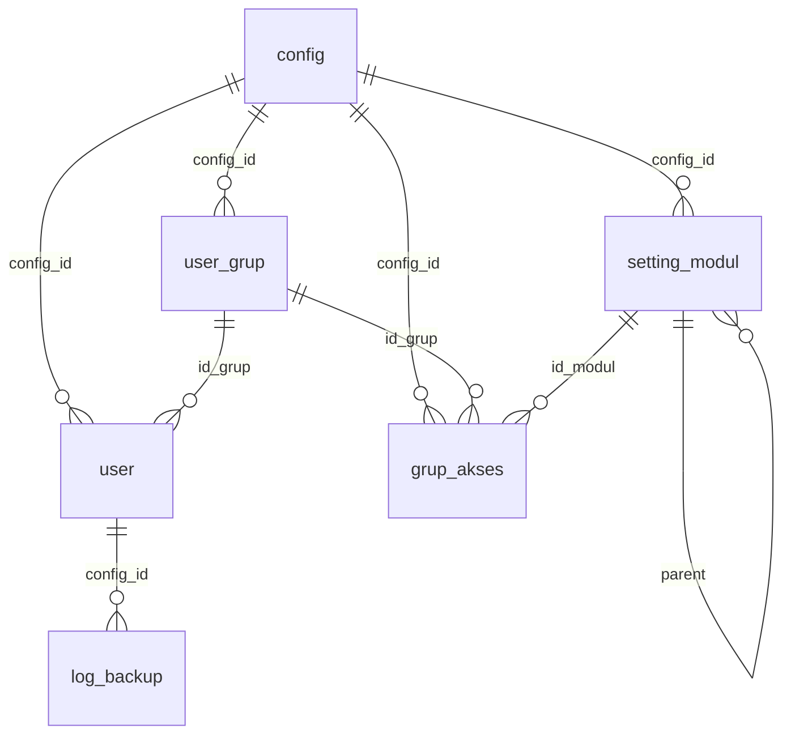
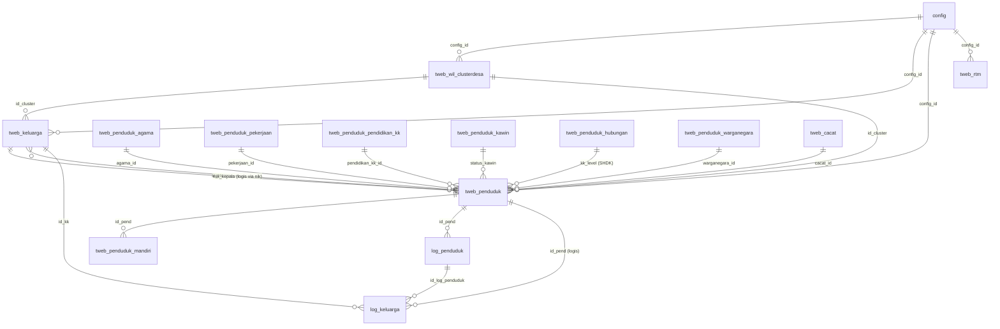
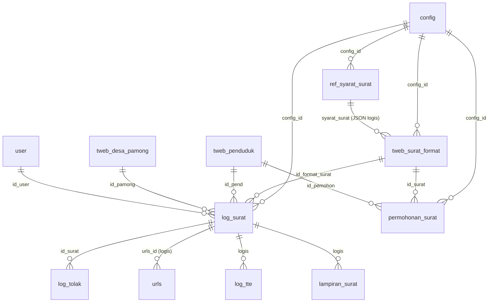
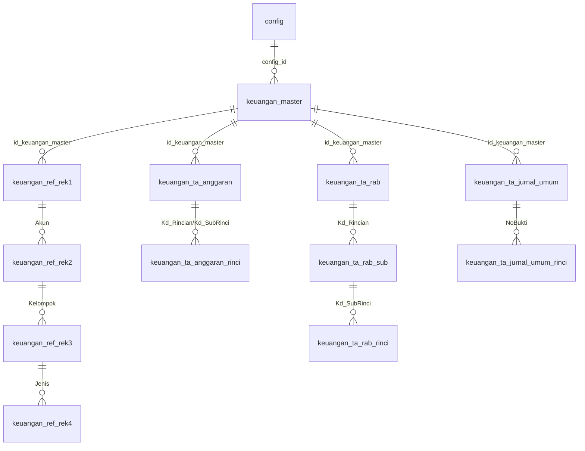
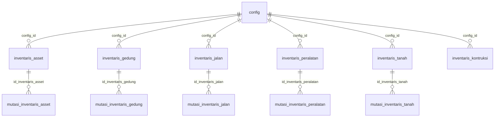

# LAMPIRAN 05 - ERD & Katalog Skema Database Sistem Acuan (Lengkap)

> Dokumen ini dihasilkan dari ekstraksi otomatis file migrasi di `donjo-app/models/migrations/struktur_tabel/` pada repo `repositori sumber`.
> Sumber: 243 file `*_create_*_table.php` + file `*_add_foreign_keys_*_table.php`. Kolom ditampilkan sebagai `nama:tipe`.
> Catatan: migrasi tambahan setelah snapshot 2023-12-22 (folder `Migrasi_*.php`) dapat menambah kolom/tabel; lihat daftar tambahan di bagian akhir.

## A. Ringkasan

- Jumlah tabel inti terdeteksi: **243**
- Jumlah relasi foreign key terdeteksi: **282**
- Semua tabel transaksional memiliki `config_id` (multi-desa dalam satu database).

## B. Diagram ERD Inti (Mermaid)

> Relasi bertanda **"logis"** adalah relasi yang dipakai aplikasi tetapi **tidak** ditegakkan sebagai foreign key di database (mis. penghubung berbasis `nik` atau `kode`).

### B.1 Multi-Desa & Hak Akses (RBAC)

### B.2 Kependudukan, Keluarga & Wilayah

### B.3 Persuratan

### B.4 Keuangan / Siskeudes (hierarki utama)

### B.5 Inventaris & Aset

## Config & Multi-Desa (3 tabel)

| Tabel | Kolom |
|---|---|
| `config` | id:integer, app_key:string, nama_desa:string, kode_desa:string, kode_pos:integer, nama_kecamatan:string, kode_kecamatan:string, nama_kepala_camat:string, nip_kepala_camat:string, nama_kabupaten:string, kode_kabupaten:string, nama_propinsi:string, kode_propinsi:string, logo:string, lat:string, lng:string, zoom:tinyInteger, map_tipe:string, path:longText, alamat_kantor:string, email_desa:string, telepon:string, nomor_operator:string, website:string, kantor_desa:string, warna:string, border:string |
| `setting_aplikasi` | id:integer, config_id:integer, judul:string, key:string, value:text, keterangan:string, jenis:string, option:text, attribute:text, kategori:string |
| `setting_modul` | id:integer, config_id:integer, modul:string, slug:string, url:string, aktif:boolean, ikon:string, urut:integer, level:boolean, hidden:boolean, ikon_kecil:string, parent:integer |

## Pengguna & Hak Akses (3 tabel)

| Tabel | Kolom |
|---|---|
| `grup_akses` | id:integer, config_id:integer, id_grup:integer, id_modul:integer, akses:tinyInteger |
| `user_grup` | id:integer, config_id:integer, nama:string, slug:string, jenis:tinyInteger |
| `user` | id:mediumIncrements, config_id:integer, username:string, password:string, id_grup:integer, pamong_id:integer, email:string, last_login:dateTime, email_verified_at:dateTime, active:boolean, nama:string, id_telegram:string, token:string, token_exp:dateTime, telegram_verified_at:dateTime, notif_telegram:boolean, company:string, phone:string, foto:string, session:string |

## Kependudukan (19 tabel)

| Tabel | Kolom |
|---|---|
| `tweb_cacat` | id:increments, nama:string |
| `tweb_keluarga_sejahtera` | id:integer, nama:string |
| `tweb_keluarga` | id:integer, config_id:integer, no_kk:string, nik_kepala:string, tgl_daftar:timestamp, kelas_sosial:integer, tgl_cetak_kk:dateTime, alamat:string, id_cluster:integer, updated_at:timestamp, updated_by:integer |
| `tweb_penduduk_agama` | id:increments, nama:string |
| `tweb_penduduk_asuransi` | id:tinyInteger, nama:string |
| `tweb_penduduk_hubungan` | id:integer, nama:string |
| `tweb_penduduk_kawin` | id:increments, nama:string |
| `tweb_penduduk_mandiri` | pin:char, config_id:integer, last_login:dateTime, tanggal_buat:dateTime, id_pend:integer, aktif:integer, scan_ktp:string, scan_kk:string, foto_selfie:string, ganti_pin:boolean, email_verified_at:timestamp, updated_at:timestamp |
| `tweb_penduduk_map` | id:integer, lat:string, lng:string |
| `tweb_penduduk_pekerjaan` | id:increments, nama:string |
| `tweb_penduduk_pendidikan_kk` | id:increments, nama:string |
| `tweb_penduduk_pendidikan` | id:tinyInteger, nama:string |
| `tweb_penduduk_sex` | id:increments, nama:string |
| `tweb_penduduk_status` | id:increments, nama:string |
| `tweb_penduduk` | id:integer, config_id:integer, nama:string, nik:string, id_kk:integer, kk_level:tinyInteger, id_rtm:string, rtm_level:integer, sex:unsignedTinyInteger, tempatlahir:string, tanggallahir:date, agama_id:integer, pendidikan_kk_id:integer, pendidikan_sedang_id:integer, pekerjaan_id:integer, status_kawin:tinyInteger, warganegara_id:tinyInteger, dokumen_pasport:string, dokumen_kitas:string, ayah_nik:string, ibu_nik:string, nama_ayah:string, nama_ibu:string, foto:string, golongan_darah_id:integer, id_cluster:integer, status:unsignedInteger, alamat_sebelumnya:string, alamat_sekarang:string, status_dasar:tinyInteger, hamil:integer, cacat_id:integer, sakit_menahun_id:integer, akta_lahir:string, akta_perkawinan:string, tanggalperkawinan:date, akta_perceraian:string, tanggalperceraian:date, cara_kb_id:tinyInteger, telepon:string, tanggal_akhir_paspor:date, no_kk_sebelumnya:string, ktp_el:tinyInteger, status_rekam:tinyInteger, waktu_lahir:string, tempat_dilahirkan:tinyInteger, jenis_kelahiran:tinyInteger, kelahiran_anak_ke:tinyInteger, penolong_kelahiran:tinyInteger, berat_lahir:smallInteger, panjang_lahir:string, tag_id_card:string, id_asuransi:tinyInteger, no_asuransi:char, email:string, email_token:string, email_tgl_kadaluarsa:dateTime, email_tgl_verifikasi:dateTime, telegram:string, telegram_token:string, telegram_tgl_kadaluarsa:dateTime, telegram_tgl_verifikasi:dateTime, bahasa_id:integer, ket:tinyText, negara_asal:string, tempat_cetak_ktp:string, tanggal_cetak_ktp:date, suku:string, bpjs_ketenagakerjaan:char, hubung_warga:string |
| `tweb_penduduk_umur` | id:integer, config_id:integer, nama:string, dari:integer, sampai:integer, status:integer |
| `tweb_penduduk_warganegara` | id:increments, nama:string |
| `tweb_rtm_hubungan` | id:tinyInteger, nama:string |
| `tweb_rtm` | id:integer, config_id:integer, nik_kepala:integer, no_kk:string, tgl_daftar:timestamp, kelas_sosial:integer, bdt:string, terdaftar_dtks:boolean |

## Wilayah & Perangkat Desa (2 tabel)

| Tabel | Kolom |
|---|---|
| `tweb_desa_pamong` | pamong_id:integer, config_id:integer, pamong_nama:string, gelar_depan:string, gelar_belakang:string, pamong_nip:string, pamong_tag_id_card:string, pamong_pin:string, pamong_nik:string, pamong_status:boolean, pamong_tgl_terdaftar:date, pamong_ttd:boolean, foto:text, id_pend:integer, pamong_tempatlahir:string, pamong_tanggallahir:date, pamong_sex:tinyInteger, pamong_pendidikan:integer, pamong_agama:integer, pamong_nosk:string, pamong_tglsk:date, pamong_masajab:string, urut:integer, pamong_niap:string, pamong_pangkat:string, pamong_nohenti:string, pamong_tglhenti:date, pamong_ub:boolean, atasan:integer, bagan_tingkat:tinyInteger, bagan_offset:integer, bagan_layout:string, bagan_warna:string, kehadiran:integer, jabatan_id:integer |
| `tweb_wil_clusterdesa` | id:integer, config_id:integer, rt:string, rw:string, dusun:string, id_kepala:integer, lat:string, lng:string, zoom:integer, path:text, map_tipe:string, warna:string, border:string, urut:integer, urut_cetak:integer |

## Persuratan (9 tabel)

| Tabel | Kolom |
|---|---|
| `disposisi_surat_masuk` | id_disposisi:integer, config_id:integer, id_surat_masuk:integer, id_desa_pamong:integer, disposisi_ke:string |
| `klasifikasi_surat` | id:integer, config_id:integer, kode:string, nama:text, uraian:mediumText, enabled:integer |
| `lampiran_surat` | id:integer, config_id:integer, slug:string, nama:string, jenis:tinyInteger, template:longText, template_desa:longText, status:tinyInteger |
| `log_surat` | id:integer, config_id:integer, id_format_surat:integer, id_pend:integer, id_pamong:integer, nama_pamong:string, nama_jabatan:string, id_user:integer, tanggal:timestamp, bulan:string, tahun:string, no_surat:string, nama_surat:string, lampiran:string, nik_non_warga:decimal, nama_non_warga:string, keterangan:string, lokasi_arsip:string, urls_id:integer, status:tinyInteger, log_verifikasi:string, tte:boolean, verifikasi_operator:boolean, verifikasi_kades:boolean, verifikasi_sekdes:boolean, isi_surat:longText, kecamatan:boolean, deleted_at:dateTime, pemohon:string |
| `permohonan_surat` | id:integer, config_id:integer, id_pemohon:integer, id_surat:integer, isian_form:text, status:boolean, alasan:string, keterangan:text, no_hp_aktif:string, syarat:text, created_at:timestamp, updated_at:timestamp, no_antrian:string |
| `ref_syarat_surat` | ref_syarat_id:increments, config_id:integer, ref_syarat_nama:string |
| `surat_keluar` | id:integer, config_id:integer, nomor_urut:smallInteger, nomor_surat:string, kode_surat:string, tanggal_surat:date, tanggal_catat:timestamp, tujuan:string, isi_singkat:string, berkas_scan:string, ekspedisi:boolean, tanggal_pengiriman:date, tanda_terima:string, keterangan:string, lokasi_arsip:string |
| `surat_masuk` | id:integer, config_id:integer, nomor_urut:smallInteger, tanggal_penerimaan:date, nomor_surat:string, kode_surat:string, tanggal_surat:date, pengirim:string, isi_singkat:string, isi_disposisi:string, berkas_scan:string, lokasi_arsip:string |
| `tweb_surat_format` | id:integer, config_id:integer, nama:string, url_surat:string, kode_surat:string, lampiran:string, kunci:boolean, favorit:boolean, jenis:tinyInteger, mandiri:boolean, masa_berlaku:integer, satuan_masa_berlaku:string, qr_code:boolean, qr_code_tte:boolean, logo_garuda:boolean, kecamatan:boolean, syarat_surat:longText, template:longText, template_desa:longText, form_isian:longText, kode_isian:longText, orientasi:string, ukuran:string, margin:text, margin_global:boolean, footer:integer, header:integer, format_nomor:string, format_nomor_global:tinyInteger, sumber_penduduk_berulang:boolean |

## Bantuan Sosial & Program (8 tabel)

| Tabel | Kolom |
|---|---|
| `dtks_anggota` | id:integer, config_id:integer, id_dtks:integer, id_penduduk:integer, id_keluarga:integer, created_at:timestamp, updated_at:timestamp, kd_ket_keberadaan_art:string, bulan_meninggal:string, tahun_meninggal:year, kd_punya_akta_meniggal:string, bulan_pindah_tempat:string, tahun_pindah_tempat:year, kd_tempat_tinggal_saat_ini:string, bulan_masuk_ruta:string, tahun_masuk_ruta:year, kd_alasan_masuk_ruta:string, kd_hubungan_dg_krt:string, kd_hubungan_dg_kk:string, kd_jenis_kelamin:string, kd_punya_aktanikah_cerai:string, kd_punya_kartuid:string, kd_sulit_penglihatan:string, kd_sulit_pendengaran:string, kd_sulit_jalan_naiktangga:string, kd_sulit_gerak_tangan_jari:string, kd_sulit_belajar_intelektual:string, kd_sulit_ingat_konsentrasi:string, kd_sulit_perilaku_emosi:string, kd_sulit_paham_bicara_kom:string, kd_sulit_mandiri:string, kd_sering_sedih_depresi:string, kd_memiliki_perawat:string, kd_merokok_sebulan_akhir:string, kd_penyakit_kronis_menahun:string, kd_partisipasi_sekolah:string, kd_pendidikan_tertinggi:string, kd_kelas_tertinggi:string, kd_ijazah_tertinggi:string, kd_bekerja_seminggu_lalu:string, jumlah_jam_kerja_seminggu_lalu:string, pendapatan_sebulan_terakhir:bigInteger, kd_punya_npwp:string, npwp:string, kd_lapangan_usaha_pekerjaan:string, kd_kedudukan_di_pekerjaan:string, kd_gizi_seimbang:string, kd_imunasasi_lengkap:string, kd_bantuan_pempus:string, kd_bantuan_pemkot:string, kd_bantuan_pemdes:string, kd_jamkes_setahun:string, kd_ikut_pbijkn_bpjssehat:string, kd_ikut_bpjssehat_nonpbi:string, kd_ikut_jamsostek_bpjsk:string, kd_ikut_pip:string, kd_ikut_prakerja:string, kd_ikut_kur:string, kd_ikut_umi:string, jumlah_jamket_kerja:string, is_usaha_sendiri_bersama:boolean, kd_punya_usaha_sendiri_bersama:string, jumlah_usaha_sendiri_bersama:tinyInteger, kd_lapangan_usaha_dr_usaha:string, tulis_lapangan_usaha_dr_usaha:string, tulis_lapangan_usaha_pekerjaan:string, jumlah_pekerja_dibayar:tinyInteger, jumlah_pekerja_tidak_dibayar:tinyInteger, kd_kepemilikan_ijin_usaha:string, kd_omset_usaha_perbulan:string, kd_guna_internet_usaha:string |
| `dtks_lampiran` | id:integer, config_id:integer, id_rtm:integer, judul:string, keterangan:string, foto:text, created_at:timestamp, updated_at:timestamp |
| `dtks_pengaturan_program` | id:integer, config_id:integer, versi_kuisioner:integer, kode:string, id_bantuan:integer, nilai_default:string, target_table:string, target_field:text, created_at:timestamp, updated_at:timestamp |
| `dtks_ref_lampiran` | id:integer, id_dtks:integer, id_lampiran:integer |
| `dtks` | id:integer, config_id:integer, is_draft:boolean, id_rtm:integer, id_keluarga:integer, created_at:timestamp, updated_at:timestamp, versi_kuisioner:string, catatan:text, kode_provinsi:string, kode_kabupaten:string, kode_kecamatan:string, kode_desa:string, kode_sls_non_sls:string, kode_sub_sls:string, nama_sls_non_sls:string, no_urut_bangunan_tinggal:string, no_urut_keluarga_verif:string, status_keluarga:string, kode_landmark_wilkerstat:string, kd_kk:string, no_urut_ruta:string, tanggal_pencacahan:date, nama_petugas_pencacahan:string, kode_petugas_pencacahan:string, tanggal_pemeriksaan:date, nama_pemeriksa:string, kode_pemeriksa:string, nama_responden:string, kd_hasil_pencacahan_ruta:string, tanggal_pendataan:date, nama_ppl:string, kode_ppl:string, nama_pml:string, kode_pml:string, kd_hasil_pendataan_keluarga:string, no_hp_responden:string, kd_stat_bangunan_tinggal:string, kd_stat_lahan_tinggal:string, kd_sertiv_lahan_milik:string, luas_lantai:integer, kd_jenis_lantai_terluas:string, kd_jenis_dinding:string, kd_kondisi_dinding:string, kd_jenis_atap:string, kd_kondisi_atap:string, jumlah_kamar_tidur:string, kd_sumber_air_minum:string, kd_jarak_sumber_air_ke_tpl:string, kd_memperoleh_air_minum:string, kd_sumber_penerangan_utama:string, kd_daya_terpasang:string, kd_daya_terpasang2:string, kd_daya_terpasang3:string, kode_pelanggan_daya:string, kd_bahan_bakar_memasak:string, kd_fasilitas_tempat_bab:string, kd_jenis_kloset:string, kd_pembuangan_akhir_tinja:string, kd_tabung_gas_3_kg:string, kd_tabung_gas_5_5_kg:string, kd_tabung_gas_12_kg:string, kd_lemari_es:string, kd_ac:string, kd_pemanas_air:string, kd_telepon_rumah:string, kd_televisi:string, kd_perhiasan_10_gr_emas:string, kd_rek_aktif:string, kd_komputer_laptop:string, kd_sepeda_motor:string, kd_mobil:string, kd_perahu:string, kd_kapal_perahu_motor:string, kd_featured_phone:string, kd_smartphone:string, kd_sepeda:string, kd_lahan:string, luas_lahan:integer, kd_ada_sertiv_lahan:string, kd_rumah_ditempat_lain:string, jumlah_sapi:integer, jumlah_kerbau:integer, jumlah_kuda:integer, jumlah_babi:integer, jumlah_kambing_domba:integer, jumlah_unggas:integer, jumlah_ikan:integer, jumlah_lainnya:integer, kd_ada_art_usaha_sendiri_bersama:string, kd_internet_sebulan:string, kd_pengeluaran_pulsa_dan_data:string, kd_ada_art_lanjut_usia:string, kd_bss_bnpt:string, bulan_bss_bnpt:string, tahun_bss_bnpt:year, kd_pkh:string, bulan_pkh:string, tahun_pkh:year, kd_bst_covid19:string, bulan_bst_covid19:string, tahun_bst_covid19:year, kd_blt_dana_desa:string, bulan_blt_dana_desa:string, tahun_blt_dana_desa:year, kd_subsidi_listrik:string, bulan_subsidi_listrik:string, tahun_subsidi_listrik:year, kd_asuransi_lain:string, bulan_asuransi_lain:string, tahun_asuransi_lain:year, kd_bantuan_pemprov:string, bulan_bantuan_pemprov:string, tahun_bantuan_pemprov:year, kd_bantuan_pemkabkot:string, bulan_bantuan_pemkabkot:string, tahun_bantuan_pemkabkot:year, kd_bantuan_pemdes:string, bulan_bantuan_pemdes:string, tahun_bantuan_pemdes:year, kd_bantuan_pemda:string, bulan_bantuan_pemda:string, tahun_bantuan_pemda:year, kd_bantuan_masyarakat:string, bulan_bantuan_masyarakat:string, tahun_bantuan_masyarakat:year, kd_subsidi_pupuk:string, bulan_subsidi_pupuk:string, tahun_subsidi_pupuk:year, kd_subsidi_lpg:string, bulan_subsidi_lpg:string, tahun_subsidi_lpg:year, kd_konsumsi_daging:string, kd_makan:string, kd_beli_pakaian_baru:string, kd_bayar_biaya_pengobatan:string, kd_bahasa_wawancara:string, tulis_bahasa_daerah:string |
| `program_peserta` | id:integer, config_id:integer, peserta:string, program_id:integer, no_id_kartu:string, kartu_nik:string, kartu_nama:string, kartu_tempat_lahir:string, kartu_tanggal_lahir:date, kartu_alamat:string, kartu_peserta:string, kartu_id_pend:integer |
| `program` | id:integer, config_id:integer, nama:string, slug:string, sasaran:tinyInteger, ndesc:string, sdate:date, edate:date, userid:mediumInteger, status:boolean, asaldana:char |
| `tweb_status_dasar` | id:increments, nama:string |

## Keuangan (Siskeudes) (66 tabel)

| Tabel | Kolom |
|---|---|
| `keuangan_manual_ref_bidang` | id:integer, Kd_Bid:string, Nama_Bidang:string |
| `keuangan_manual_ref_kegiatan` | id:integer, ID_Keg:string, Nama_Kegiatan:string |
| `keuangan_manual_ref_rek1` | id:integer, Akun:string, Nama_Akun:string |
| `keuangan_manual_ref_rek2` | id:integer, Akun:string, Kelompok:string, Nama_Kelompok:string |
| `keuangan_manual_ref_rek3` | id:integer, Kelompok:string, Jenis:string, Nama_Jenis:string |
| `keuangan_manual_rinci` | id:integer, config_id:integer, Tahun:string, Kd_Akun:string, Kd_Keg:string, Kd_Rincian:string, Nilai_Anggaran:decimal, Nilai_Realisasi:decimal |
| `keuangan_manual_rinci_tpl` | id:integer, Tahun:string, Kd_Akun:string, Kd_Keg:string, Kd_Rincian:string, Nilai_Anggaran:string, Nilai_Realisasi:string |
| `keuangan_master` | id:integer, config_id:integer, versi_database:string, tahun_anggaran:string, aktif:integer, tanggal_impor:date |
| `keuangan_ref_bank_desa` | id:integer, config_id:integer, id_keuangan_master:integer, Tahun:string, Kd_Desa:string, Kd_Rincian:string, NoRek_Bank:string, Nama_Bank:string, Kantor_Cabang:string, Nama_Pemilik:string, Alamat_Pemilik:string, No_Identitas:string, No_Telepon:string, ID_Bank:string |
| `keuangan_ref_bel_operasional` | id:integer, config_id:integer, id_keuangan_master:integer, ID_Keg:string |
| `keuangan_ref_bidang` | id:integer, config_id:integer, id_keuangan_master:integer, Kd_Bid:string, Nama_Bidang:string |
| `keuangan_ref_bunga` | id:integer, config_id:integer, id_keuangan_master:integer, Kd_Bunga:string, Kd_Admin:string |
| `keuangan_ref_desa` | id:integer, config_id:integer, id_keuangan_master:integer, Kd_Kec:string, Kd_Desa:string, Nama_Desa:string |
| `keuangan_ref_kecamatan` | id:integer, config_id:integer, id_keuangan_master:integer, Kd_Kec:string, Nama_Kecamatan:string |
| `keuangan_ref_kegiatan` | id:integer, config_id:integer, id_keuangan_master:integer, Kd_Bid:string, ID_Keg:string, Nama_Kegiatan:string, Jns_Kegiatan:tinyInteger, Kd_Sub:string |
| `keuangan_ref_korolari` | id:integer, config_id:integer, id_keuangan_master:integer, Kd_Rincian:string, Kd_RekDB:string, Kd_RekKD:string, Jenis:string |
| `keuangan_ref_neraca_close` | id:integer, config_id:integer, id_keuangan_master:integer, Kd_Rincian:string, Kelompok:string |
| `keuangan_ref_perangkat` | id:integer, config_id:integer, id_keuangan_master:integer, Kode:string, Nama_Perangkat:string |
| `keuangan_ref_potongan` | id:integer, config_id:integer, id_keuangan_master:integer, Kd_Rincian:string, Kd_Potongan:string |
| `keuangan_ref_rek1` | id:integer, config_id:integer, id_keuangan_master:integer, Akun:string, Nama_Akun:string, NoLap:string |
| `keuangan_ref_rek2` | id:integer, config_id:integer, id_keuangan_master:integer, Akun:string, Kelompok:string, Nama_Kelompok:string |
| `keuangan_ref_rek3` | id:integer, config_id:integer, id_keuangan_master:integer, Kelompok:string, Jenis:string, Nama_Jenis:string, Formula:integer |
| `keuangan_ref_rek4` | id:integer, config_id:integer, id_keuangan_master:integer, Jenis:string, Obyek:string, Nama_Obyek:string, Peraturan:string |
| `keuangan_ref_sbu` | id:integer, config_id:integer, id_keuangan_master:integer, Kd_Rincian:string, Kode_SBU:string, NoUrut_SBU:string, Nama_SBU:string, Nilai:string, Satuan:string |
| `keuangan_ref_sumber` | id:integer, config_id:integer, id_keuangan_master:integer, Kode:string, Nama_Sumber:string, Urut:string |
| `keuangan_ta_anggaran_log` | id:integer, config_id:integer, id_keuangan_master:integer, KdPosting:string, Tahun:string, Kd_Desa:string, No_Perdes:string, TglPosting:string, UserID:string, Kunci:string, No_Perkades:string, Petugas:string, Tanggal:string |
| `keuangan_ta_anggaran_rinci` | id:integer, config_id:integer, id_keuangan_master:integer, KdPosting:string, Tahun:string, Kd_Desa:string, Kd_Keg:string, Kd_Rincian:string, Kd_SubRinci:string, No_Urut:string, Uraian:string, SumberDana:string, JmlSatuan:string, HrgSatuan:string, Satuan:string, Anggaran:string, JmlSatuanPAK:string, HrgSatuanPAK:string, AnggaranStlhPAK:string, AnggaranPAK:string |
| `keuangan_ta_anggaran` | id:integer, config_id:integer, id_keuangan_master:integer, KdPosting:string, Tahun:string, KURincianSD:string, KD_Rincian:string, RincianSD:string, Anggaran:string, AnggaranPAK:string, AnggaranStlhPAK:string, Belanja:string, Kd_keg:string, SumberDana:string, Kd_Desa:string, TglPosting:string, Kd_SubRinci:string |
| `keuangan_ta_bidang` | id:integer, config_id:integer, id_keuangan_master:integer, Tahun:string, Kd_Desa:string, Kd_Bid:string, Nama_Bidang:string |
| `keuangan_ta_desa` | id:integer, config_id:integer, id_keuangan_master:integer, Tahun:string, Kd_Desa:string, Nm_Kades:string, Jbt_Kades:string, Nm_Sekdes:string, NIP_Sekdes:string, Jbt_Sekdes:string, Nm_Kaur_Keu:string, Jbt_Kaur_Keu:string, Nm_Bendahara:string, Jbt_Bendahara:string, No_Perdes:string, Tgl_Perdes:string, No_Perdes_PB:string, Tgl_Perdes_PB:string, No_Perdes_PJ:string, Tgl_Perdes_PJ:string, Alamat:string, Ibukota:string, Status:string, NPWP:string |
| `keuangan_ta_jurnal_umum_rinci` | id:integer, config_id:integer, id_keuangan_master:integer, Tahun:string, NoBukti:string, Kd_Keg:string, RincianSD:string, NoID:string, Kd_Desa:string, Akun:string, Kd_Rincian:string, Sumberdana:string, DK:string, Debet:string, Kredit:string |
| `keuangan_ta_jurnal_umum` | id:integer, config_id:integer, id_keuangan_master:integer, Tahun:string, KdBuku:string, Kd_Desa:string, Tanggal:string, JnsBukti:string, NoBukti:string, Keterangan:string, DK:string, Debet:string, Kredit:string, Jenis:string, Posted:string |
| `keuangan_ta_kegiatan` | id:integer, config_id:integer, id_keuangan_master:integer, Tahun:string, Kd_Desa:string, Kd_Bid:string, Kd_Keg:string, ID_Keg:string, Nama_Kegiatan:string, Pagu:string, Pagu_PAK:string, Nm_PPTKD:string, NIP_PPTKD:string, Lokasi:string, Waktu:string, Keluaran:string, Sumberdana:string, Jbt_PPTKD:string, Kd_Sub:string, Nilai:string, NilaiPAK:string, Satuan:string |
| `keuangan_ta_mutasi` | id:integer, config_id:integer, id_keuangan_master:integer, Tahun:string, Kd_Desa:string, No_Bukti:string, Tgl_Bukti:string, Keterangan:string, Kd_Bank:string, Kd_Rincian:string, Kd_Keg:string, Sumberdana:string, Kd_Mutasi:string, Nilai:string, ID_Bank:string |
| `keuangan_ta_pajak_rinci` | id:integer, config_id:integer, id_keuangan_master:integer, Tahun:string, Kd_Desa:string, No_SSP:string, No_Bukti:string, Kd_Rincian:string, Nilai:string |
| `keuangan_ta_pajak` | id:integer, config_id:integer, id_keuangan_master:integer, Tahun:string, Kd_Desa:string, No_SSP:string, Tgl_SSP:string, Keterangan:string, Nama_WP:string, Alamat_WP:string, NPWP:string, Kd_MAP:string, Nm_Penyetor:string, Jn_Transaksi:string, Kd_Rincian:string, Jumlah:string, KdBayar:string, ID_Bank:string, NTPN:string |
| `keuangan_ta_pemda` | id:integer, config_id:integer, id_keuangan_master:integer, Tahun:string, Kd_Prov:string, Kd_Kab:string, Nama_Pemda:string, Nama_Provinsi:string, Ibukota:string, Alamat:string, Nm_Bupati:string, Jbt_Bupati:string, Logo:binary, C_Kode:string, C_Pemda:string, C_Data:string |
| `keuangan_ta_pencairan` | id:integer, config_id:integer, id_keuangan_master:integer, Tahun:string, No_Cek:string, No_SPP:string, Tgl_Cek:string, Kd_Desa:string, Keterangan:string, Jumlah:string, Potongan:string, KdBayar:string, ID_Bank:string, Kunci:string, No_Ref:string, Tgl_Bayar:string, Validasi:string |
| `keuangan_ta_perangkat` | id:integer, config_id:integer, id_keuangan_master:integer, Tahun:string, Kd_Desa:string, Kd_Jabatan:string, No_ID:string, Nama_Perangkat:string, Alamat_Perangkat:string, Nomor_HP:string, Rek_Bank:string, Nama_Bank:string |
| `keuangan_ta_rab_rinci` | id:integer, config_id:integer, id_keuangan_master:integer, Tahun:string, Kd_Desa:string, Kd_Keg:string, Kd_Rincian:string, Kd_SubRinci:string, No_Urut:string, SumberDana:string, Uraian:string, Satuan:string, JmlSatuan:string, HrgSatuan:string, Anggaran:string, JmlSatuanPAK:string, HrgSatuanPAK:string, AnggaranStlhPAK:string, AnggaranPAK:string, Kode_SBU:string |
| `keuangan_ta_rab_sub` | id:integer, config_id:integer, id_keuangan_master:integer, Tahun:string, Kd_Desa:string, Kd_Keg:string, Kd_Rincian:string, Kd_SubRinci:string, Nama_SubRinci:string, Anggaran:string, AnggaranPAK:string, AnggaranStlhPAK:string |
| `keuangan_ta_rab` | id:integer, config_id:integer, id_keuangan_master:integer, Tahun:string, Kd_Desa:string, Kd_Keg:string, Kd_Rincian:string, Anggaran:string, AnggaranPAK:string, AnggaranStlhPAK:string, Kd_SubRinci:string |
| `keuangan_ta_rpjm_bidang` | id:integer, config_id:integer, id_keuangan_master:integer, Kd_Desa:string, Kd_Bid:string, Nama_Bidang:string |
| `keuangan_ta_rpjm_kegiatan` | id:integer, config_id:integer, id_keuangan_master:integer, Kd_Desa:string, Kd_Bid:string, Kd_Keg:string, ID_Keg:string, Nama_Kegiatan:string, Lokasi:string, Keluaran:string, Kd_Sas:string, Sasaran:string, Tahun1:string, Tahun2:string, Tahun3:string, Tahun4:string, Tahun5:string, Tahun6:string, Swakelola:string, Kerjasama:string, Pihak_Ketiga:string, Sumberdana:string, Kd_Sub:string |
| `keuangan_ta_rpjm_misi` | id:integer, config_id:integer, id_keuangan_master:integer, ID_Misi:string, Kd_Desa:string, ID_Visi:string, No_Misi:string, Uraian_Misi:string |
| `keuangan_ta_rpjm_pagu_indikatif` | id:integer, config_id:integer, id_keuangan_master:integer, Kd_Desa:string, Kd_Keg:string, Kd_Sumber:string, Tahun1:string, Tahun2:string, Tahun3:string, Tahun4:string, Tahun5:string, Tahun6:string, Pola:string |
| `keuangan_ta_rpjm_pagu_tahunan` | id:integer, config_id:integer, id_keuangan_master:integer, Kd_Desa:string, Kd_Keg:string, Kd_Tahun:string, Kd_Sumber:string, Biaya:string, Volume:string, Satuan:string, Lokasi_Spesifik:string, Jml_Sas_Pria:string, Jml_Sas_Wanita:string, Jml_Sas_ARTM:string, Waktu:string, Mulai:string, Selesai:string, Pola_Kegiatan:string, Pelaksana:string, No_ID:string |
| `keuangan_ta_rpjm_sasaran` | id:integer, config_id:integer, id_keuangan_master:integer, ID_Sasaran:string, Kd_Desa:string, ID_Tujuan:string, No_Sasaran:string, Uraian_Sasaran:string |
| `keuangan_ta_rpjm_tujuan` | id:integer, config_id:integer, id_keuangan_master:integer, ID_Tujuan:string, Kd_Desa:string, ID_Misi:string, No_Tujuan:string, Uraian_Tujuan:string |
| `keuangan_ta_rpjm_visi` | id:integer, config_id:integer, id_keuangan_master:integer, ID_Visi:string, Kd_Desa:string, No_Visi:string, No_RPJM:string, Tgl_RPJM:string, Uraian_Visi:string, TahunA:string, TahunN:string |
| `keuangan_ta_saldo_awal` | id:integer, config_id:integer, id_keuangan_master:integer, Tahun:string, Kd_Desa:string, Kd_Rincian:string, Jenis:string, Anggaran:string, Debet:string, Kredit:string, Tgl_Bukti:string |
| `keuangan_ta_spjpot` | id:integer, config_id:integer, id_keuangan_master:integer, Tahun:string, Kd_Desa:string, No_SPJ:string, Kd_Keg:string, No_Bukti:string, Kd_Rincian:string, Nilai:string, Billing_Pajak:string |
| `keuangan_ta_spj_bukti` | id:integer, config_id:integer, id_keuangan_master:integer, Tahun:string, No_SPJ:string, Kd_Keg:string, Kd_Rincian:string, No_Bukti:string, Tgl_Bukti:string, Sumberdana:string, Kd_Desa:string, Nm_Penerima:string, Alamat:string, Rek_Bank:string, Nm_Bank:string, NPWP:string, Keterangan:string, Nilai:string, Kd_SubRinci:string, Kd_Bank:string, Ref_Bayar:string, Tgl_Bayar:string, Validasi:string |
| `keuangan_ta_spj_rinci` | id:integer, config_id:integer, id_keuangan_master:integer, Tahun:string, No_SPJ:string, Kd_Keg:string, Kd_Rincian:string, Sumberdana:string, Kd_Desa:string, No_SPP:string, JmlCair:string, Nilai:string, Alamat:string, Sisa:string, Kd_SubRinci:string |
| `keuangan_ta_spj_sisa` | id:integer, config_id:integer, id_keuangan_master:integer, Tahun:string, Kd_Desa:string, No_Bukti:string, Tgl_Bukti:string, No_SPJ:string, Tgl_SPJ:string, No_SPP:string, Tgl_SPP:string, Kd_Keg:string, keterangan:text, Nilai:string |
| `keuangan_ta_spj` | id:integer, config_id:integer, id_keuangan_master:integer, Tahun:string, No_SPJ:string, Tgl_SPJ:string, Kd_Desa:string, No_SPP:string, Keterangan:string, Jumlah:string, Potongan:string, Status:string, Kunci:string |
| `keuangan_ta_sppbukti` | id:integer, config_id:integer, id_keuangan_master:integer, Tahun:string, Kd_Desa:string, No_SPP:string, Kd_Keg:string, Kd_Rincian:string, Sumberdana:string, No_Bukti:string, Tgl_Bukti:string, Nm_Penerima:string, Alamat:string, Rek_Bank:string, Nm_Bank:string, NPWP:string, Keterangan:string, Nilai:string, Kd_SubRinci:string, Kd_Bank:string, Ref_Bayar:string, Tgl_Bayar:string, Validasi:string |
| `keuangan_ta_spppot` | id:integer, config_id:integer, id_keuangan_master:integer, Tahun:string, Kd_Desa:string, No_SPP:string, Kd_Keg:string, No_Bukti:string, Kd_Rincian:string, Nilai:string, Billing_Pajak:string |
| `keuangan_ta_spp_rinci` | id:integer, config_id:integer, id_keuangan_master:integer, Tahun:string, Kd_Desa:string, No_SPP:string, Kd_Keg:string, Kd_Rincian:string, Sumberdana:string, Nilai:string, Kd_SubRinci:string |
| `keuangan_ta_spp` | id:integer, config_id:integer, id_keuangan_master:integer, Tahun:string, No_SPP:string, Tgl_SPP:string, Jn_SPP:string, Kd_Desa:string, Keterangan:string, Jumlah:string, Potongan:string, Status:string, F10:string, F11:string, FF12:string, FF13:string, FF14:string, Kd_Bank:string, Nm_Bank:string, Nm_Penerima:string, Ref_Bayar:string, Rek_Bank:string, Tgl_Bayar:string, Validasi:string |
| `keuangan_ta_sts_rinci` | id:integer, config_id:integer, id_keuangan_master:integer, Tahun:string, Kd_Desa:string, No_Bukti:string, No_TBP:string, Uraian:string, Nilai:string |
| `keuangan_ta_sts` | id:integer, config_id:integer, id_keuangan_master:integer, Tahun:string, No_Bukti:string, Tgl_Bukti:string, Kd_Desa:string, Uraian:string, NoRek_Bank:string, Nama_Bank:string, Jumlah:string, Nm_Bendahara:string, Jbt_Bendahara:string, ID_Bank:string |
| `keuangan_ta_tbp_rinci` | id:integer, config_id:integer, id_keuangan_master:integer, Tahun:string, No_Bukti:string, Kd_Desa:string, Kd_Keg:string, Kd_Rincian:string, RincianSD:string, SumberDana:string, nilai:string, Kd_SubRinci:string |
| `keuangan_ta_tbp` | id:integer, config_id:integer, id_keuangan_master:integer, Tahun:string, No_Bukti:string, Tgl_Bukti:string, Kd_Desa:string, Uraian:string, Nm_Penyetor:string, Alamat_Penyetor:string, TTD_Penyetor:string, NoRek_Bank:string, Nama_Bank:string, Jumlah:string, Nm_Bendahara:string, Jbt_Bendahara:string, Status:string, KdBayar:string, Ref_Bayar:string, ID_Bank:string |
| `keuangan_ta_triwulan_rinci` | id:integer, config_id:integer, id_keuangan_master:integer, KdPosting:string, KURincianSD:string, Tahun:string, Sifat:string, SumberDana:string, Kd_Desa:string, Kd_Keg:string, Kd_Rincian:string, Anggaran:string, AnggaranPAK:string, Tw1Rinci:string, Tw2Rinci:string, Tw3Rinci:string, Tw4Rinci:string, KunciData:string, Jan:string, Peb:string, Mar:string, Apr:string, Mei:string, Jun:string, Jul:string, Agt:string, Sep:string, Okt:string, Nop:string, Des:string |
| `keuangan_ta_triwulan` | id:integer, config_id:integer, id_keuangan_master:integer, KURincianSD:string, Tahun:string, Sifat:string, SumberDana:string, Kd_Desa:string, Kd_Keg:string, Kd_Rincian:string, Anggaran:string, AnggaranPAK:string, Tw1Rinci:string, Tw2Rinci:string, Tw3Rinci:string, Tw4Rinci:string, KunciData:string, Jan:string, Peb:string, Mar:string, Apr:string, Mei:string, Jun:string, Jul:string, Agt:string, Sep:string, Okt:string, Nop:string, Des:string, Kd_SubRinci:string |

## Inventaris & Aset (12 tabel)

| Tabel | Kolom |
|---|---|
| `inventaris_asset` | id:integer, config_id:integer, nama_barang:string, kode_barang:string, register:string, jenis:string, judul_buku:string, spesifikasi_buku:string, asal_daerah:string, pencipta:string, bahan:string, jenis_hewan:string, ukuran_hewan:string, jenis_tumbuhan:string, ukuran_tumbuhan:string, jumlah:integer, tahun_pengadaan:year, asal:string, harga:double, keterangan:text, status:integer, visible:integer |
| `inventaris_gedung` | id:integer, config_id:integer, nama_barang:string, kode_barang:string, register:string, kondisi_bangunan:string, kontruksi_bertingkat:string, kontruksi_beton:boolean, luas_bangunan:integer, letak:string, tanggal_dokument:date, no_dokument:string, luas:integer, status_tanah:string, kode_tanah:string, asal:string, harga:double, keterangan:text, status:integer, visible:integer |
| `inventaris_jalan` | id:integer, config_id:integer, nama_barang:string, kode_barang:string, register:string, kontruksi:string, panjang:integer, lebar:integer, luas:integer, letak:text, tanggal_dokument:date, no_dokument:string, status_tanah:string, kode_tanah:string, kondisi:string, asal:string, harga:double, keterangan:text, status:integer, visible:integer |
| `inventaris_kontruksi` | id:integer, config_id:integer, nama_barang:string, kondisi_bangunan:string, kontruksi_bertingkat:string, kontruksi_beton:boolean, luas_bangunan:integer, letak:string, tanggal_dokument:date, no_dokument:string, tanggal:date, status_tanah:string, kode_tanah:string, asal:string, harga:double, keterangan:text, status:integer, visible:integer |
| `inventaris_peralatan` | id:integer, config_id:integer, nama_barang:string, kode_barang:string, register:string, merk:string, ukuran:text, bahan:text, tahun_pengadaan:year, no_pabrik:string, no_rangka:string, no_mesin:string, no_polisi:string, no_bpkb:string, asal:string, harga:double, keterangan:text, status:integer, visible:integer |
| `inventaris_tanah` | id:integer, config_id:integer, nama_barang:string, kode_barang:string, register:string, luas:integer, tahun_pengadaan:year, letak:string, hak:string, no_sertifikat:string, tanggal_sertifikat:date, penggunaan:string, asal:string, harga:double, keterangan:text, status:integer, visible:integer |
| `mutasi_cdesa` | id:increments, config_id:integer, id_cdesa_masuk:unsignedInteger, cdesa_keluar:unsignedInteger, jenis_mutasi:tinyInteger, tanggal_mutasi:date, keterangan:text, id_persil:integer, no_bidang_persil:tinyInteger, luas:decimal, no_objek_pajak:string, path:text, id_peta:integer |
| `mutasi_inventaris_asset` | id:integer, config_id:integer, id_inventaris_asset:integer, jenis_mutasi:string, tahun_mutasi:date, harga_jual:double, sumbangkan:string, keterangan:text, visible:integer, status_mutasi:string |
| `mutasi_inventaris_gedung` | id:integer, config_id:integer, id_inventaris_gedung:integer, jenis_mutasi:string, tahun_mutasi:date, harga_jual:double, sumbangkan:string, keterangan:text, visible:integer, status_mutasi:string |
| `mutasi_inventaris_jalan` | id:integer, config_id:integer, id_inventaris_jalan:integer, jenis_mutasi:string, tahun_mutasi:date, harga_jual:double, sumbangkan:string, keterangan:text, visible:integer, status_mutasi:string |
| `mutasi_inventaris_peralatan` | id:integer, config_id:integer, id_inventaris_peralatan:integer, jenis_mutasi:string, tahun_mutasi:date, harga_jual:double, sumbangkan:string, keterangan:text, visible:integer, status_mutasi:string |
| `mutasi_inventaris_tanah` | id:integer, config_id:integer, id_inventaris_tanah:integer, jenis_mutasi:string, tahun_mutasi:date, harga_jual:double, sumbangkan:string, keterangan:text, visible:integer, status_mutasi:string |

## Analisis (13 tabel)

| Tabel | Kolom |
|---|---|
| `analisis_indikator` | id:increments, config_id:integer, id_master:integer, nomor:string, pertanyaan:string, id_tipe:tinyInteger, bobot:tinyInteger, act_analisis:tinyInteger, id_kategori:integer, is_publik:boolean, is_teks:boolean, referensi:string |
| `analisis_kategori_indikator` | id:integer, config_id:integer, id_master:tinyInteger, kategori:string, kategori_kode:string |
| `analisis_klasifikasi` | id:integer, config_id:integer, id_master:integer, nama:string, minval:double, maxval:double |
| `analisis_master` | id:integer, config_id:integer, nama:string, subjek_tipe:tinyInteger, lock:boolean, deskripsi:text, kode_analisis:string, id_kelompok:integer, pembagi:string, id_child:smallInteger, format_impor:tinyInteger, jenis:tinyInteger, gform_id:text, gform_nik_item_id:text, gform_last_sync:dateTime |
| `analisis_parameter` | id:integer, config_id:integer, id_indikator:integer, jawaban:string, nilai:integer, kode_jawaban:integer, asign:boolean |
| `analisis_partisipasi` | id:integer, id_subjek:integer, id_master:integer, id_periode:integer, id_klassifikasi:integer |
| `analisis_periode` | id:integer, config_id:integer, id_master:integer, nama:string, id_state:tinyInteger, aktif:boolean, keterangan:string, tahun_pelaksanaan:year |
| `analisis_ref_state` | id:tinyInteger, nama:string |
| `analisis_ref_subjek` | id:tinyInteger, subjek:string |
| `analisis_respon_bukti` | id_master:tinyInteger, config_id:integer, id_periode:tinyInteger, id_subjek:integer, pengesahan:string, tgl_update:timestamp |
| `analisis_respon_hasil` | id_master:tinyInteger, config_id:integer, id_periode:tinyInteger, id_subjek:integer, akumulasi:double, tgl_update:timestamp |
| `analisis_respon` | id_indikator:integer, config_id:integer, id_parameter:integer, id_subjek:integer, id_periode:integer |
| `analisis_tipe_indikator` | id:tinyInteger, tipe:string |

## Pembangunan (2 tabel)

| Tabel | Kolom |
|---|---|
| `pembangunan_ref_dokumentasi` | id:integer, config_id:integer, id_pembangunan:integer, gambar:string, persentase:string, keterangan:string, created_at:dateTime, updated_at:dateTime |
| `pembangunan` | id:integer, config_id:integer, id_lokasi:integer, sumber_dana:string, judul:string, slug:string, keterangan:text, lokasi:text, lat:string, lng:string, volume:string, tahun_anggaran:year, pelaksana_kegiatan:string, status:tinyInteger, created_at:dateTime, updated_at:dateTime, foto:string, anggaran:bigInteger, perubahan_anggaran:integer, sumber_biaya_pemerintah:bigInteger, sumber_biaya_provinsi:bigInteger, sumber_biaya_kab_kota:bigInteger, sumber_biaya_swadaya:bigInteger, sumber_biaya_jumlah:bigInteger, manfaat:text, waktu:integer, satuan_waktu:boolean, sifat_proyek:string |

## Pertanahan (C-Desa) (3 tabel)

| Tabel | Kolom |
|---|---|
| `cdesa_penduduk` | id:increments, config_id:integer, id_cdesa:unsignedInteger, id_pend:integer |
| `cdesa` | id:increments, config_id:integer, nomor:string, nama_kepemilikan:string, jenis_pemilik:boolean, nama_pemilik_luar:string, alamat_pemilik_luar:string |
| `persil` | id:increments, config_id:integer, nomor:string, nomor_urut_bidang:smallInteger, kelas:integer, luas_persil:decimal, id_wilayah:integer, lokasi:text, path:text, cdesa_awal:unsignedInteger, id_peta:integer |

## Web / Konten Publik (9 tabel)

| Tabel | Kolom |
|---|---|
| `agenda` | id:integer, config_id:integer, id_artikel:integer, tgl_agenda:timestamp, koordinator_kegiatan:string, lokasi_kegiatan:string |
| `anjungan_menu` | id:increments, config_id:integer, nama:string, icon:text, link:text, link_tipe:tinyInteger, urut:tinyInteger, status:integer |
| `anjungan` | id:integer, uuid:string, user_agent:text, config_id:integer, ip_address:string, keterangan:string, keyboard:boolean, status:boolean, status_alasan:string, mac_address:string, printer_ip:string, printer_port:string, id_pengunjung:string, tipe:tinyInteger |
| `artikel` | id:integer, config_id:integer, gambar:string, isi:text, enabled:integer, tgl_upload:timestamp, id_kategori:integer, id_user:integer, judul:string, headline:boolean, gambar1:string, gambar2:string, gambar3:string, dokumen:string, link_dokumen:string, boleh_komentar:boolean, slug:string, hit:integer, slider:boolean |
| `kategori` | id:integer, config_id:integer, kategori:string, tipe:integer, urut:tinyInteger, enabled:tinyInteger, parrent:tinyInteger, slug:string |
| `komentar` | id:integer, config_id:integer, id_artikel:integer, owner:string, email:string, subjek:tinyText, komentar:text, tgl_upload:timestamp, status:boolean, tipe:boolean, no_hp:string, updated_at:timestamp, is_archived:boolean, permohonan:text |
| `menu` | id:integer, config_id:integer, nama:string, link:string, parrent:integer, link_tipe:boolean, enabled:boolean, urut:integer |
| `teks_berjalan` | id:integer, config_id:integer, teks:text, urut:integer, status:boolean, tipe:tinyInteger, tautan:string, judul_tautan:string |
| `widget` | id:integer, config_id:integer, isi:text, enabled:integer, judul:string, jenis_widget:tinyInteger, urut:integer, form_admin:string, setting:text, foto:string |

## Pendataan & Layanan Mandiri (12 tabel)

| Tabel | Kolom |
|---|---|
| `buku_tamu` | id:integer, config_id:integer, nama:string, telepon:string, instansi:string, jenis_kelamin:boolean, alamat:text, bidang:string, keperluan:string, foto:string, created_at:timestamp, updated_at:timestamp |
| `kehadiran_alasan_keluar` | id:increments, config_id:integer, alasan:string, keterangan:text |
| `kehadiran_hari_libur` | id:increments, config_id:integer, tanggal:date, keterangan:text |
| `kehadiran_jam_kerja` | id:increments, config_id:integer, nama_hari:string, jam_masuk:time, jam_keluar:time, status:boolean, keterangan:text |
| `kehadiran_pengaduan` | id:increments, config_id:integer, waktu:dateTime, status:boolean, keterangan:text, id_penduduk:integer, id_pamong:integer |
| `kehadiran_perangkat_desa` | id:increments, config_id:integer, tanggal:date, pamong_id:integer, jam_masuk:time, jam_keluar:time, status_kehadiran:string |
| `kelompok_anggota` | id:integer, config_id:integer, id_kelompok:integer, id_penduduk:integer, no_anggota:string, keterangan:text, jabatan:string, no_sk_jabatan:string, tipe:string, periode:string, nmr_sk_pengangkatan:string, tgl_sk_pengangkatan:date, nmr_sk_pemberhentian:string, tgl_sk_pemberhentian:date |
| `kelompok_master` | id:integer, config_id:integer, kelompok:string, deskripsi:string, tipe:string |
| `kelompok` | id:integer, config_id:integer, id_master:integer, id_ketua:integer, nama:string, slug:string, keterangan:string, kode:string, tipe:string |
| `kontak_grup` | id_grup:integer, config_id:integer, nama_grup:string, keterangan:text, created_at:timestamp, updated_at:timestamp |
| `kontak` | id_kontak:integer, config_id:integer, nama:string, telepon:string, email:string, telegram:string, hubung_warga:string, keterangan:text, created_at:timestamp, updated_at:timestamp |
| `laporan_sinkronisasi` | id:integer, config_id:integer, tipe:string, judul:string, tahun:integer, semester:integer, nama_file:string, kirim:dateTime, created_at:timestamp, updated_at:timestamp |

## Pengaturan & Template (18 tabel)

| Tabel | Kolom |
|---|---|
| `alias_kodeisian` | id:increments, config_id:integer, judul:string, alias:string, content:string |
| `media_sosial` | id:integer, config_id:integer, gambar:text, link:text, nama:string, tipe:boolean, enabled:integer |
| `notifikasi` | id:integer, config_id:integer, kode:string, judul:string, jenis:string, isi:text, server:string, tgl_berikutnya:timestamp, updated_at:timestamp, updated_by:integer, frekuensi:smallInteger, aksi:string, aktif:tinyInteger |
| `ref_asal_tanah_kas` | id:integer, nama:text |
| `ref_dokumen` | id:increments, nama:string |
| `ref_jabatan` | id:integer, config_id:integer, nama:string, tupoksi:longText, jenis:boolean |
| `ref_penduduk_bahasa` | id:integer, nama:string, inisial:string |
| `ref_penduduk_bidang` | id:increments, nama:string |
| `ref_penduduk_hamil` | id:increments, nama:string |
| `ref_penduduk_kursus` | id:increments, nama:string |
| `ref_penduduk_suku` | id:increments, suku:string, deskripsi:text |
| `ref_peristiwa` | id:integer, nama:string |
| `ref_persil_kelas` | id:increments, tipe:string, kode:string, ndesc:text |
| `ref_persil_mutasi` | id:tinyIncrements, nama:string, ndesc:text |
| `ref_peruntukan_tanah_kas` | id:integer, nama:text |
| `ref_pindah` | id:tinyInteger, nama:string |
| `ref_sinkronisasi` | tabel:string, server:string, jenis_update:tinyInteger, tabel_hapus:string |
| `ref_status_covid` | id:increments, nama:string |

## Lain-lain (64 tabel)

| Tabel | Kolom |
|---|---|
| `anggota_grup_kontak` | id_grup_kontak:integer, config_id:integer, id_grup:integer, id_kontak:integer, id_penduduk:integer, created_at:timestamp, updated_at:timestamp |
| `area` | id:integer, config_id:integer, nama:string, path:text, enabled:integer, ref_polygon:integer, foto:string, id_cluster:integer, desk:text |
| `buku_keperluan` | id:integer, config_id:integer, keperluan:string, status:boolean, created_at:timestamp, updated_at:timestamp |
| `buku_kepuasan` | id:integer, config_id:integer, id_nama:integer, id_pertanyaan:integer, id_jawaban:integer, pertanyaan_statis:text, created_at:timestamp, updated_at:timestamp |
| `buku_pertanyaan` | id:integer, config_id:integer, pertanyaan:text, status:boolean, created_at:timestamp, updated_at:timestamp |
| `bulanan_anak` | id_bulanan_anak:increments, config_id:integer, posyandu_id:integer, kia_id:integer, status_gizi:boolean, umur_bulan:tinyInteger, status_tikar:boolean, pemberian_imunisasi_dasar:boolean, pemberian_imunisasi_campak:boolean, pengukuran_berat_badan:boolean, berat_badan:float, pengukuran_tinggi_badan:boolean, tinggi_badan:float, konseling_gizi_ayah:boolean, konseling_gizi_ibu:boolean, kunjungan_rumah:boolean, air_bersih:boolean, kepemilikan_jamban:boolean, akta_lahir:boolean, jaminan_kesehatan:boolean, pengasuhan_paud:boolean |
| `captcha_codes` | id:string, namespace:string, code:string, code_display:string, created:integer, audio_data:binary |
| `covid19_pantau` | id:integer, config_id:integer, id_pemudik:integer, tanggal_jam:dateTime, suhu_tubuh:decimal, batuk:string, flu:string, sesak_nafas:string, keluhan_lain:string, status_covid:string |
| `covid19_pemudik` | id:integer, config_id:integer, id_terdata:integer, pantau:boolean, tanggal_datang:date, asal_mudik:string, durasi_mudik:string, tujuan_mudik:string, keluhan_kesehatan:string, status_covid:string, no_hp:string, email:string, keterangan:string, is_wajib_pantau:string |
| `covid19_vaksin` | id_penduduk:integer, config_id:integer, vaksin_1:integer, tgl_vaksin_1:date, dokumen_vaksin_1:string, jenis_vaksin_1:string, vaksin_2:integer, tgl_vaksin_2:date, dokumen_vaksin_2:string, jenis_vaksin_2:string, vaksin_3:integer, tgl_vaksin_3:date, dokumen_vaksin_3:string, jenis_vaksin_3:string, tunda:integer, keterangan:tinyText, surat_dokter:string |
| `dokumen` | id:integer, config_id:integer, satuan:string, nama:string, enabled:integer, tgl_upload:timestamp, id_pend:integer, kategori:tinyInteger, attr:text, tipe:tinyInteger, url:text, tahun:integer, kategori_info_publik:tinyInteger, updated_at:timestamp, deleted:boolean, id_syarat:integer, id_parent:integer, created_at:timestamp, created_by:string, updated_by:string, dok_warga:boolean, lokasi_arsip:string |
| `fcm_token_mandiri` | id_user_mandiri:integer, config_id:mediumInteger, device:string, token:longText |
| `fcm_token` | id_user:mediumInteger, config_id:integer, device:string, token:longText |
| `gambar_gallery` | id:integer, config_id:integer, parrent:integer, gambar:string, nama:string, enabled:integer, tgl_upload:timestamp, tipe:integer, slider:boolean, urut:integer |
| `garis` | id:integer, config_id:integer, nama:string, path:text, enabled:integer, ref_line:integer, foto:string, desk:text, id_cluster:integer |
| `gis_simbol` | id:integer, config_id:integer, simbol:string |
| `hubung_warga` | id:increments, config_id:integer, id_grup:integer, subjek:string, isi:text |
| `ibu_hamil` | id_ibu_hamil:increments, config_id:integer, posyandu_id:integer, kia_id:integer, status_kehamilan:boolean, usia_kehamilan:tinyInteger, tanggal_melahirkan:date, pemeriksaan_kehamilan:boolean, konsumsi_pil_fe:boolean, butir_pil_fe:integer, pemeriksaan_nifas:boolean, konseling_gizi:boolean, kunjungan_rumah:boolean, akses_air_bersih:boolean, kepemilikan_jamban:boolean, jaminan_kesehatan:boolean |
| `inbox` | UpdatedInDB:timestamp, ReceivingDateTime:timestamp, Text:text, SenderNumber:string, Coding:enum, UDH:text, SMSCNumber:string, Class:integer, TextDecoded:text, ID:increments, config_id:integer, RecipientID:text, Processed:enum |
| `kader_pemberdayaan_masyarakat` | id:increments, config_id:integer, penduduk_id:integer, kursus:text, bidang:text, keterangan:text |
| `kia` | id:increments, config_id:integer, no_kia:string, ibu_id:integer, anak_id:integer, hari_perkiraan_lahir:date |
| `line` | id:integer, config_id:integer, nama:string, simbol:string, color:string, tipe:integer, tebal:integer, jenis:string, parrent:integer, enabled:integer |
| `login_attempts` | id:increments, config_id:integer, username:string, ip_address:string, time:unsignedInteger |
| `log_backup` | id:increments, config_id:integer, ukuran:string, path:string, permanen:boolean, downloaded_at:timestamp, status:integer, pid_process:integer, created_at:timestamp, updated_at:timestamp |
| `log_ekspor` | id:integer, tgl_ekspor:timestamp, kode_ekspor:string, semua:integer, dari_tgl:date, total:integer |
| `log_hapus_penduduk` | id:integer, config_id:integer, id_pend:integer, nik:decimal, foto:string, deleted_by:string |
| `log_keluarga` | id:integer, config_id:integer, id_kk:integer, id_peristiwa:integer, tgl_peristiwa:timestamp, id_pend:integer, updated_by:integer, id_log_penduduk:integer |
| `log_login` | uuid:char, config_id:integer, username:string, ip_address:string, user_agent:string, referer:string, lainnya:string |
| `log_notifikasi_admin` | id:increments, id_user:mediumInteger, config_id:integer, judul:string, isi:text, image:string, payload:string, read:integer |
| `log_notifikasi_mandiri` | id:bigIncrements, id_user_mandiri:mediumInteger, config_id:integer, judul:string, isi:text, image:string, payload:string, read:tinyInteger |
| `log_penduduk` | id:integer, config_id:integer, id_pend:integer, kode_peristiwa:integer, meninggal_di:string, jam_mati:string, sebab:string, penolong_mati:string, akta_mati:string, alamat_tujuan:tinyText, tgl_lapor:timestamp, tgl_peristiwa:dateTime, catatan:text, no_kk:string, nama_kk:string, ref_pindah:tinyInteger, maksud_tujuan_kedatangan:string |
| `log_perubahan_penduduk` | id:integer, config_id:integer, id_pend:integer, id_cluster:string, tanggal:timestamp |
| `log_restore_desa` | id:increments, config_id:integer, ukuran:string, path:string, restore_at:timestamp, status:integer, pid_process:integer |
| `log_sinkronisasi` | id:increments, config_id:integer, modul:string |
| `log_tolak` | id:integer, config_id:integer, id_surat:integer, keterangan:longText |
| `log_tte` | id:increments, config_id:integer, message:text, jenis_error:string |
| `lokasi` | id:integer, config_id:integer, desk:text, nama:string, enabled:integer, lat:string, lng:string, ref_point:integer, foto:string, id_cluster:integer |
| `migrasi` | id:integer, versi_database:string, premium:text |
| `outbox` | UpdatedInDB:timestamp, InsertIntoDB:timestamp, SendingDateTime:timestamp, SendBefore:time, SendAfter:time, Text:text, DestinationNumber:string, Coding:enum, UDH:text, Class:integer, TextDecoded:text, ID:increments, config_id:integer, MultiPart:enum, RelativeValidity:integer, SenderID:string, SendingTimeOut:timestamp, DeliveryReport:enum, CreatorID:text |
| `password_resets` | email:string, token:string, created_at:timestamp |
| `pelapak` | id:integer, config_id:integer, id_pend:integer, telepon:string, lat:string, lng:string, zoom:tinyInteger, status:boolean |
| `pendapat` | id:integer, config_id:integer, pengguna:text, tanggal:timestamp, pilihan:integer |
| `pengaduan` | id:integer, config_id:integer, id_pengaduan:integer, nik:string, nama:string, email:string, telepon:string, judul:string, isi:text, status:integer, foto:string, ip_address:string, created_at:timestamp, updated_at:timestamp |
| `pesan_detail` | id:unsignedInteger, config_id:integer, pesan_id:integer, text:text, pengirim:string, nama_pengirim:string |
| `pesan` | id:unsignedInteger, config_id:integer, judul:string, jenis:string, sudah_dibaca:integer, diarsipkan:integer |
| `point` | id:integer, config_id:integer, nama:string, simbol:string, tipe:integer, parrent:integer, enabled:integer |
| `polygon` | id:integer, config_id:integer, nama:string, simbol:string, color:string, tipe:integer, parrent:integer, enabled:integer |
| `posyandu` | id:increments, config_id:integer, nama:string, alamat:string |
| `produk_kategori` | id:integer, config_id:integer, kategori:string, slug:string, status:boolean |
| `produk` | id:integer, config_id:integer, id_pelapak:integer, id_produk_kategori:integer, nama:string, harga:integer, satuan:string, tipe_potongan:boolean, potongan:integer, deskripsi:text, foto:string, status:boolean, created_at:timestamp, updated_at:timestamp |
| `sasaran_paud` | id_sasaran_paud:increments, config_id:integer, posyandu_id:integer, kia_id:integer, kategori_usia:boolean, januari:boolean, februari:boolean, maret:boolean, april:boolean, mei:boolean, juni:boolean, juli:boolean, agustus:boolean, september:boolean, oktober:boolean, november:boolean, desember:boolean |
| `sentitems` | UpdatedInDB:timestamp, InsertIntoDB:timestamp, SendingDateTime:timestamp, DeliveryDateTime:timestamp, Text:text, DestinationNumber:string, Coding:enum, UDH:text, SMSCNumber:string, Class:integer, TextDecoded:text, ID:unsignedInteger, config_id:integer, SenderID:string, SequencePosition:integer, Status:enum, StatusError:integer, TPMR:integer, RelativeValidity:integer, CreatorID:text |
| `statistics` | id:integer, config_id:integer, url_id:integer, created:dateTime |
| `suplemen` | id:integer, config_id:integer, nama:string, slug:string, sasaran:tinyInteger, keterangan:string |
| `suplemen_terdata` | id:integer, config_id:integer, id_suplemen:integer, id_terdata:string, sasaran:tinyInteger, keterangan:string |
| `sys_traffic` | Tanggal:date, config_id:integer, ipAddress:longText, Jumlah:bigInteger |
| `tanah_desa` | id:integer, config_id:integer, id_penduduk:integer, nik:decimal, jenis_pemilik:text, nama_pemilik_asal:string, luas:integer, hak_milik:integer, hak_guna_bangunan:integer, hak_pakai:integer, hak_guna_usaha:integer, hak_pengelolaan:integer, hak_milik_adat:integer, hak_verponding:integer, tanah_negara:integer, perumahan:integer, perdagangan_jasa:integer, perkantoran:integer, industri:integer, fasilitas_umum:integer, sawah:integer, tegalan:integer, perkebunan:integer, peternakan_perikanan:integer, hutan_belukar:integer, hutan_lebat_lindung:integer, tanah_kosong:integer, lain:integer, mutasi:text, keterangan:text, visible:tinyInteger |
| `tanah_kas_desa` | id:integer, config_id:integer, nama_pemilik_asal:string, letter_c:text, kelas:text, luas:integer, asli_milik_desa:integer, pemerintah:integer, provinsi:integer, kabupaten_kota:integer, lain_lain:integer, sawah:integer, tegal:integer, kebun:integer, tambak_kolam:integer, tanah_kering_darat:integer, ada_patok:integer, tidak_ada_patok:integer, ada_papan_nama:integer, tidak_ada_papan_nama:integer, tanggal_perolehan:date, lokasi:text, peruntukan:text, mutasi:text, keterangan:text, visible:tinyInteger |
| `tweb_aset` | id_aset:integer, golongan:string, bidang:string, kelompok:string, sub_kelompok:string, sub_sub_kelompok:string, nama:string |
| `tweb_cara_kb` | id:tinyInteger, nama:string, sex:tinyInteger |
| `tweb_golongan_darah` | id:integer, nama:string |
| `tweb_sakit_menahun` | id:integer, nama:string |
| `tweb_status_ktp` | id:tinyInteger, nama:string, ktp_el:tinyInteger, status_rekam:string |
| `urls` | id:integer, config_id:integer, url:string, alias:string, created:dateTime |

## C. Relasi Foreign Key (282)

| Tabel | Kolom | Referensi | Nama Constraint |
|---|---|---|---|
| `agenda` | `id_artikel` | `id` | id_artikel_fk |
| `agenda` | `config_id` | `id` | agenda_config_fk |
| `analisis_indikator` | `config_id` | `id` | analisis_indikator_config_fk |
| `analisis_kategori_indikator` | `config_id` | `id` | analisis_kategori_indikator_config_fk |
| `analisis_klasifikasi` | `config_id` | `id` | analisis_klasifikasi_config_fk |
| `analisis_master` | `config_id` | `id` | analisis_master_config_fk |
| `analisis_parameter` | `config_id` | `id` | analisis_parameter_config_fk |
| `analisis_periode` | `config_id` | `id` | analisis_periode_config_fk |
| `analisis_respon_bukti` | `config_id` | `id` | analisis_respon_bukti_config_fk |
| `analisis_respon_hasil` | `config_id` | `id` | analisis_respon_hasil_config_fk |
| `analisis_respon` | `config_id` | `id` | analisis_respon_config_fk |
| `anggota_grup_kontak` | `id_penduduk` | `id` | anggota_grup_kontak_id_penduduk_fk |
| `anggota_grup_kontak` | `id_grup` | `id_grup` | anggota_grup_kontak_ke_kontak_grup |
| `anggota_grup_kontak` | `config_id` | `id` | anggota_grup_kontak_config_fk |
| `anggota_grup_kontak` | `id_kontak` | `id_kontak` | anggota_grup_kontak_ke_kontak |
| `anjungan_menu` | `config_id` | `id` | anjungan_menu_config_fk |
| `anjungan` | `config_id` | `id` | anjungan_config_fk |
| `area` | `config_id` | `id` | area_config_fk |
| `artikel` | `config_id` | `id` | artikel_config_fk |
| `buku_keperluan` | `config_id` | `id` | buku_keperluan_config_fk |
| `buku_kepuasan` | `config_id` | `id` | buku_kepuasan_config_fk |
| `buku_pertanyaan` | `config_id` | `id` | buku_pertanyaan_config_fk |
| `buku_tamu` | `config_id` | `id` | buku_tamu_config_fk |
| `bulanan_anak` | `config_id` | `id` | bulanan_anak_config_fk |
| `cdesa_penduduk` | `id_cdesa` | `id` | cdesa_penduduk_fk |
| `cdesa_penduduk` | `config_id` | `id` | cdesa_penduduk_config_fk |
| `cdesa` | `config_id` | `id` | cdesa_config_fk |
| `covid19_pantau` | `id_pemudik` | `id` | fk_pantau_pemudik |
| `covid19_pantau` | `config_id` | `id` | covid19_pantau_config_fk |
| `covid19_pemudik` | `id_terdata` | `id` | fk_pemudik_penduduk |
| `covid19_pemudik` | `config_id` | `id` | covid19_pemudik_config_fk |
| `covid19_vaksin` | `config_id` | `id` | covid19_vaksin_config_fk |
| `disposisi_surat_masuk` | `config_id` | `id` | disposisi_surat_masuk_config_fk |
| `disposisi_surat_masuk` | `id_desa_pamong` | `pamong_id` | desa_pamong_fk |
| `disposisi_surat_masuk` | `id_surat_masuk` | `id` | id_surat_fk |
| `dokumen` | `config_id` | `id` | dokumen_config_fk |
| `dtks_anggota` | `id_keluarga` | `id` | FK_kel_dtks_anggota |
| `dtks_anggota` | `config_id` | `id` | dtks_anggota_config_fk |
| `dtks_anggota` | `id_dtks` | `id` | FK_dtks_dtks_anggota |
| `dtks_anggota` | `id_penduduk` | `id` | FK_pend_dtks_anggota |
| `dtks_lampiran` | `config_id` | `id` | dtks_lampiran_config_fk |
| `dtks_lampiran` | `id_rtm` | `id` | FK_dtks_lampiran_rtm |
| `dtks_pengaturan_program` | `config_id` | `id` | dtks_pengaturan_program_config_fk |
| `dtks_pengaturan_program` | `id_bantuan` | `id` | FK_dtks_p_program |
| `dtks_ref_lampiran` | `id_dtks` | `id` | FK_ref_lampiran_dtks |
| `dtks_ref_lampiran` | `id_lampiran` | `id` | FK_lampiran_dtks |
| `dtks` | `id_keluarga` | `id` | FK_kel_dtks |
| `dtks` | `id_rtm` | `id` | FK_dtks_rtm |
| `dtks` | `config_id` | `id` | dtks_config_fk |
| `gambar_gallery` | `config_id` | `id` | gambar_gallery_config_fk |
| `garis` | `config_id` | `id` | garis_config_fk |
| `gis_simbol` | `config_id` | `id` | gis_simbol_config_fk |
| `grup_akses` | `id_modul` | `id` | fk_id_modul |
| `grup_akses` | `id_grup` | `id` | fk_id_grup |
| `grup_akses` | `config_id` | `id` | grup_akses_config_fk |
| `hubung_warga` | `id_grup` | `id_grup` | hubung_warga_id_grup_fk |
| `hubung_warga` | `config_id` | `id` | hubung_warga_config_fk |
| `ibu_hamil` | `config_id` | `id` | ibu_hamil_config_fk |
| `inbox` | `config_id` | `id` | inbox_config_fk |
| `inventaris_asset` | `config_id` | `id` | inventaris_asset_config_fk |
| `inventaris_gedung` | `config_id` | `id` | inventaris_gedung_config_fk |
| `inventaris_jalan` | `config_id` | `id` | inventaris_jalan_config_fk |
| `inventaris_kontruksi` | `config_id` | `id` | inventaris_kontruksi_config_fk |
| `inventaris_peralatan` | `config_id` | `id` | inventaris_peralatan_config_fk |
| `inventaris_tanah` | `config_id` | `id` | inventaris_tanah_config_fk |
| `kader_pemberdayaan_masyarakat` | `config_id` | `id` | kader_pemberdayaan_masyarakat_config_fk |
| `kategori` | `config_id` | `id` | kategori_config_fk |
| `kehadiran_alasan_keluar` | `config_id` | `id` | kehadiran_alasan_keluar_config_fk |
| `kehadiran_hari_libur` | `config_id` | `id` | kehadiran_hari_libur_config_fk |
| `kehadiran_jam_kerja` | `config_id` | `id` | kehadiran_jam_kerja_config_fk |
| `kehadiran_pengaduan` | `config_id` | `id` | kehadiran_pengaduan_config_fk |
| `kehadiran_perangkat_desa` | `config_id` | `id` | kehadiran_perangkat_desa_config_fk |
| `kelompok_anggota` | `id_kelompok` | `id` | kelompok_anggota_kelompok_fk |
| `kelompok_anggota` | `config_id` | `id` | kelompok_anggota_config_fk |
| `kelompok_anggota` | `id_penduduk` | `id` | kelompok_anggota_penduduk_fk |
| `kelompok_master` | `config_id` | `id` | kelompok_master_config_fk |
| `kelompok` | `id_master` | `id` | kelompok_kelompok_master_fk |
| `kelompok` | `config_id` | `id` | kelompok_config_fk |
| `keuangan_manual_rinci` | `config_id` | `id` | keuangan_manual_rinci_config_fk |
| `keuangan_master` | `config_id` | `id` | keuangan_master_config_fk |
| `keuangan_ref_bank_desa` | `config_id` | `id` | keuangan_ref_bank_desa_config_fk |
| `keuangan_ref_bank_desa` | `id_keuangan_master` | `id` | id_keuangan_ref_bank_desa_master_fk |
| `keuangan_ref_bel_operasional` | `config_id` | `id` | keuangan_ref_bel_operasional_config_fk |
| `keuangan_ref_bel_operasional` | `id_keuangan_master` | `id` | id_keuangan_ref_bel_operasional_master_fk |
| `keuangan_ref_bidang` | `config_id` | `id` | keuangan_ref_bidang_config_fk |
| `keuangan_ref_bidang` | `id_keuangan_master` | `id` | id_keuangan_ref_bidang_master_fk |
| `keuangan_ref_bunga` | `config_id` | `id` | keuangan_ref_bunga_config_fk |
| `keuangan_ref_bunga` | `id_keuangan_master` | `id` | id_keuangan_ref_bunga_master_fk |
| `keuangan_ref_desa` | `config_id` | `id` | keuangan_ref_desa_config_fk |
| `keuangan_ref_desa` | `id_keuangan_master` | `id` | id_keuangan_ref_desa_master_fk |
| `keuangan_ref_kecamatan` | `config_id` | `id` | keuangan_ref_kecamatan_config_fk |
| `keuangan_ref_kecamatan` | `id_keuangan_master` | `id` | id_keuangan_ref_kecamatan_master_fk |
| `keuangan_ref_kegiatan` | `config_id` | `id` | keuangan_ref_kegiatan_config_fk |
| `keuangan_ref_kegiatan` | `id_keuangan_master` | `id` | id_keuangan_ref_kegiatan_master_fk |
| `keuangan_ref_korolari` | `config_id` | `id` | keuangan_ref_korolari_config_fk |
| `keuangan_ref_korolari` | `id_keuangan_master` | `id` | id_keuangan_ref_korolari_master_fk |
| `keuangan_ref_neraca_close` | `config_id` | `id` | keuangan_ref_neraca_close_config_fk |
| `keuangan_ref_neraca_close` | `id_keuangan_master` | `id` | id_keuangan_ref_neraca_close_master_fk |
| `keuangan_ref_perangkat` | `config_id` | `id` | keuangan_ref_perangkat_config_fk |
| `keuangan_ref_perangkat` | `id_keuangan_master` | `id` | id_keuangan_ref_perangkat_master_fk |
| `keuangan_ref_potongan` | `config_id` | `id` | keuangan_ref_potongan_config_fk |
| `keuangan_ref_potongan` | `id_keuangan_master` | `id` | id_keuangan_ref_potongan_master_fk |
| `keuangan_ref_rek1` | `config_id` | `id` | keuangan_ref_rek1_config_fk |
| `keuangan_ref_rek1` | `id_keuangan_master` | `id` | id_keuangan_ref_rek1_master_fk |
| `keuangan_ref_rek2` | `config_id` | `id` | keuangan_ref_rek2_config_fk |
| `keuangan_ref_rek2` | `id_keuangan_master` | `id` | id_keuangan_ref_rek2_master_fk |
| `keuangan_ref_rek3` | `config_id` | `id` | keuangan_ref_rek3_config_fk |
| `keuangan_ref_rek3` | `id_keuangan_master` | `id` | id_keuangan_ref_rek3_master_fk |
| `keuangan_ref_rek4` | `config_id` | `id` | keuangan_ref_rek4_config_fk |
| `keuangan_ref_rek4` | `id_keuangan_master` | `id` | id_keuangan_ref_rek4_master_fk |
| `keuangan_ref_sbu` | `config_id` | `id` | keuangan_ref_sbu_config_fk |
| `keuangan_ref_sbu` | `id_keuangan_master` | `id` | id_keuangan_ref_sbu_master_fk |
| `keuangan_ref_sumber` | `config_id` | `id` | keuangan_ref_sumber_config_fk |
| `keuangan_ref_sumber` | `id_keuangan_master` | `id` | id_keuangan_ref_sumber_master_fk |
| `keuangan_ta_anggaran_log` | `config_id` | `id` | keuangan_ta_anggaran_log_config_fk |
| `keuangan_ta_anggaran_log` | `id_keuangan_master` | `id` | id_keuangan_ta_anggaran_log_master_fk |
| `keuangan_ta_anggaran_rinci` | `config_id` | `id` | keuangan_ta_anggaran_rinci_config_fk |
| `keuangan_ta_anggaran_rinci` | `id_keuangan_master` | `id` | id_keuangan_ta_anggaran_rinci_master_fk |
| `keuangan_ta_anggaran` | `config_id` | `id` | keuangan_ta_anggaran_config_fk |
| `keuangan_ta_anggaran` | `id_keuangan_master` | `id` | id_keuangan_ta_anggaran_master_fk |
| `keuangan_ta_bidang` | `config_id` | `id` | keuangan_ta_bidang_config_fk |
| `keuangan_ta_bidang` | `id_keuangan_master` | `id` | id_keuangan_ta_bidang_master_fk |
| `keuangan_ta_desa` | `config_id` | `id` | keuangan_ta_desa_config_fk |
| `keuangan_ta_desa` | `id_keuangan_master` | `id` | id_keuangan_ta_desa_master_fk |
| `keuangan_ta_jurnal_umum_rinci` | `config_id` | `id` | keuangan_ta_jurnal_umum_rinci_config_fk |
| `keuangan_ta_jurnal_umum_rinci` | `id_keuangan_master` | `id` | id_keuangan_ta_jurnal_umum_rinci_master_fk |
| `keuangan_ta_jurnal_umum` | `config_id` | `id` | keuangan_ta_jurnal_umum_config_fk |
| `keuangan_ta_jurnal_umum` | `id_keuangan_master` | `id` | id_keuangan_ta_jurnal_umum_master_fk |
| `keuangan_ta_kegiatan` | `config_id` | `id` | keuangan_ta_kegiatan_config_fk |
| `keuangan_ta_kegiatan` | `id_keuangan_master` | `id` | id_keuangan_ta_kegiatan_master_fk |
| `keuangan_ta_mutasi` | `config_id` | `id` | keuangan_ta_mutasi_config_fk |
| `keuangan_ta_mutasi` | `id_keuangan_master` | `id` | id_keuangan_ta_mutasi_master_fk |
| `keuangan_ta_pajak_rinci` | `config_id` | `id` | keuangan_ta_pajak_rinci_config_fk |
| `keuangan_ta_pajak_rinci` | `id_keuangan_master` | `id` | id_keuangan_ta_pajak_rinci_master_fk |
| `keuangan_ta_pajak` | `config_id` | `id` | keuangan_ta_pajak_config_fk |
| `keuangan_ta_pajak` | `id_keuangan_master` | `id` | id_keuangan_ta_pajak_master_fk |
| `keuangan_ta_pemda` | `config_id` | `id` | keuangan_ta_pemda_config_fk |
| `keuangan_ta_pemda` | `id_keuangan_master` | `id` | id_keuangan_ta_pemda_master_fk |
| `keuangan_ta_pencairan` | `config_id` | `id` | keuangan_ta_pencairan_config_fk |
| `keuangan_ta_pencairan` | `id_keuangan_master` | `id` | id_keuangan_ta_pencairan_master_fk |
| `keuangan_ta_perangkat` | `config_id` | `id` | keuangan_ta_perangkat_config_fk |
| `keuangan_ta_perangkat` | `id_keuangan_master` | `id` | id_keuangan_ta_perangkat_master_fk |
| `keuangan_ta_rab_rinci` | `config_id` | `id` | keuangan_ta_rab_rinci_config_fk |
| `keuangan_ta_rab_rinci` | `id_keuangan_master` | `id` | id_keuangan_ta_rab_rinci_master_fk |
| `keuangan_ta_rab_sub` | `config_id` | `id` | keuangan_ta_rab_sub_config_fk |
| `keuangan_ta_rab_sub` | `id_keuangan_master` | `id` | id_keuangan_ta_rab_sub_master_fk |
| `keuangan_ta_rab` | `config_id` | `id` | keuangan_ta_rab_config_fk |
| `keuangan_ta_rab` | `id_keuangan_master` | `id` | id_keuangan_ta_rab_master_fk |
| `keuangan_ta_rpjm_bidang` | `config_id` | `id` | keuangan_ta_rpjm_bidang_config_fk |
| `keuangan_ta_rpjm_bidang` | `id_keuangan_master` | `id` | id_keuangan_ta_rpjm_bidang_master_fk |
| `keuangan_ta_rpjm_kegiatan` | `config_id` | `id` | keuangan_ta_rpjm_kegiatan_config_fk |
| `keuangan_ta_rpjm_kegiatan` | `id_keuangan_master` | `id` | id_keuangan_ta_rpjm_kegiatan_master_fk |
| `keuangan_ta_rpjm_misi` | `config_id` | `id` | keuangan_ta_rpjm_misi_config_fk |
| `keuangan_ta_rpjm_misi` | `id_keuangan_master` | `id` | id_keuangan_ta_rpjm_misi_master_fk |
| `keuangan_ta_rpjm_pagu_indikatif` | `config_id` | `id` | keuangan_ta_rpjm_pagu_indikatif_config_fk |
| `keuangan_ta_rpjm_pagu_indikatif` | `id_keuangan_master` | `id` | id_keuangan_ta_rpjm_pagu_indikatif_master_fk |
| `keuangan_ta_rpjm_pagu_tahunan` | `config_id` | `id` | keuangan_ta_rpjm_pagu_tahunan_config_fk |
| `keuangan_ta_rpjm_pagu_tahunan` | `id_keuangan_master` | `id` | id_keuangan_ta_rpjm_pagu_tahunan_master_fk |
| `keuangan_ta_rpjm_sasaran` | `config_id` | `id` | keuangan_ta_rpjm_sasaran_config_fk |
| `keuangan_ta_rpjm_sasaran` | `id_keuangan_master` | `id` | id_keuangan_ta_rpjm_sasaran_master_fk |
| `keuangan_ta_rpjm_tujuan` | `config_id` | `id` | keuangan_ta_rpjm_tujuan_config_fk |
| `keuangan_ta_rpjm_tujuan` | `id_keuangan_master` | `id` | id_keuangan_ta_rpjm_tujuan_master_fk |
| `keuangan_ta_rpjm_visi` | `config_id` | `id` | keuangan_ta_rpjm_visi_config_fk |
| `keuangan_ta_rpjm_visi` | `id_keuangan_master` | `id` | id_keuangan_ta_rpjm_visi_master_fk |
| `keuangan_ta_saldo_awal` | `config_id` | `id` | keuangan_ta_saldo_awal_config_fk |
| `keuangan_ta_saldo_awal` | `id_keuangan_master` | `id` | id_keuangan_ta_saldo_awal_master_fk |
| `keuangan_ta_spjpot` | `config_id` | `id` | keuangan_ta_spjpot_config_fk |
| `keuangan_ta_spjpot` | `id_keuangan_master` | `id` | id_keuangan_ta_spjpot_master_fk |
| `keuangan_ta_spj_bukti` | `config_id` | `id` | keuangan_ta_spj_bukti_config_fk |
| `keuangan_ta_spj_bukti` | `id_keuangan_master` | `id` | id_keuangan_ta_spj_bukti_master_fk |
| `keuangan_ta_spj_rinci` | `config_id` | `id` | keuangan_ta_spj_rinci_config_fk |
| `keuangan_ta_spj_rinci` | `id_keuangan_master` | `id` | id_keuangan_ta_spj_rinci_master_fk |
| `keuangan_ta_spj_sisa` | `config_id` | `id` | keuangan_ta_spj_sisa_config_fk |
| `keuangan_ta_spj_sisa` | `id_keuangan_master` | `id` | id_keuangan_ta_spj_sisa_master_fk |
| `keuangan_ta_spj` | `config_id` | `id` | keuangan_ta_spj_config_fk |
| `keuangan_ta_spj` | `id_keuangan_master` | `id` | id_keuangan_ta_spj_master_fk |
| `keuangan_ta_sppbukti` | `config_id` | `id` | keuangan_ta_sppbukti_config_fk |
| `keuangan_ta_sppbukti` | `id_keuangan_master` | `id` | id_keuangan_ta_sppbukti_master_fk |
| `keuangan_ta_spppot` | `config_id` | `id` | keuangan_ta_spppot_config_fk |
| `keuangan_ta_spppot` | `id_keuangan_master` | `id` | id_keuangan_ta_spppot_master_fk |
| `keuangan_ta_spp_rinci` | `config_id` | `id` | keuangan_ta_spp_rinci_config_fk |
| `keuangan_ta_spp_rinci` | `id_keuangan_master` | `id` | id_keuangan_ta_spp_rinci_master_fk |
| `keuangan_ta_spp` | `config_id` | `id` | keuangan_ta_spp_config_fk |
| `keuangan_ta_spp` | `id_keuangan_master` | `id` | id_keuangan_ta_spp_master_fk |
| `keuangan_ta_sts_rinci` | `config_id` | `id` | keuangan_ta_sts_rinci_config_fk |
| `keuangan_ta_sts_rinci` | `id_keuangan_master` | `id` | id_keuangan_ta_sts_rinci_master_fk |
| `keuangan_ta_sts` | `config_id` | `id` | keuangan_ta_sts_config_fk |
| `keuangan_ta_sts` | `id_keuangan_master` | `id` | id_keuangan_ta_sts_master_fk |
| `keuangan_ta_tbp_rinci` | `config_id` | `id` | keuangan_ta_tbp_rinci_config_fk |
| `keuangan_ta_tbp_rinci` | `id_keuangan_master` | `id` | id_keuangan_ta_tbp_rinci_master_fk |
| `keuangan_ta_tbp` | `config_id` | `id` | keuangan_ta_tbp_config_fk |
| `keuangan_ta_tbp` | `id_keuangan_master` | `id` | id_keuangan_ta_tbp_master_fk |
| `keuangan_ta_triwulan_rinci` | `config_id` | `id` | keuangan_ta_triwulan_rinci_config_fk |
| `keuangan_ta_triwulan_rinci` | `id_keuangan_master` | `id` | id_keuangan_ta_triwulan_rinci_master_fk |
| `keuangan_ta_triwulan` | `config_id` | `id` | keuangan_ta_triwulan_config_fk |
| `keuangan_ta_triwulan` | `id_keuangan_master` | `id` | id_keuangan_ta_triwulan_master_fk |
| `kia` | `config_id` | `id` | kia_config_fk |
| `klasifikasi_surat` | `config_id` | `id` | klasifikasi_surat_config_fk |
| `komentar` | `config_id` | `id` | komentar_config_fk |
| `kontak_grup` | `config_id` | `id` | kontak_grup_config_fk |
| `kontak` | `config_id` | `id` | kontak_config_fk |
| `lampiran_surat` | `config_id` | `id` | lampiran_surat_config_fk |
| `laporan_sinkronisasi` | `config_id` | `id` | laporan_sinkronisasi_config_fk |
| `line` | `config_id` | `id` | line_config_fk |
| `login_attempts` | `config_id` | `id` | login_attempts_config_fk |
| `log_backup` | `config_id` | `id` | log_backup_config_fk |
| `log_hapus_penduduk` | `config_id` | `id` | log_hapus_penduduk_config_fk |
| `log_keluarga` | `id_log_penduduk` | `id` | log_penduduk_fk |
| `log_keluarga` | `config_id` | `id` | log_keluarga_config_fk |
| `log_penduduk` | `ref_pindah` | `id` | id_ref_pindah |
| `log_penduduk` | `id_pend` | `id` | fk_tweb_penduduk |
| `log_penduduk` | `config_id` | `id` | log_penduduk_config_fk |
| `log_perubahan_penduduk` | `config_id` | `id` | log_perubahan_penduduk_config_fk |
| `log_restore_desa` | `config_id` | `id` | log_restore_desa_config_fk |
| `log_sinkronisasi` | `config_id` | `id` | log_sinkronisasi_config_fk |
| `log_surat` | `config_id` | `id` | log_surat_config_fk |
| `log_tolak` | `config_id` | `id` | log_tolak_config_fk |
| `log_tte` | `config_id` | `id` | log_tte_config_fk |
| `lokasi` | `config_id` | `id` | lokasi_config_fk |
| `media_sosial` | `config_id` | `id` | media_sosial_config_fk |
| `menu` | `config_id` | `id` | menu_config_fk |
| `mutasi_cdesa` | `config_id` | `id` | mutasi_cdesa_config_fk |
| `mutasi_cdesa` | `id_cdesa_masuk` | `id` | cdesa_mutasi_fk |
| `mutasi_inventaris_asset` | `config_id` | `id` | mutasi_inventaris_asset_config_fk |
| `mutasi_inventaris_asset` | `id_inventaris_asset` | `id` | FK_mutasi_inventaris_asset |
| `mutasi_inventaris_gedung` | `config_id` | `id` | mutasi_inventaris_gedung_config_fk |
| `mutasi_inventaris_gedung` | `id_inventaris_gedung` | `id` | FK_mutasi_inventaris_gedung |
| `mutasi_inventaris_jalan` | `config_id` | `id` | mutasi_inventaris_jalan_config_fk |
| `mutasi_inventaris_jalan` | `id_inventaris_jalan` | `id` | FK_mutasi_inventaris_jalan |
| `mutasi_inventaris_peralatan` | `config_id` | `id` | mutasi_inventaris_peralatan_config_fk |
| `mutasi_inventaris_peralatan` | `id_inventaris_peralatan` | `id` | FK_mutasi_inventaris_peralatan |
| `mutasi_inventaris_tanah` | `config_id` | `id` | mutasi_inventaris_tanah_config_fk |
| `mutasi_inventaris_tanah` | `id_inventaris_tanah` | `id` | FK_mutasi_inventaris_tanah |
| `notifikasi` | `config_id` | `id` | notifikasi_config_fk |
| `outbox` | `config_id` | `id` | outbox_config_fk |
| `pelapak` | `config_id` | `id` | pelapak_config_fk |
| `pembangunan_ref_dokumentasi` | `config_id` | `id` | pembangunan_ref_dokumentasi_config_fk |
| `pembangunan` | `config_id` | `id` | pembangunan_config_fk |
| `pendapat` | `config_id` | `id` | pendapat_config_fk |
| `pengaduan` | `config_id` | `id` | pengaduan_config_fk |
| `permohonan_surat` | `config_id` | `id` | permohonan_surat_config_fk |
| `persil` | `config_id` | `id` | persil_config_fk |
| `pesan_detail` | `config_id` | `id` | pesan_detail_config_fk |
| `pesan` | `config_id` | `id` | pesan_config_fk |
| `point` | `config_id` | `id` | point_config_fk |
| `polygon` | `config_id` | `id` | polygon_config_fk |
| `posyandu` | `config_id` | `id` | posyandu_config_fk |
| `produk_kategori` | `config_id` | `id` | produk_kategori_config_fk |
| `produk` | `config_id` | `id` | produk_config_fk |
| `produk` | `id_pelapak` | `id` | lapak_fk |
| `produk` | `id_produk_kategori` | `id` | produk_kategori_fk |
| `program_peserta` | `config_id` | `id` | program_peserta_config_fk |
| `program` | `config_id` | `id` | program_config_fk |
| `ref_jabatan` | `config_id` | `id` | ref_jabatan_config_fk |
| `ref_syarat_surat` | `config_id` | `id` | ref_syarat_surat_config_fk |
| `sasaran_paud` | `config_id` | `id` | sasaran_paud_config_fk |
| `sentitems` | `config_id` | `id` | sentitems_config_fk |
| `setting_aplikasi` | `config_id` | `id` | setting_aplikasi_config_fk |
| `setting_modul` | `config_id` | `id` | setting_modul_config_fk |
| `statistics` | `config_id` | `id` | statistics_config_fk |
| `suplemen` | `config_id` | `id` | suplemen_config_fk |
| `suplemen_terdata` | `id_suplemen` | `id` | suplemen_terdata_ibfk_1 |
| `suplemen_terdata` | `config_id` | `id` | suplemen_terdata_config_fk |
| `surat_keluar` | `config_id` | `id` | surat_keluar_config_fk |
| `surat_masuk` | `config_id` | `id` | surat_masuk_config_fk |
| `sys_traffic` | `config_id` | `id` | sys_traffic_config_fk |
| `tanah_desa` | `config_id` | `id` | tanah_desa_config_fk |
| `tanah_kas_desa` | `config_id` | `id` | tanah_kas_desa_config_fk |
| `teks_berjalan` | `config_id` | `id` | teks_berjalan_config_fk |
| `tweb_desa_pamong` | `config_id` | `id` | tweb_desa_pamong_config_fk |
| `tweb_keluarga` | `config_id` | `id` | tweb_keluarga_config_fk |
| `tweb_penduduk_mandiri` | `config_id` | `id` | tweb_penduduk_mandiri_config_fk |
| `tweb_penduduk_mandiri` | `id_pend` | `id` | id_pend_fk |
| `tweb_penduduk` | `config_id` | `id` | tweb_penduduk_config_fk |
| `tweb_penduduk_umur` | `config_id` | `id` | tweb_penduduk_umur_config_fk |
| `tweb_rtm` | `config_id` | `id` | tweb_rtm_config_fk |
| `tweb_surat_format` | `config_id` | `id` | tweb_surat_format_config_fk |
| `tweb_wil_clusterdesa` | `config_id` | `id` | tweb_wil_clusterdesa_config_fk |
| `urls` | `config_id` | `id` | urls_config_fk |
| `user_grup` | `config_id` | `id` | user_grup_config_fk |
| `user` | `config_id` | `id` | user_config_fk |
| `widget` | `config_id` | `id` | widget_config_fk |

## D. Tabel yang Dibuat Setelah Snapshot 2023-12-22 (folder `Migrasi_*.php`)

> Tabel-tabel berikut **tidak** ada di folder `struktur_tabel/` karena dibuat oleh migrasi inkremental. Kolom lengkap harus dibaca langsung dari file sumber (kolom di bawah ekstraksi otomatis dan dapat tercampur antar-blok).

| Tabel | File Sumber | Perkiraan Kolom / Kegunaan |
|---|---|---|
| `pemilihan` | `Migrasi_2024010171.php` | `uuid, judul, tanggal, status, keterangan, gambar, jenis` — data pemilihan desa |
| `pesan_mandiri` | `Migrasi_2024020171.php` | pesan/percakapan layanan mandiri (`uuid, owner, penduduk_id, subjek, komentar, status, tipe, permohonan`) |
| `shortcut` | `Migrasi_2024040171.php` | shortcut dashboard (`judul, link, akses, jenis_query, raw_query, icon, warna, urut, status`) |
| `theme` | `Migrasi_2024040171.php` | tema tampilan (`config_id, nama, slug, versi, sistem, path, status, keterangan`) |
| `surat_dinas` | `Migrasi_2024040171.php` | format surat dinas (mirip `tweb_surat_format` + `jenis`) |
| `log_surat_dinas` | `Migrasi_2024040171.php` | arsip surat dinas (`id_format_surat, id_pamong, no_surat, isi_surat, tte`) |
| `sinergi_program` | `Migrasi_2024070171.php` | program sinergi (`judul, gambar, tautan, urut, status`) |
| `log_perubahan_surat` | `Migrasi_2024080171.php` | audit perubahan surat (`log_surat_id, keterangan, lock`) |
| `keuangan_template` | `Migrasi_2025010171.php` | template keuangan baru (`parent_uuid, uraian`) |
| `keuangan` | `Migrasi_2025010171.php` | data keuangan baru (`template_uuid, tahun, anggaran, realisasi`) |
| `log_activity` | `Migrasi_2025060171.php` | activity log Spatie (`log_name, description, subject, event, causer, properties, batch_uuid`) |
| `profil_desa` | `Migrasi_2025070171.php` | profil desa (`kategori, judul, key, value, adat, marga, is_publik`) |
| `otp_token` | `Migrasi_2025110171.php` | token OTP (`user_id, token_hash, channel, purpose, expires_at, attempts, two_factor_enabled`) |
| `one_time_passwords` | `Migrasi_2025110171.php` | 2FA password Spatie (`password, origin_properties, expires_at, authenticatable`) |
| `security_reports` | `Migrasi_2025120171.php` | laporan keamanan (`filename, type, data, generated_at, version, statistics`) |
| `security_baselines` | `Migrasi_2025120171.php` | baseline keamanan (`generated_at, version, statistics, files`) |
| `notifications` | `Migrasi_beta.php` | notifikasi Laravel (`id, type, notifiable, data, read_at, config_id`) |

### Ringkasan jumlah tabel
- Tabel snapshot (`struktur_tabel`): **243**
- Tabel tambahan (`Migrasi_*.php`): **17** unik
- **Total ≈ 260 tabel**
- Ditambah puluhan **view** (`create_*_view.php`) dan tabel referensi `tweb_*`/`ref_*` yang tidak memiliki `config_id`.

