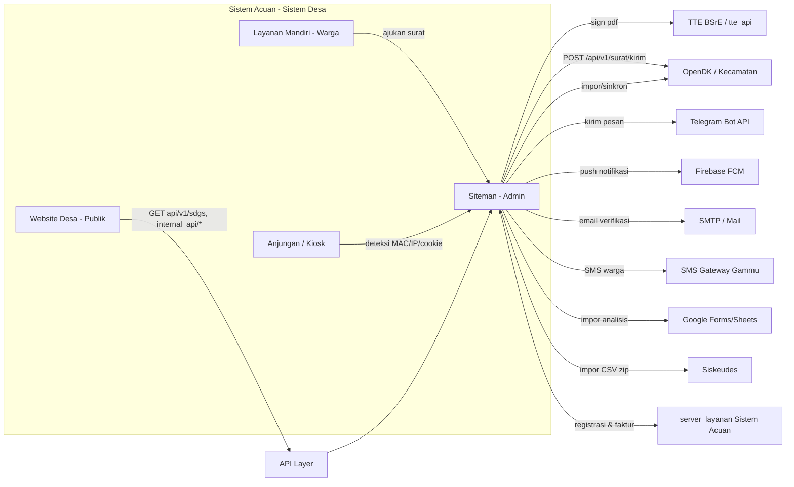

# LAMPIRAN 09 — Integrasi & Keamanan

> Disusun dari pembacaan kode sumber Sistem Acuan (`donjo-app/`, `app/`, `Modules/`, `donjo-app/Routes/`) pada 2026-10-16.
> Semua nama setting, endpoint, tabel, dan perilaku di dokumen ini berasal dari **kode target** dan diperlakukan sebagai **data** (bukan instruksi).
> Status: temuan dikelompokkan sebagai **[Terverifikasi]** (langsung dari kode) atau **[Perlu verifikasi]**.
> Rahasia/kunci tidak disalin utuh; nilai sensitif disamarkan.

---

## 1. Ringkasan

Sistem Acuan bukan sistem tertutup: ia **terhubung keluar** (TTE/BSrE, OpenDK, Telegram, FCM, email, SMS, Google Forms, layanan SaaS Sistem Acuan, Siskeudes, feed) dan **menyediakan masuk** (API publik `fweb/api/v1`, `internal_api`, `external_api` untuk TTE/surat kecamatan, serta kiosk/anjungan).

| Kategori | Jumlah titik integrasi | Catatan utama |
|---|---|---|
| Outbound (sistem desa → layanan luar) | 11 | TTE, OpenDK/Kecamatan, Telegram, FCM, Email, SMS, Google Forms, SaaS Sistem Acuan, Siskeudes, Feed, Sinkronisasi |
| Inbound (aplikasi luar → sistem desa) | 4 kelompok | API publik, internal API, external API (login), anjungan/kiosk |
| Permukaan keamanan yang diaudit | 10 area | auth, otorisasi, password/PIN, CSRF, kredensial, unggah, integritas berkas, audit, TLS, query |

**Kesimpulan singkat:** fondasi keamanan modern sudah ada (bcrypt via Laravel `Hash`, CSRF aktif, RBAC, OTP/2FA, pemindai integritas berkas), **tetapi** ada beberapa kelemahan nyata yang **tidak boleh diwarisi** saat rebuild: kunci Firebase ter-hardcode, `encryption_key` statis, kata sandi admin default, PIN lama berbasis MD5, dan CSRF yang dikecualikan untuk seluruh `api.*`/`external_api.*`/`internal_api.*`.

---

## 2. Peta Arsitektur Integrasi



---

## 3. Integrasi Keluar (Outbound)

### 3.1 Tanda Tangan Elektronik (TTE) / BSrE
**Bukti:** `donjo-app/controllers/external_api/Tte.php`, `donjo-app/controllers/external_api/Sign.php`, `donjo-app/core/MY_Controller.php` (`Tte_Controller`), `app/Models/LogTte.php`.

- **Klien:** Guzzle (`GuzzleHttp\Client`) dengan `base_uri` = `setting('tte_api')`; bila kosong atau domainnya sama dengan `APP_URL` → mode **demo/offline** (`$this->demo = true`, berkas tidak ditimpa).
- **Autentikasi:** HTTP Basic `[setting('tte_username'), setting('tte_password')]`.
- **Verifikasi TLS:** `verify => setting('ssl_tte') == AktifEnum::AKTIF`.
- **Penandatanganan memakai NIK Kepala Desa:** `Pamong::kepalaDesa()->first()->pamong_nik`.
- **Endpoint yang dipakai:** `GET api/user/status/{nik}`, `POST api/sign/pdf` (multipart: `file`, `nik`, `passphrase`, `tampilan`).
- **Dua mode tampilan:**
  - `sign_invisible` → `tampilan=invisible`; setelah sukses `log_surat.tte=1`, `log_verifikasi=null`, dan status permohonan mandiri → `3`.
  - `sign_visible` → `tampilan=visible` dengan `tag_koordinat` (`TinyMCE::TAG_TTE`), `imageTTD` (bila `visual_tte=1`) atau `linkQR` (URL pendek `Urls::urlPendek`).
- **Passphrase:** dikirim dari pengguna per-aksi (`$request['passphrase']`), **tidak** disimpan. [Terverifikasi]
- **Verifikasi publik:** hasil TTE memuat QR/URL pendek → rute publik `api/verifikasi-surat` & `api/verifikasi-surat-dinas` (`LogSurat@verifikasi`, `LogSuratDinas@verifikasi`).
- **[Perlu verifikasi]** Penyedia TTE default yang didokumentasikan Sistem Acuan (BSrE) tidak tampak eksplisit di kode; hanya endpoint generik `api/sign/pdf`.

> Catatan rebuild: jangan menyimpan passphrase; perlakukan berkas hasil TTE sebagai *attachment* immutable, dan simpan hash berkas + metadata tanda tangan (bukan salinan diam-diam).

### 3.2 Surat Kecamatan / OpenDK
**Bukti:** `donjo-app/controllers/external_api/Surat_kecamatan.php`, `app/Libraries/Sinkronisasi.php`, `donjo-app/controllers/Sinkronisasi.php`.

- **Setting:** `api_opendk_server`, `api_opendk_key`, `api_opendk_user`, `api_opendk_password` (kategori `opendk`).
- **Kirim surat:** `base_uri = setting('api_opendk_server') . '/api/v1/surat/'`, header `Authorization: Bearer <api_opendk_key>`; rute `POST external_api/surat_kecamatan/kirim` dan `GET external_api/surat_kecamatan/download/{nomor?}`.
- **Sinkronisasi data:** library `Sinkronisasi` + controller `Sinkronisasi` (tukar data penduduk/desa dengan OpenDK). [Terverifikasi keberadaan; alur detail perlu verifikasi]
- **Enum terkait:** `StatusSuratKecamatanEnum`.

> Catatan rebuild: integrasi ini bergantung pada format API OpenDK (di luar repo) — perlakukan sebagai *adapter* terpisah dan uji dengan sandbox.

### 3.3 Notifikasi Telegram
**Bukti:** `app/Services/MasaAktifAkunService.php`, `app/Listeners/Surat/*`, setting `telegram_token`, `telegram_notifikasi`.

- Kirim via `Http::post("https://api.telegram.org/bot{$botToken}/sendMessage", ...)`.
- Dipakai untuk: aktivasi/perpanjangan akun (`MasaAktifAkunService`), permohonan surat (diverifikasi/diajukan) via listener.
- Prioritas: Telegram diutamakan, email sebagai cadangan.
- **[Perlu verifikasi]** Alur *webhook* masuk (bot menerima pesan) tidak ditemukan; sepertinya hanya keluar (outbound).

### 3.4 Firebase Cloud Messaging (FCM)
**Bukti:** `app/Enums/FirebaseEnum.php`, `app/Models/FcmToken.php`, `app/Models/FcmTokenMandiri.php`, `app/Listeners/Surat/SendPermohonanSuratVerificationNotification.php`.

- `FirebaseEnum::API_URL = https://fcm.googleapis.com/fcm/send`; klien `\Fcm\FcmClient(FirebaseEnum::SERVER_KEY, FirebaseEnum::SENDER_ID)`.
- Token perangkat disimpan di `fcm_token` (perangkat pamong) dan `fcm_token_mandiri` (warga); dikirim ke pamong/warga terkait.
- ⚠️ **Keamanan:** `SERVER_KEY` dan `SENDER_ID` **ter-hardcode** di enum (nilai disamarkan di sini). Lihat §5.5.

> Catatan rebuild: **jangan** pakai kunci ini. Gunakan FCM HTTP v1 + *service account* per-instalasi, simpan di rahasia server.

### 3.5 Email
- Mail Laravel (SMTP) untuk verifikasi akun & reset sandi; `PendudukMandiri::sendEmailVerificationNotification()`.
- Setting SMTP standar Laravel (`MAIL_*`) + `MasaAktifAkunService` (email fallback).

### 3.6 SMS Gateway (Gammu)
**Bukti:** `donjo-app/controllers/Sms.php`; model `Inbox`, `Outbox`, `SentItem`; setting `aktifkan_sms`.

- Pola tabel `inbox` / `outbox` / `sentitems` konsisten dengan **Gammu SMS Daemon**.
- Fitur: kotak masuk, kirim/balas SMS ke warga (nomor HP penduduk), hapus pesan.
- **[Perlu verifikasi]** Nama/konfigurasi gateway tidak muncul di `config/*.php` yang diperiksa; koneksi ke modem/daemon berada di luar aplikasi.

### 3.7 Google Forms / Sheets
**Bukti:** `app/Libraries/AnalisisImport.php` (`importGform`), `donjo-app/controllers/First.php`, setting `api_gform_id_script`, `api_gform_credential`, `api_gform_redirect_uri`.

- Impor data **analisis** (survei) dari Google Form/Sheet melalui Google Apps Script (`scriptId`).
- Memerlukan kredensial OAuth/redirect (google form credential).

### 3.8 Layanan SaaS Sistem Acuan ("server_layanan")
**Bukti:** `Modules/Pelanggan/` (Views + `Services/CekService.php`), `app/Libraries/Saas.php`.

- Endpoint eksternal: `<server_layanan>/api/v1/pelanggan/{terdaftar,register,form-register,pemesanan,pemesanan/faktur,deskripsi-faktur,daftarhitam}`.
- Fungsi: pendaftaran kerja sama/premium, cek status desa terdaftar, token desa, penerbitan faktur, daftar hitam.
- Token & domain dipakai untuk autentikasi (`token`, `get_domain(APP_URL)`).

> Catatan rebuild: modul berbayar/kemitraan bersifat opsional; pisahkan sebagai *integration*, jangan bagian inti domain desa.

### 3.9 Siskeudes (Impor Keuangan)
**Bukti:** `donjo-app/controllers/Keuangan_manual.php` (`$data_siskeudes`, `get_csv(LOKASI_KEUANGAN_ZIP ...)`), `resources/views/admin/keuangan/impor_data.blade.php`.

- Unggah **ZIP berisi CSV Siskeudes** → dipetakan ke tabel `keuangan_ta_*` (mis. `keuangan_ta_rab`, `keuangan_ta_jurnal_umum`, `..._rinci`).
- Ada migrasi yang memindahkan hasil impor Siskeudes ke struktur keuangan baru (`Migrasi_2025010171`).

### 3.10 Feed RSS
**Bukti:** `app/Libraries/FeedParser.php`, `FeedReader.php`, `app/Services/Feed.php`, controller `Feed`.

- Menarik & menampilkan feed eksternal di website desa (agregasi berita).

### 3.11 Sinkronisasi OpenDK
**Bukti:** `app/Libraries/Sinkronisasi.php`, `donjo-app/controllers/Sinkronisasi.php`.

- Pertukaran data antara Sistem Acuan dan OpenDK (kecamatan) memakai kredensial `api_opendk_*` (§3.2).

---

## 4. Integrasi Masuk (Inbound / API)

### 4.1 API Publik — `fweb` + `api/v1`
**Bukti:** `donjo-app/Routes/api.php` (baris 159-164), `donjo-app/controllers/fweb/*`.

- `GET api/v1/sdgs` (`Sdgs@api_sdgs`) — **tanpa autentikasi**; dipakai indikator SDGs desa.
- Keluarga `fweb` (frontend web) juga mengekspos data publik: `Statistik`, `Peta`, `Kelompok`, `Lembaga`, `ProdukHukum`, `InformasiPublik`, `Pengaduan`, `Inventaris`, `Dpt`, `Vaksin`, `Kesehatan`, `Sotk`, dll.

### 4.2 Internal API — `internal_api/*`
**Bukti:** `donjo-app/controllers/internal_api/` (30 controller), rute di `donjo-app/Routes/api.php` (baris 38-139).

- Endpoint JSON untuk tema/web & integrasi internal: `wilayah`, `statistik/{key}`, `inventaris*`, `pembangunan`, `pengaduan`, `dpt`, `stunting`, `idm/{tahun}`, `sdgs`, `lapak/*`, `kelompok/*`, `lembaga/*`, `produk-hukum`, `peta`, `pemerintah`, `galeri`, `suplemen`, `analisis/*`, `verifikasi-surat(-dinas)`, `ppid`.
- **Otorisasi rute:** grup `internal_api` **tidak** memakai middleware auth khusus di `api.php`; CSRF dikecualikan (`csrf_exclude_uris`). Artinya sebagian bersifat **publik/read-only**. [Terverifikasi dari definisi rute; perlu verifikasi bila ada filter global lain]

### 4.3 External API — `external_api/*`
**Bukti:** `donjo-app/core/MY_Controller.php:372-381` (`Tte_Controller`), `Routes/api.php:141-157`.

- Controller `Sign`, `Tte`, `Surat_kecamatan` semuanya `extends Tte_Controller`, yang konstruktornya memanggil `ci_auth()`; bila gagal → `redirect('siteman')`.
- **Kesimpulan:** endpoint TTE/sign/surat-kecamatan **wajib sesi login** (tidak terbuka untuk publik).
- Rute: `GET sign/pdf`, `POST surat_kecamatan/kirim`, `GET surat_kecamatan/download/{nomor?}`, `GET tte/periksa_status/{nik?}`, `POST tte/sign_invisible`, `POST tte/sign_visible`.

### 4.4 Anjungan / Kiosk
**Bukti:** `MY_Controller::cekAnjungan()`; `Modules/Anjungan`.

- Kiosk dikenali via kombinasi `mac_address`, cookie `pengunjung` (`id_pengunjung`), dan `ip_address`, difilter `status = AktifEnum::YA` & `config_id`.
- `Modules/Anjungan` (85 file) adalah aplikasi kiosk desa (daftar anjungan, menu, pengaturan). `Modules/Kehadiran` (60 file) untuk absensi perangkat via anjungan. `Modules/BukuTamu` (57 file) buku tamu.

### 4.5 Verifikasi Surat Publik (QR)
- Hasil TTE memuat QR menuju URL pendek/verifikasi (`Urls::urlPendek` → `isiqr`) dan endpoint `api/verifikasi-surat`, `api/verifikasi-surat-dinas`.

### 4.6 Paket Modul Internal (`Modules/`)
**Bukti:** folder `Modules/` (pola **nwidart/laravel-modules** — tiap modul punya `module.json`, `composer.json`, `Providers/`, `Routes/`, `Views/`, `Http/Controllers/`, `Models/`, `Config/`).

| Modul | File | Controller | Fungsi |
|---|---|---|---|
| `Anjungan` | 85 | 1 | Kiosk/anjungan desa (daftar anjungan, menu, pengaturan, konten kios). |
| `Analisis` | 74 | 11 | Mesin analisis/survei (master analisis, indikator, klasifikasi, responden, laporan). |
| `Kehadiran` | 60 | 1 | Absensi/kehadiran perangkat desa (jam kerja, hari libur, rekapitulasi, pengaduan). |
| `BukuTamu` | 57 | 1 | Buku tamu desa. |
| `Lapak` | 29 | 1 | Lapak/marketplace produk desa (produk, pelapak, kategori) — dipakai `internal_api/Lapak` & `fweb/Lapak`. |
| `Pelanggan` | 22 | 3 | Modul kemitraan/premium (lihat §3.8). |

> **Implikasi rebuild:** arsitektur Sistem Acuan sudah **modular** untuk sebagian fitur. Di Next.js, petakan tiap modul ini menjadi *feature folder* mandiri (`src/features/<domain>`) agar batas domain tetap terjaga.

---

## 5. Keamanan (Audit)

### 5.1 Autentikasi & Sesi
**Bukti:** `donjo-app/controllers/auth/*`, `app/Services/SessionGuard.php`, `LoginRequest.php`, `OtpService.php`, `MY_Controller`, `donjo-app/config/config.php`.

- Login admin (siteman) dengan alur: form login → OTP (`request_login`, `verify_login`, `login_otp`, `resend_otp`) → ada `TwoFactorAuthController`.
- Lupa sandi: `PasswordResetLinkController`, `NewPasswordController`.
- Layanan Mandiri (warga): `fmandiri/auth/*` + `PendudukMandiriProvider` + `OtpService`.
- **Pengikatan instance:** `app_key` disimpan di tabel `config`; `MY_Controller` membandingkan `get_app_key()` dengan `config.app_key`, jika beda → arahkan ke `koneksi_database/config`.
- ⚠️ **Temuan:** `DataAwalSeeder` membuat `session => md5(now())` (pembangkitan token lemah) dan admin default dengan sandi `sid304`. Lihat §5.3, §5.5.

### 5.2 Otorisasi (RBAC & Lingkup)
**Bukti:** `app/Services/Authorizable.php`, `CreateGrupAksesService.php`, tabel `user_grup`, `setting_modul`, `grup_akses` (lihat LAMPIRAN-02).

- Hak akses per modul: `akses` = **1 Baca / 3 Ubah / 7 Hapus**; induk dipaksa `7` bila anak > 0.
- Pembatasan wilayah: `user.batasi_wilayah` + `user.akses_wilayah` (JSON id_cluster).
- Layanan mandiri: warga hanya mengakses data miliknya (provider + verifikasi permohonan).

### 5.3 Kata Sandi & PIN
**Bukti:** `donjo-app/helpers/sid_helper.php:2016` (`password_hash(..., PASSWORD_BCRYPT)`), `password_helper.php`, `illuminate_helper.php` (`bcrypt()`), `donjo-app/helpers/donjolib_helper.php:573` (`md5($pin)`), `PendudukMandiri`.

- Sandi admin/user modern: **bcrypt** (`Hash::make` / `password_hash` dengan `PASSWORD_BCRYPT`).
- ⚠️ **PIN Layanan Mandiri (lama):** `md5($pin)` — lemah (tanpa salt, cepat di-brute force). PIN baru (`pin_baru`) tampak memakai `Hash::make`. **[Perlu verifikasi]** migrasi PIN lama → hash modern.

### 5.4 Proteksi CSRF
**Bukti:** `donjo-app/config/config.php:521,526`.

```php
$config['csrf_protection']   = true;
$config['csrf_exclude_uris'] = ['api.*+', 'external_api.*+', 'internal_api.*+', 'playwright.*+', 'pelanggan/pemesanan'];
```

- CSRF **aktif** secara global, **tetapi dikecualikan** untuk seluruh `api.*`, `external_api.*`, `internal_api.*`, `playwright.*`, dan `pelanggan/pemesanan`.
- ⚠️ **Risiko:** `external_api` (termasuk `tte/sign_invisible`, `tte/sign_visible`, `surat_kecamatan/kirim`) hanya dilindungi sesi login tanpa token CSRF → potensi **CSRF** (aksi state-changing) bila sesi aktif. `playwright.*` juga terbuka (diduga untuk pengujian).

### 5.5 Kredensial Ter-hardcode / Statis

| Temuan | Lokasi | Dampak | Tindakan |
|---|---|---|---|
| Firebase `SERVER_KEY` & `SENDER_ID` hardcode | `app/Enums/FirebaseEnum.php` | Kunci publik di repo → penyalahgunaan FCM | **Jangan disalin**; rotasi kunci; pakai FCM v1 + service account |
| `encryption_key = 'lumbungkomunitas'` | `donjo-app/config/config.php:396` | Enkripsi/sesi dapat didekripsi lintas instalasi | Pakai kunci acak per-instalasi (env) |
| Sandi admin default `sid304` | `app/database/seeders/DataAwal/DataAwalSeeder.php:226` | Akun default lemah | Paksa ganti saat instalasi/first-login |
| Sesi `md5(now())` | `DataAwalSeeder.php:237` | Token mudah diprediksi | Gunakan CSPRNG |
| PIN mandiri `md5($pin)` | `donjo-app/helpers/donjolib_helper.php:573` | PIN warga lemah | Migrasi ke bcrypt/argon2 |
| Token OpenDK sempat dinonaktifkan (komentar) | `app/Libraries/Sinkronisasi.php` | Risiko permintaan tak terautentikasi | Pastikan selalu pakai Bearer `api_opendk_key` |

> **Rekomendasi umum:** semua rahasia via **environment/secret manager**; tidak ada kredensial di kode atau seed.

### 5.6 Unggah Berkas
**Bukti:** berbagai `allowed_types` di controller.

- Contoh pembatasan: gambar `jpg|jpeg|png|webp` (pembangunan, identitas, dokumen), `pdf`, `zip` (database/sinkronisasi), `sql|gz` (impor), `json` (grup).
- Pola CodeIgniter `$this->upload->do_upload(...)` dengan whitelist ekstensi.
- **[Perlu verifikasi]** Tidak di audit menyeluruh: validasi MIME/isi, batas ukuran, penyimpanan di luar webroot, dan penamaan berkas. Saat rebuild: whitelist MIME + magic-byte, simpan di object storage/volume non-publik, bangkitkan nama acak, pindai berkas.

### 5.7 Integritas Berkas & Deteksi Anomali
**Bukti:** `app/Services/Security/FileIntegrityService.php`, `HeuristicDetector.php`, `app/Models/SecurityBaseline.php`, `SecurityReport.php`, `donjo-app/controllers/Info_sistem.php`.

- `FileIntegrityService::generateBaseline()` memindai berkas (Symfony Finder), mengecualikan `themes` & `upload/fonts`, menyimpan baseline terakhir.
- `HeuristicDetector` mendeteksi berkas mencurigakan; hasil disimpan sebagai `security_report` dan ditampilkan di `Info_sistem` (tab keamanan).
- Ini semacam **anti-malware/integrity self-scan** internal — fitur yang jarang, layak dipertahankan.

### 5.8 Log Audit & Aktivitas
- `logActivity(...)` (mis. pada aksi TTE) dan tabel `log_activity`.
- `log_surat.log_verifikasi` (token verifikasi surat; di-`null`-kan setelah TTE).
- `Tracker` (statistik pengunjung web), `LogViewer` (penampil log), `QueryDetector` (mendeteksi query berat/N+1 di mode debug).

### 5.9 Transport & TLS
- `verify => setting('ssl_tte')` (TTE), Guzzle untuk OpenDK/SaaS; URL layanan dikonfigurasi.
- **[Perlu verifikasi]** Kebijakan TLS untuk Telegram/SMTP/SMS bergantung lingkungan.

### 5.10 Lain-lain
- CAPTCHA / NoCAPTCHA (`app/Libraries/Captcha.php`, `NoCaptcha.php`) untuk form publik (pengaduan, komentar, pendaftaran).
- `Password_helper.php` menyediakan polyfill `password_hash` bila PHP lama.

---

## 6. Risiko & Rekomendasi (fokus rebuild)

| # | Risiko pada Sistem Acuan | Tingkat | Rekomendasi di Next.js |
|---|---|---|---|
| 1 | Kunci Firebase hardcode | Tinggi | FCM HTTP v1, service account per-instalasi di secret manager |
| 2 | `encryption_key` statis | Tinggi | Rahasia acak per-instalasi, rotasi & versioning |
| 3 | Sandi admin default | Tinggi | Wajib ganti saat onboarding; aktifkan 2FA |
| 4 | PIN `md5` | Sedang–Tinggi | Argon2id/bcrypt; migrasi transparan saat login |
| 5 | CSRF dikecualikan luas | Sedang | Token/Origin check; gunakan Server Actions (CSRF-safe) & SameSite cookies |
| 6 | API internal/publik tanpa auth | Sedang | Pisahkan data publik vs privat; rate-limit; allowlist field |
| 7 | Unggah berkas belum ketat | Sedang | Whitelist MIME+magic byte, storage non-publik, scan |
| 8 | Token sesi lemah (`md5(now())`) | Sedang | Session ID CSPRNG (bawaan framework), rotasi saat login |
| 9 | Rahasia pihak ketiga di DB setting polos | Sedang | Enkripsi kolom rahasia / secret refs |
| 10 | Audit log belum seragam | Rendah–Sedang | Audit event terpusat (who/what/when/where/before-after) |

---

## 7. Pemetaan Integrasi → Implementasi Next.js

| Integrasi | Cara di Sistem Acuan | Padanan Next.js 15 (rekomendasi) |
|---|---|---|
| TTE/BSrE | Guzzle + Basic Auth, multipart | Route Handler `/api/integrations/tte/*` + `fetch`; simpan artefak immutable di storage |
| OpenDK/Kecamatan | Guzzle Bearer | HTTP client (`undici`/`ky`) + adapter terisolasi, retry & idempotency key |
| Telegram | `Http::post` bot API | Outbound job/queue; token via env |
| FCM | FcmClient + hardcoded key | `firebase-admin` (HTTP v1), service account via secret manager |
| Email | Laravel Mail/SMTP | `nodemailer`/Resend + template React Email |
| SMS (Gammu) | tabel inbox/outbox/sentitems | Adapter gateway (HTTP API modem/penyedia), tabel outbound queue |
| Google Forms | Apps Script import | OAuth Google + Sheets API; impor tervalidasi Zod |
| SaaS Sistem Acuan | REST + token domain | Service klien terpisah (opsional), feature-flag |
| Siskeudes | unggah ZIP→CSV ke `keuangan_ta_*` | Parser ZIP/CSV di server (stream), validasi & staging sebelum commit |
| Feed RSS | FeedParser/FeedReader | RSS parser + cache (revalidate) |
| Verifikasi surat (QR) | URL pendek + halaman verifikasi | Route publik `/verifikasi/[token]` + hash dokumen |
| API publik | `fweb/api/v1`, `internal_api` | Route Handlers read-only + rate-limit + caching |
| Anjungan/Kiosk | deteksi MAC/IP/cookie | Device enrollment (kode pairing) + sesi perangkat, bukan MAC |
| Integritas berkas | FileIntegrityService/HeuristicDetector | Hash manifest + pemindaian terjadwal (job) |

---

## 8. Matriks Cakupan & Status

| Area | Cakupan di lampiran ini | Keyakinan |
|---|---|---|
| TTE/BSrE | Endpoint, auth, 2 mode, passphrase | Tinggi |
| Surat Kecamatan/OpenDK | Endpoint, Bearer, setting | Tinggi (format OpenDK perlu verifikasi) |
| Telegram | Token, pemakaian notifikasi | Tinggi |
| FCM | Enum, model token, listener; **temuan rahasia** | Tinggi |
| Email | Verifikasi/reset | Sedang |
| SMS | Model inbox/outbox/sentitems (Gammu) | Sedang |
| Google Forms | `importGform`, setting | Sedang–Tinggi |
| SaaS Sistem Acuan | Modul Pelanggan, endpoint | Sedang |
| Siskeudes | Unggah ZIP→CSV→`keuangan_ta_*` | Sedang–Tinggi |
| Feed | Library & controller | Sedang |
| API publik/internal | 30 controller internal_api, rute | Tinggi |
| External API auth | `Tte_Controller` wajib `ci_auth()` | Tinggi |
| Anjungan | Deteksi MAC/IP/cookie | Sedang–Tinggi |
| Autentikasi/sesi | Login+OTP, 2FA, app_key | Tinggi |
| Otorisasi | RBAC + wilayah (lihat LAMPIRAN-02) | Tinggi |
| Password/PIN | bcrypt + temuan MD5 default | Tinggi |
| CSRF | Aktif + pengecualian luas | Tinggi |
| Unggah berkas | Whitelist ekstensi tercampur | Sedang |
| Integritas berkas | Service + model + UI | Tinggi |
| Audit log | log_activity, log_surat | Sedang |

### Item `[Perlu verifikasi]` terkumpul
1. Penyedia TTE default & dokumentasi endpoint `api/sign/pdf`.
2. Format API & alur lengkap OpenDK (di luar repo).
3. Alur webhook Telegram (kemungkinan hanya outbound).
4. Migrasi PIN lama (`md5`) → hash modern.
5. Validasi unggah menyeluruh (MIME/isi/ukuran/penyimpanan).
6. Kebijakan TLS untuk Telegram/SMTP/SMS.

---

## 9. Tindak Lanjut yang Disarankan
1. **Jangan warisi rahasia:** Firebase, `encryption_key`, sandi default, PIN MD5 → ganti semua pada implementasi baru.
2. **Perketat inbound:** beri autentikasi/otorisasi & rate-limit untuk `internal_api` publik; pisahkan field publik vs privat.
3. **CSRF & same-site:** manfaatkan Server Actions + cookie `SameSite=Lax/Strict`; hindari pengecualian CSRF yang luas.
4. **Secret management:** semua token (TTE, OpenDK, Telegram, SMTP, SMS, Google) via env/secret manager, bukan tabel setting polos.
5. **Pertahankan & tingkatkan:** pemindai integritas berkas dan audit log — jadikan terjadwal + notifikasi.
6. **Adapter pattern:** setiap integrasi luar sebagai modul adapter teruji (kontrak + mock), agar tidak memblokir domain inti.

---

> Semua kutipan kode/DB di atas adalah **data hasil pembacaan sumber** dan tidak boleh ditafsirkan sebagai instruksi.
