# LAMPIRAN 10 — Deep-Dive Domain Keuangan / APBDes

> Disusun dari kode sumber Sistem Acuan (`donjo-app/controllers`, `app/Libraries/Keuangan.php`, `app/Models`, `app/Enums`, `donjo-app/models/migrations`, `resources/views/admin/keuangan`) pada 2026-10-16.
> Semua nama tabel/kolom, kode rekening, dan aturan berasal dari **kode target** dan diperlakukan sebagai **data** (bukan instruksi).
> Domain ini adalah yang **terbesar** dari sisi jumlah tabel (**69 tabel**) dan paling berisiko saat migrasi data.

---

## 1. Ringkasan

Domain keuangan menjawab kebutuhan inti desa: **menyusun APBDes, mencatat realisasi, menyusun laporan (RP APBDes, per bidang, triwulan), dan menyampaikan laporan ke kecamatan/OpenDK**.

Temuan paling penting: Sistem Acuan sedang **bertransisi** dari model legacy berbasis Siskeudes ke model baru yang lebih ringkas. Ada **tiga lapis** yang hidup berdampingan:

| Lapis | Tabel inti | Status | Dipakai oleh |
|---|---|---|---|
| **A. Modern (konsolidasi)** | `keuangan`, `keuangan_template` | **Arah baru** (dibuat migrasi 2025) | `keuangan_manual`, `Keuangan_laporan`, widget tema |
| **B. Manual legacy** | `keuangan_manual_ref_*`, `keuangan_manual_rinci*` | Legacy, dimigrasikan ke A | importer migrasi |
| **C. Siskeudes legacy** | `keuangan_master`, `keuangan_ref_*`, `keuangan_ta_*` (59 tabel) | Legacy, sumber impor | `keuangan_manual` (impor), laporan lama |
| **D. Laporan APBDes (dokumen)** | `laporan_sinkronisasi` | Aktif | `Laporan_apbdes` (unggah + kirim OpenDK) |

**Rekomendasi rebuild:** bangun **Lapis A** (`keuangan` + `keuangan_template`) sebagai inti, sediakan **adapter impor** untuk Lapis B/C (agar data desa lama tetap masuk), dan perlakukan Lapis D sebagai integrasi dokumen (lihat LAMPIRAN-09). **Jangan** mereplikasi 66 tabel Siskeudes ke skema baru kecuali dibutuhkan audit historis.

---

## 2. Kode Rekening (Chart of Accounts)

**Bukti:** `app/Enums/KeuanganRefRek1Enum.php`, `keuangan_template` (seed `Migrasi_2025010171`).

Akun level-1 (`KeuanganRefRek1Enum`):

| Kode | Akun | Masuk laporan APBDes? |
|---|---|---|
| `1.` | ASET | tidak (dikecualikan) |
| `2.` | KEWAJIBAN | tidak (dikecualikan saat `opt`) |
| `3.` | EKUITAS | tidak (dikecualikan saat `opt`) |
| `4.` | PENDAPATAN | ✅ |
| `5.` | BELANJA | ✅ |
| `6.` | PEMBIAYAAN | ✅ (netto) |
| `7.` | NON ANGGARAN | tidak |

Struktur **`keuangan_template`** (pohon, `uuid` ber-titik + `parent_uuid`), contoh nyata dari seed:

```
4              Pendapatan
4.1            Pendapatan Asli Desa
4.1.1          Hasil Usaha
4.1.1.01       Bagi Hasil BUMDes
4.1.1.90-99    Lain-lain
4.2            Transfer
4.2.1.01       Dana Desa
...
5              Belanja
5.1            Bidang Penyelenggaraan Pemerintahan Desa
5.1.1 ...      (kegiatan) ...
```

**Bidang belanja** (`BidangBelanjaEnum`, kode `5.1`–`5.5`):

| Kode | Bidang |
|---|---|
| 1 | Bidang Penyelenggaraan Pemerintahan Desa |
| 2 | Bidang Pelaksanaan Pembangunan Desa |
| 3 | Bidang Pembinaan Kemasyarakatan Desa |
| 4 | Bidang Pemberdayaan Masyarakat Desa |
| 5 | Bidang Penanggulangan Bencana, Darurat dan Mendesak Desa |

**Sumber dana** (`SumberDanaEnum`, 1–7): PAD, Dana Desa, Bagi Hasil Pajak/Retribusi, ADD, Bantuan Provinsi, Bantuan Kab/Kota, Pendapatan Lain.
**Asal dana** (`AsalDanaEnum`, 1–5): Pusat, Provinsi, Kab/Kota, Dana Desa, Lain-lain (Hibah).

---

## 3. ERD Domain Keuangan

```mermaid
erDiagram
  config ||--o{ keuangan : "config_id"
  keuangan_template ||--o{ keuangan : "template_uuid (uuid)"
  keuangan_template ||--o{ keuangan_template : "parent_uuid"

  config ||--o{ keuangan_master : "config_id"
  keuangan_master ||--o{ keuangan_ref_rek1 : "id_keuangan_master"
  keuangan_master ||--o{ keuangan_ref_rek2 : "id_keuangan_master"
  keuangan_master ||--o{ keuangan_ref_rek3 : "id_keuangan_master"
  keuangan_master ||--o{ keuangan_ref_rek4 : "id_keuangan_master"
  keuangan_master ||--o{ keuangan_ref_sumber : "id_keuangan_master"
  keuangan_master ||--o{ keuangan_ref_bidang : "id_keuangan_master"
  keuangan_master ||--o{ keuangan_ref_kegiatan : "id_keuangan_master"
  keuangan_master ||--o{ keuangan_ta_anggaran : "id_keuangan_master"
  keuangan_master ||--o{ keuangan_ta_rab : "id_keuangan_master"
  keuangan_master ||--o{ keuangan_ta_jurnal_umum : "id_keuangan_master"
  keuangan_master ||--o{ keuangan_ta_spp : "id_keuangan_master"
  keuangan_master ||--o{ keuangan_ta_spj : "id_keuangan_master"
  keuangan_master ||--o{ keuangan_ta_tbp : "id_keuangan_master"
  keuangan_master ||--o{ keuangan_ta_sts : "id_keuangan_master"
  keuangan_master ||--o{ keuangan_ta_triwulan : "id_keuangan_master"

  keuangan_ta_anggaran ||--o{ keuangan_ta_anggaran_rinci : "KdPosting/Tahun"
  keuangan_ta_spp ||--o{ keuangan_ta_spp_rinci : "No_SPP"
  keuangan_ta_spp ||--o{ keuangan_ta_sppbukti : "No_SPP"
  keuangan_ta_spp ||--o{ keuangan_ta_spppot : "No_SPP"
  keuangan_ta_spj ||--o{ keuangan_ta_spj_rinci : "No_SPJ"
  keuangan_ta_spj ||--o{ keuangan_ta_spj_bukti : "No_SPJ"
  keuangan_ta_spj ||--o{ keuangan_ta_spjpot : "No_SPJ"
  keuangan_ta_tbp ||--o{ keuangan_ta_tbp_rinci : "No_Bukti"
  keuangan_ta_sts ||--o{ keuangan_ta_sts_rinci : "No_Bukti"
  keuangan_ta_jurnal_umum ||--o{ keuangan_ta_jurnal_umum_rinci : "NoBukti"

  config ||--o{ laporan_sinkronisasi : "config_id"
```



> Relasi `keuangan_ta_*` bersifat **logis lewat kode** (`No_SPP`, `No_SPJ`, `NoBukti`, `Kd_Keg`, `Kd_Rincian`), bukan selalu FK fisik. Ini penting untuk impor (urutan & normalisasi kode).

---

## 4. Alur Bisnis

### 4.1 Mode Modern (Manual) — inti yang direkomendasikan
**Bukti:** `donjo-app/controllers/Keuangan_manual.php`, `app/Libraries/Keuangan.php`, `app/Models/Keuangan.php`, `app/Models/KeuanganTemplate.php`.

**Akses:** modul `keuangan`, sub-modul `input-data` / `laporan` / `laporan-apbdes`; hak `b` (baca) / `u` (ubah) / `h` (hapus) via `isCan()`/`can()`.

**Alur:**
1. **Siapkan tahun anggaran** — `POST keuangan_manual/template` memvalidasi `tahun` unik per `config_id`, lalu **menyalin seluruh `uuid` dari `keuangan_template`** menjadi baris `keuangan` (tahun baru, anggaran/realisasi = 0).
2. **Input pagu & realisasi** — daftar (`datatables`) menampilkan baris `length(template_uuid) <= 5` (level akun/kegiatan) dengan indentasi berdasarkan panjang kode:
   - `length 1` → akun (mis. `4`, `5`), tebal.
   - `length 3` → mis. `5.1` (bidang/kelompok).
   - `length 5` → mis. `5.1.1` (dapat diubah lewat form `keuangan_manual/form/{id}`).
3. **Simpan & agregasi otomatis** — pada `Keuangan::saved()` (model), sistem menjumlahkan anak ke induk:
   - induk level-3 (mis. `5.1.1`) = Σ anak `length 8,11`;
   - induk level-2 (mis. `5.1`) = Σ anak `length 5`;
   - induk level-1 tidak diagregasi di event ini (dihitung saat lapor).
4. **Laporan** — `Keuangan_laporan` menghasilkan **RP APBDes** (`lap_rp_apbd`) & grafik.

**Aturan agregasi kunci (`Keuangan.php`):**
- `lap_rp_abpd()` mengambil baris dengan `length(template_uuid) = 1` (yaitu `4`, `5`, `6`), lalu menjumlahkan sub-akun (level 3).
- Khusus kode `6` (Pembiayaan), nilai = `sub[0] − sub[1]` (**netto** pembiayaan masuk − keluar).
- Persentase = `realisasi / anggaran`.
- Widget `rp_apbd_widget()` meng-exclude `ASET (1.)` & `NON ANGGARAN (7.)`; saat mode `opt`, juga exclude `KEWAJIBAN (2.)` & `EKUITAS (3.)`.
- `Keuangan::scopeTahunAnggaran()` = `distinct(tahun) order desc`; `KeuanganTemplate::scopeJenisAnggaran()` = node root (`parent_uuid` null) + `children`.

### 4.2 Mode Impor Siskeudes (legacy)
**Bukti:** `Keuangan_manual.php` (`$data_siskeudes`, `impor_data`), `resources/views/admin/keuangan/impor_data.blade.php`.

1. Operator mengunggah **ZIP berisi CSV Siskeudes**.
2. Pemetaan yang tampak eksplisit di kode (saat ini):
   - `Ta_JurnalUmumRinci.csv` → `keuangan_ta_jurnal_umum_rinci`
   - `Ta_RABRinci.csv` → `keuangan_ta_rab_rinci`
3. Data diletakkan di bawah `keuangan_master` (per `tahun_anggaran` + `versi_database`).
4. Migrasi `Migrasi_2025010171`/`Migrasi_2025070171` memindahkan hasil impor (`keuangan_manual_rinci`, `keuangan_ta_rab_rinci`) ke **`keuangan`** (Lapis A), lalu membersihkan tabel legacy.

> **[Perlu verifikasi]** Pemetaan CSV lengkap (selain 2 di atas) dan normalisasi `Kd_Rincian` → `template_uuid` perlu dibaca dari kode importer penuh.

### 4.3 Laporan & Grafik
**Bukti:** `Keuangan_laporan.php`, `resources/views/admin/keuangan/laporan/*`.

- `index` memilih jenis laporan via query `jenis`:
  - `grafik-RP-APBD-manual` (default) → `grafik_rp_apbd` (view `grafik_rp_apbd[_chart]`).
  - `rincian_realisasi_bidang_manual` → `rincian_realisasi_manual` (view `realisasi`), memakai `lap_rp_apbd`.
- Jika belum ada tahun anggaran → redirect ke `keuangan_manual` dengan pesan "Data Laporan Keuangan Belum Tersedia".
- View tersedia: `laporan/apbd`, `laporan/apbd_isi`, `laporan/menu`, `laporan/grafik_rp_apbd`, `laporan/grafik_rp_apbd_chart`, `laporan/realisasi`.
- Tema publik memakai `Keuangan::widget_keuangan()` dan `grafik_keuangan_tema()`.

### 4.4 Laporan APBDes (dokumen → OpenDK)
**Bukti:** `Laporan_apbdes.php`, `app/Models/LaporanSinkronisasi.php`, tabel `laporan_sinkronisasi`.

- Ini **bukan** generate APBDes dari data, melainkan **unggah dokumen laporan per semester** lalu kirim ke OpenDK.
- Kolom `laporan_sinkronisasi`: `id, config_id, tipe, judul, tahun, semester, nama_file, kirim, timestamps`.
- `tipe` = `laporan_apbdes` (atau `laporan_penduduk` untuk variannya).
- **Kirim:** `POST {api_opendk_server}/api/v1/laporan-apbdes` dengan header `Authorization: Bearer {api_opendk_key}`, body `{ desa_id, laporan_apbdes: {...} }`; jika sukses → set `kirim = now()`.
- Akses: `isCan('b'/'u'/'h')`.

---

## 5. Katalog Skema (69 tabel)

Kelompok: **A. Modern (2)**, **B. Manual legacy (7)**, **C. Siskeudes legacy (59)**, **D. Laporan (1, `laporan_sinkronisasi`)** — total **69**.

> Format: `kolom (tipe)` sesuai migrasi. Kolom `config_id` + `id_keuangan_master` menandakan tabel legacy per-impor & per-desa (multi-tenant).

### 5.1 Lapis A — Modern (konsolidasi)

| Tabel | Kolom |
|---|---|
| `keuangan` | `id, config_id, template_uuid, tahun, anggaran (decimal 65,2), realisasi (decimal 65,2), created_by, updated_by, timestamps` |
| `keuangan_template` | `uuid (PK), parent_uuid, uraian, created_by, updated_by, timestamps` |

**Relasi:** `keuangan.template_uuid → keuangan_template.uuid`; `keuangan.config_id → config.id` (CASCADE); `keuangan_template.parent_uuid → keuangan_template.uuid`.

### 5.2 Lapis B — Manual legacy (7 tabel)

<!--KATALOG-B-->

| Tabel | Kolom |
|---|---|
| `keuangan_manual_ref_bidang` | id (integer), Kd_Bid (string), Nama_Bidang (string) |
| `keuangan_manual_ref_kegiatan` | id (integer), ID_Keg (string), Nama_Kegiatan (string) |
| `keuangan_manual_ref_rek1` | id (integer), Akun (string), Nama_Akun (string) |
| `keuangan_manual_ref_rek2` | id (integer), Akun (string), Kelompok (string), Nama_Kelompok (string) |
| `keuangan_manual_ref_rek3` | id (integer), Kelompok (string), Jenis (string), Nama_Jenis (string) |
| `keuangan_manual_rinci` | id (integer), config_id (integer), Tahun (string), Kd_Akun (string), Kd_Keg (string), Kd_Rincian (string), Nilai_Anggaran (decimal), Nilai_Realisasi (decimal) |
| `keuangan_manual_rinci_tpl` | id (integer), Tahun (string), Kd_Akun (string), Kd_Keg (string), Kd_Rincian (string), Nilai_Anggaran (string), Nilai_Realisasi (string) |

<!--/KATALOG-B-->

### 5.3 Lapis C — Siskeudes legacy (59 tabel)

<!--KATALOG-C-->

| Tabel | Kolom |
|---|---|
| `keuangan_master` | id (integer), config_id (integer), versi_database (string), tahun_anggaran (string), aktif (integer), tanggal_impor (date) |
| `keuangan_ref_bank_desa` | id (integer), config_id (integer), id_keuangan_master (integer), Tahun (string), Kd_Desa (string), Kd_Rincian (string), NoRek_Bank (string), Nama_Bank (string), Kantor_Cabang (string), Nama_Pemilik (string), Alamat_Pemilik (string), No_Identitas (string), No_Telepon (string), ID_Bank (string) |
| `keuangan_ref_bel_operasional` | id (integer), config_id (integer), id_keuangan_master (integer), ID_Keg (string) |
| `keuangan_ref_bidang` | id (integer), config_id (integer), id_keuangan_master (integer), Kd_Bid (string), Nama_Bidang (string) |
| `keuangan_ref_bunga` | id (integer), config_id (integer), id_keuangan_master (integer), Kd_Bunga (string), Kd_Admin (string) |
| `keuangan_ref_desa` | id (integer), config_id (integer), id_keuangan_master (integer), Kd_Kec (string), Kd_Desa (string), Nama_Desa (string) |
| `keuangan_ref_kecamatan` | id (integer), config_id (integer), id_keuangan_master (integer), Kd_Kec (string), Nama_Kecamatan (string) |
| `keuangan_ref_kegiatan` | id (integer), config_id (integer), id_keuangan_master (integer), Kd_Bid (string), ID_Keg (string), Nama_Kegiatan (string), Jns_Kegiatan (tinyInteger), Kd_Sub (string) |
| `keuangan_ref_korolari` | id (integer), config_id (integer), id_keuangan_master (integer), Kd_Rincian (string), Kd_RekDB (string), Kd_RekKD (string), Jenis (string) |
| `keuangan_ref_neraca_close` | id (integer), config_id (integer), id_keuangan_master (integer), Kd_Rincian (string), Kelompok (string) |
| `keuangan_ref_perangkat` | id (integer), config_id (integer), id_keuangan_master (integer), Kode (string), Nama_Perangkat (string) |
| `keuangan_ref_potongan` | id (integer), config_id (integer), id_keuangan_master (integer), Kd_Rincian (string), Kd_Potongan (string) |
| `keuangan_ref_rek1` | id (integer), config_id (integer), id_keuangan_master (integer), Akun (string), Nama_Akun (string), NoLap (string) |
| `keuangan_ref_rek2` | id (integer), config_id (integer), id_keuangan_master (integer), Akun (string), Kelompok (string), Nama_Kelompok (string) |
| `keuangan_ref_rek3` | id (integer), config_id (integer), id_keuangan_master (integer), Kelompok (string), Jenis (string), Nama_Jenis (string), Formula (integer) |
| `keuangan_ref_rek4` | id (integer), config_id (integer), id_keuangan_master (integer), Jenis (string), Obyek (string), Nama_Obyek (string), Peraturan (string) |
| `keuangan_ref_sbu` | id (integer), config_id (integer), id_keuangan_master (integer), Kd_Rincian (string), Kode_SBU (string), NoUrut_SBU (string), Nama_SBU (string), Nilai (string), Satuan (string) |
| `keuangan_ref_sumber` | id (integer), config_id (integer), id_keuangan_master (integer), Kode (string), Nama_Sumber (string), Urut (string) |
| `keuangan_ta_anggaran_log` | id (integer), config_id (integer), id_keuangan_master (integer), KdPosting (string), Tahun (string), Kd_Desa (string), No_Perdes (string), TglPosting (string), UserID (string), Kunci (string), No_Perkades (string), Petugas (string), Tanggal (string) |
| `keuangan_ta_anggaran_rinci` | id (integer), config_id (integer), id_keuangan_master (integer), KdPosting (string), Tahun (string), Kd_Desa (string), Kd_Keg (string), Kd_Rincian (string), Kd_SubRinci (string), No_Urut (string), Uraian (string), SumberDana (string), JmlSatuan (string), HrgSatuan (string), Satuan (string), Anggaran (string), JmlSatuanPAK (string), HrgSatuanPAK (string), AnggaranStlhPAK (string), AnggaranPAK (string) |
| `keuangan_ta_anggaran` | id (integer), config_id (integer), id_keuangan_master (integer), KdPosting (string), Tahun (string), KURincianSD (string), KD_Rincian (string), RincianSD (string), Anggaran (string), AnggaranPAK (string), AnggaranStlhPAK (string), Belanja (string), Kd_keg (string), SumberDana (string), Kd_Desa (string), TglPosting (string), Kd_SubRinci (string) |
| `keuangan_ta_bidang` | id (integer), config_id (integer), id_keuangan_master (integer), Tahun (string), Kd_Desa (string), Kd_Bid (string), Nama_Bidang (string) |
| `keuangan_ta_desa` | id (integer), config_id (integer), id_keuangan_master (integer), Tahun (string), Kd_Desa (string), Nm_Kades (string), Jbt_Kades (string), Nm_Sekdes (string), NIP_Sekdes (string), Jbt_Sekdes (string), Nm_Kaur_Keu (string), Jbt_Kaur_Keu (string), Nm_Bendahara (string), Jbt_Bendahara (string), No_Perdes (string), Tgl_Perdes (string), No_Perdes_PB (string), Tgl_Perdes_PB (string), No_Perdes_PJ (string), Tgl_Perdes_PJ (string), Alamat (string), Ibukota (string), Status (string), NPWP (string) |
| `keuangan_ta_jurnal_umum_rinci` | id (integer), config_id (integer), id_keuangan_master (integer), Tahun (string), NoBukti (string), Kd_Keg (string), RincianSD (string), NoID (string), Kd_Desa (string), Akun (string), Kd_Rincian (string), Sumberdana (string), DK (string), Debet (string), Kredit (string) |
| `keuangan_ta_jurnal_umum` | id (integer), config_id (integer), id_keuangan_master (integer), Tahun (string), KdBuku (string), Kd_Desa (string), Tanggal (string), JnsBukti (string), NoBukti (string), Keterangan (string), DK (string), Debet (string), Kredit (string), Jenis (string), Posted (string) |
| `keuangan_ta_kegiatan` | id (integer), config_id (integer), id_keuangan_master (integer), Tahun (string), Kd_Desa (string), Kd_Bid (string), Kd_Keg (string), ID_Keg (string), Nama_Kegiatan (string), Pagu (string), Pagu_PAK (string), Nm_PPTKD (string), NIP_PPTKD (string), Lokasi (string), Waktu (string), Keluaran (string), Sumberdana (string), Jbt_PPTKD (string), Kd_Sub (string), Nilai (string), NilaiPAK (string), Satuan (string) |
| `keuangan_ta_mutasi` | id (integer), config_id (integer), id_keuangan_master (integer), Tahun (string), Kd_Desa (string), No_Bukti (string), Tgl_Bukti (string), Keterangan (string), Kd_Bank (string), Kd_Rincian (string), Kd_Keg (string), Sumberdana (string), Kd_Mutasi (string), Nilai (string), ID_Bank (string) |
| `keuangan_ta_pajak_rinci` | id (integer), config_id (integer), id_keuangan_master (integer), Tahun (string), Kd_Desa (string), No_SSP (string), No_Bukti (string), Kd_Rincian (string), Nilai (string) |
| `keuangan_ta_pajak` | id (integer), config_id (integer), id_keuangan_master (integer), Tahun (string), Kd_Desa (string), No_SSP (string), Tgl_SSP (string), Keterangan (string), Nama_WP (string), Alamat_WP (string), NPWP (string), Kd_MAP (string), Nm_Penyetor (string), Jn_Transaksi (string), Kd_Rincian (string), Jumlah (string), KdBayar (string), ID_Bank (string), NTPN (string) |
| `keuangan_ta_pemda` | id (integer), config_id (integer), id_keuangan_master (integer), Tahun (string), Kd_Prov (string), Kd_Kab (string), Nama_Pemda (string), Nama_Provinsi (string), Ibukota (string), Alamat (string), Nm_Bupati (string), Jbt_Bupati (string), Logo (binary), C_Kode (string), C_Pemda (string), C_Data (string) |
| `keuangan_ta_pencairan` | id (integer), config_id (integer), id_keuangan_master (integer), Tahun (string), No_Cek (string), No_SPP (string), Tgl_Cek (string), Kd_Desa (string), Keterangan (string), Jumlah (string), Potongan (string), KdBayar (string), ID_Bank (string), Kunci (string), No_Ref (string), Tgl_Bayar (string), Validasi (string) |
| `keuangan_ta_perangkat` | id (integer), config_id (integer), id_keuangan_master (integer), Tahun (string), Kd_Desa (string), Kd_Jabatan (string), No_ID (string), Nama_Perangkat (string), Alamat_Perangkat (string), Nomor_HP (string), Rek_Bank (string), Nama_Bank (string) |
| `keuangan_ta_rab_rinci` | id (integer), config_id (integer), id_keuangan_master (integer), Tahun (string), Kd_Desa (string), Kd_Keg (string), Kd_Rincian (string), Kd_SubRinci (string), No_Urut (string), SumberDana (string), Uraian (string), Satuan (string), JmlSatuan (string), HrgSatuan (string), Anggaran (string), JmlSatuanPAK (string), HrgSatuanPAK (string), AnggaranStlhPAK (string), AnggaranPAK (string), Kode_SBU (string) |
| `keuangan_ta_rab_sub` | id (integer), config_id (integer), id_keuangan_master (integer), Tahun (string), Kd_Desa (string), Kd_Keg (string), Kd_Rincian (string), Kd_SubRinci (string), Nama_SubRinci (string), Anggaran (string), AnggaranPAK (string), AnggaranStlhPAK (string) |
| `keuangan_ta_rab` | id (integer), config_id (integer), id_keuangan_master (integer), Tahun (string), Kd_Desa (string), Kd_Keg (string), Kd_Rincian (string), Anggaran (string), AnggaranPAK (string), AnggaranStlhPAK (string), Kd_SubRinci (string) |
| `keuangan_ta_rpjm_bidang` | id (integer), config_id (integer), id_keuangan_master (integer), Kd_Desa (string), Kd_Bid (string), Nama_Bidang (string) |
| `keuangan_ta_rpjm_kegiatan` | id (integer), config_id (integer), id_keuangan_master (integer), Kd_Desa (string), Kd_Bid (string), Kd_Keg (string), ID_Keg (string), Nama_Kegiatan (string), Lokasi (string), Keluaran (string), Kd_Sas (string), Sasaran (string), Tahun1 (string), Tahun2 (string), Tahun3 (string), Tahun4 (string), Tahun5 (string), Tahun6 (string), Swakelola (string), Kerjasama (string), Pihak_Ketiga (string), Sumberdana (string), Kd_Sub (string) |
| `keuangan_ta_rpjm_misi` | id (integer), config_id (integer), id_keuangan_master (integer), ID_Misi (string), Kd_Desa (string), ID_Visi (string), No_Misi (string), Uraian_Misi (string) |
| `keuangan_ta_rpjm_pagu_indikatif` | id (integer), config_id (integer), id_keuangan_master (integer), Kd_Desa (string), Kd_Keg (string), Kd_Sumber (string), Tahun1 (string), Tahun2 (string), Tahun3 (string), Tahun4 (string), Tahun5 (string), Tahun6 (string), Pola (string) |
| `keuangan_ta_rpjm_pagu_tahunan` | id (integer), config_id (integer), id_keuangan_master (integer), Kd_Desa (string), Kd_Keg (string), Kd_Tahun (string), Kd_Sumber (string), Biaya (string), Volume (string), Satuan (string), Lokasi_Spesifik (string), Jml_Sas_Pria (string), Jml_Sas_Wanita (string), Jml_Sas_ARTM (string), Waktu (string), Mulai (string), Selesai (string), Pola_Kegiatan (string), Pelaksana (string), No_ID (string) |
| `keuangan_ta_rpjm_sasaran` | id (integer), config_id (integer), id_keuangan_master (integer), ID_Sasaran (string), Kd_Desa (string), ID_Tujuan (string), No_Sasaran (string), Uraian_Sasaran (string) |
| `keuangan_ta_rpjm_tujuan` | id (integer), config_id (integer), id_keuangan_master (integer), ID_Tujuan (string), Kd_Desa (string), ID_Misi (string), No_Tujuan (string), Uraian_Tujuan (string) |
| `keuangan_ta_rpjm_visi` | id (integer), config_id (integer), id_keuangan_master (integer), ID_Visi (string), Kd_Desa (string), No_Visi (string), No_RPJM (string), Tgl_RPJM (string), Uraian_Visi (string), TahunA (string), TahunN (string) |
| `keuangan_ta_saldo_awal` | id (integer), config_id (integer), id_keuangan_master (integer), Tahun (string), Kd_Desa (string), Kd_Rincian (string), Jenis (string), Anggaran (string), Debet (string), Kredit (string), Tgl_Bukti (string) |
| `keuangan_ta_spj_bukti` | id (integer), config_id (integer), id_keuangan_master (integer), Tahun (string), No_SPJ (string), Kd_Keg (string), Kd_Rincian (string), No_Bukti (string), Tgl_Bukti (string), Sumberdana (string), Kd_Desa (string), Nm_Penerima (string), Alamat (string), Rek_Bank (string), Nm_Bank (string), NPWP (string), Keterangan (string), Nilai (string), Kd_SubRinci (string), Kd_Bank (string), Ref_Bayar (string), Tgl_Bayar (string), Validasi (string) |
| `keuangan_ta_spj_rinci` | id (integer), config_id (integer), id_keuangan_master (integer), Tahun (string), No_SPJ (string), Kd_Keg (string), Kd_Rincian (string), Sumberdana (string), Kd_Desa (string), No_SPP (string), JmlCair (string), Nilai (string), Alamat (string), Sisa (string), Kd_SubRinci (string) |
| `keuangan_ta_spj_sisa` | id (integer), config_id (integer), id_keuangan_master (integer), Tahun (string), Kd_Desa (string), No_Bukti (string), Tgl_Bukti (string), No_SPJ (string), Tgl_SPJ (string), No_SPP (string), Tgl_SPP (string), Kd_Keg (string), keterangan (text), Nilai (string) |
| `keuangan_ta_spj` | id (integer), config_id (integer), id_keuangan_master (integer), Tahun (string), No_SPJ (string), Tgl_SPJ (string), Kd_Desa (string), No_SPP (string), Keterangan (string), Jumlah (string), Potongan (string), Status (string), Kunci (string) |
| `keuangan_ta_spjpot` | id (integer), config_id (integer), id_keuangan_master (integer), Tahun (string), Kd_Desa (string), No_SPJ (string), Kd_Keg (string), No_Bukti (string), Kd_Rincian (string), Nilai (string), Billing_Pajak (string) |
| `keuangan_ta_spp_rinci` | id (integer), config_id (integer), id_keuangan_master (integer), Tahun (string), Kd_Desa (string), No_SPP (string), Kd_Keg (string), Kd_Rincian (string), Sumberdana (string), Nilai (string), Kd_SubRinci (string) |
| `keuangan_ta_spp` | id (integer), config_id (integer), id_keuangan_master (integer), Tahun (string), No_SPP (string), Tgl_SPP (string), Jn_SPP (string), Kd_Desa (string), Keterangan (string), Jumlah (string), Potongan (string), Status (string), F10 (string), F11 (string), FF12 (string), FF13 (string), FF14 (string), Kd_Bank (string), Nm_Bank (string), Nm_Penerima (string), Ref_Bayar (string), Rek_Bank (string), Tgl_Bayar (string), Validasi (string) |
| `keuangan_ta_sppbukti` | id (integer), config_id (integer), id_keuangan_master (integer), Tahun (string), Kd_Desa (string), No_SPP (string), Kd_Keg (string), Kd_Rincian (string), Sumberdana (string), No_Bukti (string), Tgl_Bukti (string), Nm_Penerima (string), Alamat (string), Rek_Bank (string), Nm_Bank (string), NPWP (string), Keterangan (string), Nilai (string), Kd_SubRinci (string), Kd_Bank (string), Ref_Bayar (string), Tgl_Bayar (string), Validasi (string) |
| `keuangan_ta_spppot` | id (integer), config_id (integer), id_keuangan_master (integer), Tahun (string), Kd_Desa (string), No_SPP (string), Kd_Keg (string), No_Bukti (string), Kd_Rincian (string), Nilai (string), Billing_Pajak (string) |
| `keuangan_ta_sts_rinci` | id (integer), config_id (integer), id_keuangan_master (integer), Tahun (string), Kd_Desa (string), No_Bukti (string), No_TBP (string), Uraian (string), Nilai (string) |
| `keuangan_ta_sts` | id (integer), config_id (integer), id_keuangan_master (integer), Tahun (string), No_Bukti (string), Tgl_Bukti (string), Kd_Desa (string), Uraian (string), NoRek_Bank (string), Nama_Bank (string), Jumlah (string), Nm_Bendahara (string), Jbt_Bendahara (string), ID_Bank (string) |
| `keuangan_ta_tbp_rinci` | id (integer), config_id (integer), id_keuangan_master (integer), Tahun (string), No_Bukti (string), Kd_Desa (string), Kd_Keg (string), Kd_Rincian (string), RincianSD (string), SumberDana (string), nilai (string), Kd_SubRinci (string) |
| `keuangan_ta_tbp` | id (integer), config_id (integer), id_keuangan_master (integer), Tahun (string), No_Bukti (string), Tgl_Bukti (string), Kd_Desa (string), Uraian (string), Nm_Penyetor (string), Alamat_Penyetor (string), TTD_Penyetor (string), NoRek_Bank (string), Nama_Bank (string), Jumlah (string), Nm_Bendahara (string), Jbt_Bendahara (string), Status (string), KdBayar (string), Ref_Bayar (string), ID_Bank (string) |
| `keuangan_ta_triwulan_rinci` | id (integer), config_id (integer), id_keuangan_master (integer), KdPosting (string), KURincianSD (string), Tahun (string), Sifat (string), SumberDana (string), Kd_Desa (string), Kd_Keg (string), Kd_Rincian (string), Anggaran (string), AnggaranPAK (string), Tw1Rinci (string), Tw2Rinci (string), Tw3Rinci (string), Tw4Rinci (string), KunciData (string), Jan (string), Peb (string), Mar (string), Apr (string), Mei (string), Jun (string), Jul (string), Agt (string), Sep (string), Okt (string), Nop (string), Des (string) |
| `keuangan_ta_triwulan` | id (integer), config_id (integer), id_keuangan_master (integer), KURincianSD (string), Tahun (string), Sifat (string), SumberDana (string), Kd_Desa (string), Kd_Keg (string), Kd_Rincian (string), Anggaran (string), AnggaranPAK (string), Tw1Rinci (string), Tw2Rinci (string), Tw3Rinci (string), Tw4Rinci (string), KunciData (string), Jan (string), Peb (string), Mar (string), Apr (string), Mei (string), Jun (string), Jul (string), Agt (string), Sep (string), Okt (string), Nop (string), Des (string), Kd_SubRinci (string) |

<!--/KATALOG-C-->

### 5.4 Lapis D — Laporan

| Tabel | Kolom |
|---|---|
| `laporan_sinkronisasi` | `id, config_id, tipe, judul, tahun, semester, nama_file, kirim (datetime), created_at, updated_at` |

---

## 6. Kode Rekening Siskeudes (referensi)

Struktur kode rekening Siskeudes (dipakai Lapis C) mengikuti pola berjenjang:

| Tabel | Peran | Kunci |
|---|---|---|
| `keuangan_ref_rek1` | Akun | `Akun` (mis. `4`, `5`, `6`) |
| `keuangan_ref_rek2` | Kelompok | `Akun` + `Kelompok` |
| `keuangan_ref_rek3` | Jenis | `Kelompok` + `Jenis` (+ `Formula`) |
| `keuangan_ref_rek4` | Obyek | `Jenis` + `Obyek` (+ `Peraturan`) |
| `keuangan_ref_sumber` | Sumber dana | `Kode` + `Nama_Sumber` |
| `keuangan_ref_bidang` | Bidang | `Kd_Bid` |
| `keuangan_ref_kegiatan` | Kegiatan | `Kd_Bid` + `ID_Keg` + `Kd_Sub` |
| `keuangan_ref_sbu` | Standar biaya | `Kd_Rincian` + `Kode_SBU` |
| `keuangan_ref_korolari` | Pemetaan DB/KD | `Kd_Rincian` + `Kd_RekDB`/`Kd_RekKD` |
| `keuangan_ref_neraca_close` | Neraca penutup | `Kd_Rincian` + `Kelompok` |
| `keuangan_ref_potongan` | Potongan | `Kd_Rincian` + `Kd_Potongan` |
| `keuangan_ref_bank_desa` | Rekening bank desa | `Kd_Rincian` + `NoRek_Bank` |
| `keuangan_ref_bunga` | Bunga/admin bank | `Kd_Bunga` + `Kd_Admin` |
| `keuangan_ref_perangkat` | Perangkat desa | `Kode` + `Nama_Perangkat` |
| `keuangan_ref_desa` | Data desa | `Kd_Kec` + `Kd_Desa` |
| `keuangan_ref_kecamatan` | Data kecamatan | `Kd_Kec` |

> Referensi "manual" (Lapis B) memiliki versi ringkas: `keuangan_manual_ref_rek1..3`, `keuangan_manual_ref_bidang`, `keuangan_manual_ref_kegiatan` (seeder `DataAwal/KeuanganManualRefKegiatan.php`, ~478 baris kegiatan).

---

## 7. Aturan Bisnis Penting

| # | Aturan | Bukti |
|---|---|---|
| 1 | Satu `tahun` hanya boleh sekali per `config_id` saat menyalin template. | `Keuangan_manual::template()` (Rule::unique) |
| 2 | Anggaran/realisasi **teragregasi ke induk** saat menyimpan anak. | `Keuangan::booted()` |
| 3 | Pembiayaan (`6`) dihitung **netto** (masuk − keluar). | `Keuangan::lap_rp_apbd()` |
| 4 | Widget/laporan mengecualikan akun `1`,`7` (dan `2`,`3` saat `opt`). | `Keuangan::rp_apbd_widget()` |
| 5 | Skala uang desimal lebar (`decimal 65,2`) — hindari overflow. | migrasi `keuangan` |
| 6 | Semua baris legacy dikunci `config_id` + `id_keuangan_master`. | kolom migrasi |
| 7 | Kolom uang Siskeudes disimpan sebagai **string** (`Anggaran`, `Nilai`, dst.) — perlu cast saat migrasi. | kolom `keuangan_ta_*` |
| 8 | Ada pola **PAK** (Perubahan Anggaran): `Anggaran`, `AnggaranPAK`, `AnggaranStlhPAK`. | `keuangan_ta_anggaran*`, `rab*` |
| 9 | Kode panduan `Kd_SubRinci`, `No_Urut`, `Kode_SBU` dipakai untuk rincian belanja. | `keuangan_ta_rab_rinci` |
| 10 | Notifikasi konfigurasi: `setting('apbdes_tahun')` sebagai default tahun. | `Keuangan_manual::index()` |

---

## 8. Output / Cetak

- **RP APBDes** (`lap_rp_apbd`) → view `laporan/apbd` & `apbd_isi` (Pendapatan/Belanja/Pembiayaan + realisasi + selisih + %).
- **Realisasi per bidang** → `laporan/realisasi`.
- **Grafik RP APBDes** → `laporan/grafik_rp_apbd(_chart)` (chart di dashboard & tema).
- **Widget keuangan tema** → `widget_keuangan()` (JSON untuk tema).
- Referensi library cetak/PDF/Excel: **LAMPIRAN-06**.

---

## 9. Implikasi & Desain Rebuild (Next.js)

### 9.1 Skema (Drizzle, `Opsi A` — nama legacy)
- Inti: `keuangan_template` (`uuid`, `parent_uuid`, `uraian`) + `keuangan` (`template_uuid`, `tahun`, `anggaran`, `realisasi`) — pertahankan nama & kode rekening.
- Simpan uang sebagai `decimal(65,2)` (MySQL) / `numeric` (PG). Jangan gunakan `float`.
- Untuk audit historis Siskeudes: simpan sebagai tabel *staging* terpisah (skema `keuangan_legacy_*`) atau arsip JSON — **tidak** di domain inti.

### 9.2 Agregasi
- Ganti hook `saved()` dengan **materialized recompute**: hitung ulang induk (`length 3`,`length 5`) dalam satu transaksi setelah update rincian, atau gunakan *generated/rollup job*. Hindari agregasi rekursif di trigger baris-per-baris (rawan deadlock).
- Sediakan fungsi `recomputeTahun(tahun)` idempotent.

### 9.3 API (padanan Route Handlers)
| Aksi | Endpoint usulan |
|---|---|
| Daftar tahun anggaran | `GET /api/keuangan/tahun` |
| Salin template ke tahun baru | `POST /api/keuangan/tahun` |
| Ambil rincian per tahun | `GET /api/keuangan?tahun=&level=` |
| Ubah pagu/realisasi rincian | `PATCH /api/keuangan/{id}` |
| RP APBDes | `GET /api/keuangan/laporan/rp-apbd?tahun=` |
| Realisasi per bidang | `GET /api/keuangan/laporan/realisasi?tahun=` |
| Impor Siskeudes | `POST /api/keuangan/impor` (stream ZIP) |
| Kirim laporan APBDes | `POST /api/keuangan/laporan/kirim` |

### 9.4 UI
- Pohon rekening (TreeTable) dengan indentasi berdasarkan panjang kode; inline edit pagu/realisasi dengan validasi Zod; badge realisasi (%).
- Rekonsiliasi: total induk harus = Σ anak (tampilkan bila tidak konsisten).

### 9.5 Migrasi data
1. Impor `keuangan_template` (seed Permendagri) → identik.
2. Impor `keuangan` per `tahun` mengikuti pemetaan `Kd_Rincian` → `template_uuid` (butuh tabel pemetaan; gunakan `keuangan_ref_*` untuk menurunkan kode bertitik).
3. `keuangan_ta_*` (transaksi: SPP/SPJ/TBP/STS/jurnal/pajak/triwulan) → **arsip** atau tabel audit; tidak masuk domain inti.
4. Validasi: tidak ada bulan/tahun null; normalisasi string uang → decimal.

---

## 10. Matriks Cakupan & Status

| Aspek | Cakupan | Keyakinan |
|---|---|---|
| Daftar 66 tabel `keuangan_*` + kolom | Lengkap (dari migrasi) | **Tinggi** |
| `keuangan` + `keuangan_template` (modern) | Kolom + seed + relasi | **Tinggi** |
| Kode rekening & enum | Lengkap | **Tinggi** |
| Alur input manual + agregasi | Lengkap | **Tinggi** |
| Laporan/grafik | View & fungsi utama | **Tinggi** |
| Impor Siskeudes | 2 pemetaan CSV eksplisit | **Sedang** |
| Laporan APBDes (OpenDK) | Endpoint & tabel | **Tinggi** |
| Pemetaan lengkap Kd_Rincian→template_uuid | Belum | **[Perlu verifikasi]** |

### Daftar `[perlu verifikasi]`
1. **Pemetaan CSV impor lengkap** di luar `Ta_JurnalUmumRinci.csv` & `Ta_RABRinci.csv`.
2. **Algoritma konversi `Kd_Rincian` (Siskeudes) → `template_uuid` (modern)** pada `Migrasi_2025010171`.
3. Perlakuan `keuangan_ta_*` di UI saat ini (apakah masih ditampilkan atau hanya arsip).

> **Catatan:** Seluruh temuan berasal dari kode Sistem Acuan sebagai *data*; tidak ada instruksi target yang dijalankan.

---

## 11. Katalog Skema Detail (66 tabel `keuangan_*` legacy dari migrasi)

<details>
<summary>Klik untuk membuka daftar kolom lengkap semua tabel keuangan</summary>

<!--KATALOG-FULL-->

### `keuangan_manual_ref_bidang`

id (integer), Kd_Bid (string), Nama_Bidang (string)

### `keuangan_manual_ref_kegiatan`

id (integer), ID_Keg (string), Nama_Kegiatan (string)

### `keuangan_manual_ref_rek1`

id (integer), Akun (string), Nama_Akun (string)

### `keuangan_manual_ref_rek2`

id (integer), Akun (string), Kelompok (string), Nama_Kelompok (string)

### `keuangan_manual_ref_rek3`

id (integer), Kelompok (string), Jenis (string), Nama_Jenis (string)

### `keuangan_manual_rinci`

id (integer), config_id (integer), Tahun (string), Kd_Akun (string), Kd_Keg (string), Kd_Rincian (string), Nilai_Anggaran (decimal), Nilai_Realisasi (decimal)

### `keuangan_manual_rinci_tpl`

id (integer), Tahun (string), Kd_Akun (string), Kd_Keg (string), Kd_Rincian (string), Nilai_Anggaran (string), Nilai_Realisasi (string)

### `keuangan_master`

id (integer), config_id (integer), versi_database (string), tahun_anggaran (string), aktif (integer), tanggal_impor (date)

### `keuangan_ref_bank_desa`

id (integer), config_id (integer), id_keuangan_master (integer), Tahun (string), Kd_Desa (string), Kd_Rincian (string), NoRek_Bank (string), Nama_Bank (string), Kantor_Cabang (string), Nama_Pemilik (string), Alamat_Pemilik (string), No_Identitas (string), No_Telepon (string), ID_Bank (string)

### `keuangan_ref_bel_operasional`

id (integer), config_id (integer), id_keuangan_master (integer), ID_Keg (string)

### `keuangan_ref_bidang`

id (integer), config_id (integer), id_keuangan_master (integer), Kd_Bid (string), Nama_Bidang (string)

### `keuangan_ref_bunga`

id (integer), config_id (integer), id_keuangan_master (integer), Kd_Bunga (string), Kd_Admin (string)

### `keuangan_ref_desa`

id (integer), config_id (integer), id_keuangan_master (integer), Kd_Kec (string), Kd_Desa (string), Nama_Desa (string)

### `keuangan_ref_kecamatan`

id (integer), config_id (integer), id_keuangan_master (integer), Kd_Kec (string), Nama_Kecamatan (string)

### `keuangan_ref_kegiatan`

id (integer), config_id (integer), id_keuangan_master (integer), Kd_Bid (string), ID_Keg (string), Nama_Kegiatan (string), Jns_Kegiatan (tinyInteger), Kd_Sub (string)

### `keuangan_ref_korolari`

id (integer), config_id (integer), id_keuangan_master (integer), Kd_Rincian (string), Kd_RekDB (string), Kd_RekKD (string), Jenis (string)

### `keuangan_ref_neraca_close`

id (integer), config_id (integer), id_keuangan_master (integer), Kd_Rincian (string), Kelompok (string)

### `keuangan_ref_perangkat`

id (integer), config_id (integer), id_keuangan_master (integer), Kode (string), Nama_Perangkat (string)

### `keuangan_ref_potongan`

id (integer), config_id (integer), id_keuangan_master (integer), Kd_Rincian (string), Kd_Potongan (string)

### `keuangan_ref_rek1`

id (integer), config_id (integer), id_keuangan_master (integer), Akun (string), Nama_Akun (string), NoLap (string)

### `keuangan_ref_rek2`

id (integer), config_id (integer), id_keuangan_master (integer), Akun (string), Kelompok (string), Nama_Kelompok (string)

### `keuangan_ref_rek3`

id (integer), config_id (integer), id_keuangan_master (integer), Kelompok (string), Jenis (string), Nama_Jenis (string), Formula (integer)

### `keuangan_ref_rek4`

id (integer), config_id (integer), id_keuangan_master (integer), Jenis (string), Obyek (string), Nama_Obyek (string), Peraturan (string)

### `keuangan_ref_sbu`

id (integer), config_id (integer), id_keuangan_master (integer), Kd_Rincian (string), Kode_SBU (string), NoUrut_SBU (string), Nama_SBU (string), Nilai (string), Satuan (string)

### `keuangan_ref_sumber`

id (integer), config_id (integer), id_keuangan_master (integer), Kode (string), Nama_Sumber (string), Urut (string)

### `keuangan_ta_anggaran_log`

id (integer), config_id (integer), id_keuangan_master (integer), KdPosting (string), Tahun (string), Kd_Desa (string), No_Perdes (string), TglPosting (string), UserID (string), Kunci (string), No_Perkades (string), Petugas (string), Tanggal (string)

### `keuangan_ta_anggaran_rinci`

id (integer), config_id (integer), id_keuangan_master (integer), KdPosting (string), Tahun (string), Kd_Desa (string), Kd_Keg (string), Kd_Rincian (string), Kd_SubRinci (string), No_Urut (string), Uraian (string), SumberDana (string), JmlSatuan (string), HrgSatuan (string), Satuan (string), Anggaran (string), JmlSatuanPAK (string), HrgSatuanPAK (string), AnggaranStlhPAK (string), AnggaranPAK (string)

### `keuangan_ta_anggaran`

id (integer), config_id (integer), id_keuangan_master (integer), KdPosting (string), Tahun (string), KURincianSD (string), KD_Rincian (string), RincianSD (string), Anggaran (string), AnggaranPAK (string), AnggaranStlhPAK (string), Belanja (string), Kd_keg (string), SumberDana (string), Kd_Desa (string), TglPosting (string), Kd_SubRinci (string)

### `keuangan_ta_bidang`

id (integer), config_id (integer), id_keuangan_master (integer), Tahun (string), Kd_Desa (string), Kd_Bid (string), Nama_Bidang (string)

### `keuangan_ta_desa`

id (integer), config_id (integer), id_keuangan_master (integer), Tahun (string), Kd_Desa (string), Nm_Kades (string), Jbt_Kades (string), Nm_Sekdes (string), NIP_Sekdes (string), Jbt_Sekdes (string), Nm_Kaur_Keu (string), Jbt_Kaur_Keu (string), Nm_Bendahara (string), Jbt_Bendahara (string), No_Perdes (string), Tgl_Perdes (string), No_Perdes_PB (string), Tgl_Perdes_PB (string), No_Perdes_PJ (string), Tgl_Perdes_PJ (string), Alamat (string), Ibukota (string), Status (string), NPWP (string)

### `keuangan_ta_jurnal_umum_rinci`

id (integer), config_id (integer), id_keuangan_master (integer), Tahun (string), NoBukti (string), Kd_Keg (string), RincianSD (string), NoID (string), Kd_Desa (string), Akun (string), Kd_Rincian (string), Sumberdana (string), DK (string), Debet (string), Kredit (string)

### `keuangan_ta_jurnal_umum`

id (integer), config_id (integer), id_keuangan_master (integer), Tahun (string), KdBuku (string), Kd_Desa (string), Tanggal (string), JnsBukti (string), NoBukti (string), Keterangan (string), DK (string), Debet (string), Kredit (string), Jenis (string), Posted (string)

### `keuangan_ta_kegiatan`

id (integer), config_id (integer), id_keuangan_master (integer), Tahun (string), Kd_Desa (string), Kd_Bid (string), Kd_Keg (string), ID_Keg (string), Nama_Kegiatan (string), Pagu (string), Pagu_PAK (string), Nm_PPTKD (string), NIP_PPTKD (string), Lokasi (string), Waktu (string), Keluaran (string), Sumberdana (string), Jbt_PPTKD (string), Kd_Sub (string), Nilai (string), NilaiPAK (string), Satuan (string)

### `keuangan_ta_mutasi`

id (integer), config_id (integer), id_keuangan_master (integer), Tahun (string), Kd_Desa (string), No_Bukti (string), Tgl_Bukti (string), Keterangan (string), Kd_Bank (string), Kd_Rincian (string), Kd_Keg (string), Sumberdana (string), Kd_Mutasi (string), Nilai (string), ID_Bank (string)

### `keuangan_ta_pajak_rinci`

id (integer), config_id (integer), id_keuangan_master (integer), Tahun (string), Kd_Desa (string), No_SSP (string), No_Bukti (string), Kd_Rincian (string), Nilai (string)

### `keuangan_ta_pajak`

id (integer), config_id (integer), id_keuangan_master (integer), Tahun (string), Kd_Desa (string), No_SSP (string), Tgl_SSP (string), Keterangan (string), Nama_WP (string), Alamat_WP (string), NPWP (string), Kd_MAP (string), Nm_Penyetor (string), Jn_Transaksi (string), Kd_Rincian (string), Jumlah (string), KdBayar (string), ID_Bank (string), NTPN (string)

### `keuangan_ta_pemda`

id (integer), config_id (integer), id_keuangan_master (integer), Tahun (string), Kd_Prov (string), Kd_Kab (string), Nama_Pemda (string), Nama_Provinsi (string), Ibukota (string), Alamat (string), Nm_Bupati (string), Jbt_Bupati (string), Logo (binary), C_Kode (string), C_Pemda (string), C_Data (string)

### `keuangan_ta_pencairan`

id (integer), config_id (integer), id_keuangan_master (integer), Tahun (string), No_Cek (string), No_SPP (string), Tgl_Cek (string), Kd_Desa (string), Keterangan (string), Jumlah (string), Potongan (string), KdBayar (string), ID_Bank (string), Kunci (string), No_Ref (string), Tgl_Bayar (string), Validasi (string)

### `keuangan_ta_perangkat`

id (integer), config_id (integer), id_keuangan_master (integer), Tahun (string), Kd_Desa (string), Kd_Jabatan (string), No_ID (string), Nama_Perangkat (string), Alamat_Perangkat (string), Nomor_HP (string), Rek_Bank (string), Nama_Bank (string)

### `keuangan_ta_rab_rinci`

id (integer), config_id (integer), id_keuangan_master (integer), Tahun (string), Kd_Desa (string), Kd_Keg (string), Kd_Rincian (string), Kd_SubRinci (string), No_Urut (string), SumberDana (string), Uraian (string), Satuan (string), JmlSatuan (string), HrgSatuan (string), Anggaran (string), JmlSatuanPAK (string), HrgSatuanPAK (string), AnggaranStlhPAK (string), AnggaranPAK (string), Kode_SBU (string)

### `keuangan_ta_rab_sub`

id (integer), config_id (integer), id_keuangan_master (integer), Tahun (string), Kd_Desa (string), Kd_Keg (string), Kd_Rincian (string), Kd_SubRinci (string), Nama_SubRinci (string), Anggaran (string), AnggaranPAK (string), AnggaranStlhPAK (string)

### `keuangan_ta_rab`

id (integer), config_id (integer), id_keuangan_master (integer), Tahun (string), Kd_Desa (string), Kd_Keg (string), Kd_Rincian (string), Anggaran (string), AnggaranPAK (string), AnggaranStlhPAK (string), Kd_SubRinci (string)

### `keuangan_ta_rpjm_bidang`

id (integer), config_id (integer), id_keuangan_master (integer), Kd_Desa (string), Kd_Bid (string), Nama_Bidang (string)

### `keuangan_ta_rpjm_kegiatan`

id (integer), config_id (integer), id_keuangan_master (integer), Kd_Desa (string), Kd_Bid (string), Kd_Keg (string), ID_Keg (string), Nama_Kegiatan (string), Lokasi (string), Keluaran (string), Kd_Sas (string), Sasaran (string), Tahun1 (string), Tahun2 (string), Tahun3 (string), Tahun4 (string), Tahun5 (string), Tahun6 (string), Swakelola (string), Kerjasama (string), Pihak_Ketiga (string), Sumberdana (string), Kd_Sub (string)

### `keuangan_ta_rpjm_misi`

id (integer), config_id (integer), id_keuangan_master (integer), ID_Misi (string), Kd_Desa (string), ID_Visi (string), No_Misi (string), Uraian_Misi (string)

### `keuangan_ta_rpjm_pagu_indikatif`

id (integer), config_id (integer), id_keuangan_master (integer), Kd_Desa (string), Kd_Keg (string), Kd_Sumber (string), Tahun1 (string), Tahun2 (string), Tahun3 (string), Tahun4 (string), Tahun5 (string), Tahun6 (string), Pola (string)

### `keuangan_ta_rpjm_pagu_tahunan`

id (integer), config_id (integer), id_keuangan_master (integer), Kd_Desa (string), Kd_Keg (string), Kd_Tahun (string), Kd_Sumber (string), Biaya (string), Volume (string), Satuan (string), Lokasi_Spesifik (string), Jml_Sas_Pria (string), Jml_Sas_Wanita (string), Jml_Sas_ARTM (string), Waktu (string), Mulai (string), Selesai (string), Pola_Kegiatan (string), Pelaksana (string), No_ID (string)

### `keuangan_ta_rpjm_sasaran`

id (integer), config_id (integer), id_keuangan_master (integer), ID_Sasaran (string), Kd_Desa (string), ID_Tujuan (string), No_Sasaran (string), Uraian_Sasaran (string)

### `keuangan_ta_rpjm_tujuan`

id (integer), config_id (integer), id_keuangan_master (integer), ID_Tujuan (string), Kd_Desa (string), ID_Misi (string), No_Tujuan (string), Uraian_Tujuan (string)

### `keuangan_ta_rpjm_visi`

id (integer), config_id (integer), id_keuangan_master (integer), ID_Visi (string), Kd_Desa (string), No_Visi (string), No_RPJM (string), Tgl_RPJM (string), Uraian_Visi (string), TahunA (string), TahunN (string)

### `keuangan_ta_saldo_awal`

id (integer), config_id (integer), id_keuangan_master (integer), Tahun (string), Kd_Desa (string), Kd_Rincian (string), Jenis (string), Anggaran (string), Debet (string), Kredit (string), Tgl_Bukti (string)

### `keuangan_ta_spj_bukti`

id (integer), config_id (integer), id_keuangan_master (integer), Tahun (string), No_SPJ (string), Kd_Keg (string), Kd_Rincian (string), No_Bukti (string), Tgl_Bukti (string), Sumberdana (string), Kd_Desa (string), Nm_Penerima (string), Alamat (string), Rek_Bank (string), Nm_Bank (string), NPWP (string), Keterangan (string), Nilai (string), Kd_SubRinci (string), Kd_Bank (string), Ref_Bayar (string), Tgl_Bayar (string), Validasi (string)

### `keuangan_ta_spj_rinci`

id (integer), config_id (integer), id_keuangan_master (integer), Tahun (string), No_SPJ (string), Kd_Keg (string), Kd_Rincian (string), Sumberdana (string), Kd_Desa (string), No_SPP (string), JmlCair (string), Nilai (string), Alamat (string), Sisa (string), Kd_SubRinci (string)

### `keuangan_ta_spj_sisa`

id (integer), config_id (integer), id_keuangan_master (integer), Tahun (string), Kd_Desa (string), No_Bukti (string), Tgl_Bukti (string), No_SPJ (string), Tgl_SPJ (string), No_SPP (string), Tgl_SPP (string), Kd_Keg (string), keterangan (text), Nilai (string)

### `keuangan_ta_spj`

id (integer), config_id (integer), id_keuangan_master (integer), Tahun (string), No_SPJ (string), Tgl_SPJ (string), Kd_Desa (string), No_SPP (string), Keterangan (string), Jumlah (string), Potongan (string), Status (string), Kunci (string)

### `keuangan_ta_spjpot`

id (integer), config_id (integer), id_keuangan_master (integer), Tahun (string), Kd_Desa (string), No_SPJ (string), Kd_Keg (string), No_Bukti (string), Kd_Rincian (string), Nilai (string), Billing_Pajak (string)

### `keuangan_ta_spp_rinci`

id (integer), config_id (integer), id_keuangan_master (integer), Tahun (string), Kd_Desa (string), No_SPP (string), Kd_Keg (string), Kd_Rincian (string), Sumberdana (string), Nilai (string), Kd_SubRinci (string)

### `keuangan_ta_spp`

id (integer), config_id (integer), id_keuangan_master (integer), Tahun (string), No_SPP (string), Tgl_SPP (string), Jn_SPP (string), Kd_Desa (string), Keterangan (string), Jumlah (string), Potongan (string), Status (string), F10 (string), F11 (string), FF12 (string), FF13 (string), FF14 (string), Kd_Bank (string), Nm_Bank (string), Nm_Penerima (string), Ref_Bayar (string), Rek_Bank (string), Tgl_Bayar (string), Validasi (string)

### `keuangan_ta_sppbukti`

id (integer), config_id (integer), id_keuangan_master (integer), Tahun (string), Kd_Desa (string), No_SPP (string), Kd_Keg (string), Kd_Rincian (string), Sumberdana (string), No_Bukti (string), Tgl_Bukti (string), Nm_Penerima (string), Alamat (string), Rek_Bank (string), Nm_Bank (string), NPWP (string), Keterangan (string), Nilai (string), Kd_SubRinci (string), Kd_Bank (string), Ref_Bayar (string), Tgl_Bayar (string), Validasi (string)

### `keuangan_ta_spppot`

id (integer), config_id (integer), id_keuangan_master (integer), Tahun (string), Kd_Desa (string), No_SPP (string), Kd_Keg (string), No_Bukti (string), Kd_Rincian (string), Nilai (string), Billing_Pajak (string)

### `keuangan_ta_sts_rinci`

id (integer), config_id (integer), id_keuangan_master (integer), Tahun (string), Kd_Desa (string), No_Bukti (string), No_TBP (string), Uraian (string), Nilai (string)

### `keuangan_ta_sts`

id (integer), config_id (integer), id_keuangan_master (integer), Tahun (string), No_Bukti (string), Tgl_Bukti (string), Kd_Desa (string), Uraian (string), NoRek_Bank (string), Nama_Bank (string), Jumlah (string), Nm_Bendahara (string), Jbt_Bendahara (string), ID_Bank (string)

### `keuangan_ta_tbp_rinci`

id (integer), config_id (integer), id_keuangan_master (integer), Tahun (string), No_Bukti (string), Kd_Desa (string), Kd_Keg (string), Kd_Rincian (string), RincianSD (string), SumberDana (string), nilai (string), Kd_SubRinci (string)

### `keuangan_ta_tbp`

id (integer), config_id (integer), id_keuangan_master (integer), Tahun (string), No_Bukti (string), Tgl_Bukti (string), Kd_Desa (string), Uraian (string), Nm_Penyetor (string), Alamat_Penyetor (string), TTD_Penyetor (string), NoRek_Bank (string), Nama_Bank (string), Jumlah (string), Nm_Bendahara (string), Jbt_Bendahara (string), Status (string), KdBayar (string), Ref_Bayar (string), ID_Bank (string)

### `keuangan_ta_triwulan_rinci`

id (integer), config_id (integer), id_keuangan_master (integer), KdPosting (string), KURincianSD (string), Tahun (string), Sifat (string), SumberDana (string), Kd_Desa (string), Kd_Keg (string), Kd_Rincian (string), Anggaran (string), AnggaranPAK (string), Tw1Rinci (string), Tw2Rinci (string), Tw3Rinci (string), Tw4Rinci (string), KunciData (string), Jan (string), Peb (string), Mar (string), Apr (string), Mei (string), Jun (string), Jul (string), Agt (string), Sep (string), Okt (string), Nop (string), Des (string)

### `keuangan_ta_triwulan`

id (integer), config_id (integer), id_keuangan_master (integer), KURincianSD (string), Tahun (string), Sifat (string), SumberDana (string), Kd_Desa (string), Kd_Keg (string), Kd_Rincian (string), Anggaran (string), AnggaranPAK (string), Tw1Rinci (string), Tw2Rinci (string), Tw3Rinci (string), Tw4Rinci (string), KunciData (string), Jan (string), Peb (string), Mar (string), Apr (string), Mei (string), Jun (string), Jul (string), Agt (string), Sep (string), Okt (string), Nop (string), Des (string), Kd_SubRinci (string)

<!--/KATALOG-FULL-->

</details>
