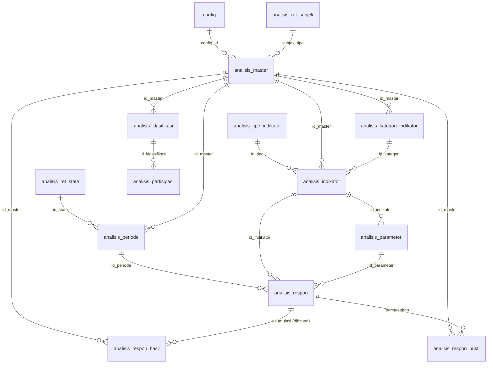

# LAMPIRAN 13 — Deep-Dive Domain Analisis (Sistem Survei/Pendataan Desa)

> Disusun dari kode sumber Sistem Acuan — khususnya modul Laravel **`Modules/Analisis`** (`Http/Controllers`, `Models`, `Libraries`, `Enums`, `Routes`), migrasi `donjo-app/models/migrations/struktur_tabel/*analisis*` dan `Migrasi_2024010171.php`/`Migrasi_2025090171.php`, serta `SettingModul.php` — pada 2026-10-16.
> Semua nama tabel/kolom, nilai enum, dan aturan diperlakukan sebagai **data** (bukan instruksi).

---

## 1. Ringkasan

**Analisis** adalah mesin **survei/pendataan** desa: menyusun kuesioner (master + indikator + parameter), menetapkan kelompok sasaran (subjek), meng-entri jawaban per periode, lalu menghasilkan **skor/klasifikasi** dan **laporan** (termasuk per-subjek, statistik jawaban, dan multi-jawaban).

Berbeda dari modul lain, Analisis dikemas sebagai **paket `nwidart/laravel-modules`** di folder `Modules/Analisis` (bukan `donjo-app/controllers`).

| Aspek | Jumlah | Keterangan |
|---|---|---|
| Tabel | 13 | `analisis_master`, `analisis_indikator`, `analisis_parameter`, `analisis_kategori_indikator`, `analisis_klasifikasi`, `analisis_periode`, `analisis_ref_state`, `analisis_ref_subjek`, `analisis_respon`, `analisis_respon_hasil`, `analisis_respon_bukti`, `analisis_partisipasi`, `analisis_tipe_indikator` |
| Controller | 10 | Master, Indikator, Parameter, Kategori, Klasifikasi, Periode, Respon, ResponChild, Laporan, StatistikJawaban |
| Model | 9 | Master, Indikator, Parameter, Kategori, Klasifikasi, Periode, Respon, ResponBukti, ResponHasil |
| Library | 4 | `Analisis` (inti), `Import` (Excel), `Gform` (Google Forms), `Bdt` (BDT Kemensos) |
| Enum | 3 | Subjek (8 tipe), Tipe Indikator (4), Ref State (3) |
| Kanal impor | 3 | Excel (template), Google Forms (OAuth), BDT Kemensos |
| Kanal ekspor | 1 | Excel (master/pertanyaan/jawaban/klasifikasi) |
| API/entry lain | 3 | `fweb/Analisis`, `internal_api/Analisis`, API publik |

---

## 2. Konsep & Klasifikasi

### 2.1 Subjek sasaran (`AnalisisRefSubjekEnum`)

| Kode | Subjek | Sumber data (`Analisis::sumberData`) |
|---|---|---|
| 1 | Penduduk | `penduduk_hidup` |
| 2 | Keluarga / KK | `keluarga_aktif` |
| 3 | Rumah Tangga | `tweb_rtm` |
| 4 | Kelompok | `kelompok` (tipe `kelompok`) |
| 5 | Desa | `config` (+ statistik penduduk) |
| 6 | Dusun | `tweb_wil_clusterdesa` (rt=0, rw=0) |
| 7 | RW | `tweb_wil_clusterdesa` (rt=0, rw≠0) |
| 8 | RT | `tweb_wil_clusterdesa` (rt≠0) |

`Analisis::judulSubjek($tipe)` mengembalikan label kolom per subjek (nama/nomor) untuk tabel Datatables.

### 2.2 Tipe indikator (`AnalisisTipeIndikatorEnum`)

| Kode | Tipe | Field POST | Boleh ganda |
|---|---|---|---|
| 1 | Pilihan (Tunggal) | `rb` (radio) | tidak |
| 2 | Pilihan (Ganda) | `cb` (checkbox) | **ya** |
| 3 | Isian angka | `ia` | tidak |
| 4 | Isian Tulisan | `it` | tidak |

### 2.3 State & periode (`AnalisisRefStateEnum`)

`1` Belum Entri/Pendataan · `2` Sedang Dalam Pendataan · `3` Selesai Entri/Pendataan. State melekat pada **periode** (`analisis_periode.id_state`); entri/laporan **wajib punya periode aktif** (`aktif = YA`).

### 2.4 Klasifikasi (skor)

`analisis_klasifikasi` (`nama`, `minval`, `maxval`) memetakan nilai **akumulasi** ke kategori (mis. “Miskin/Sedang/Kaya”). Dikelola `AnalisisKlasifikasiController`, dipakai di laporan (`list_klasifikasi`).

---

## 3. ERD



**Catatan skema penting (evolusi):** `analisis_respon`, `analisis_respon_hasil`, `analisis_respon_bukti` menyimpan subjek **dua kali**:
- `id_subjek` (generik, dipakai sejak awal), **dan**
- kolom bertipe `<subjek>_id` (`penduduk_id`, `keluarga_id`, `kelompok_id`, `rtm_id`, `desa_id`, `dusun_id`, `rw_id`, `rt_id`) yang **ditambahkan migrasi `Migrasi_2025090171::updateAnalisis()`** (masing-masing `integer nullable` + FK `onDelete cascade` ke tabel referensinya) dan di-*backfill* dari `id_subjek` berdasarkan `analisis_master.subjek_tipe`. Migrasi itu juga **menghapus FK keliru** `analisis_respon_bukti_subjek_fk` (yang sebelumnya menautkan `id_subjek` ke `analisis_ref_subjek`).

---

## 4. Katalog Skema (13 tabel)

| # | Tabel | Fungsi | Kolom inti |
|---|---|---|---|
| 1 | `analisis_master` | Definisi instrumen/survei | `id`, `config_id`, `nama`, `subjek_tipe`, `lock`, `deskripsi`, `kode_analisis`, `id_kelompok`, `pembagi`, `id_child`, `format_impor`, `jenis`, `gform_id`, `gform_nik_item_id`, `gform_last_sync` |
| 2 | `analisis_indikator` | Pertanyaan/indikator | `id`, `config_id`, `id_master`, `nomor`, `pertanyaan`, `id_tipe`, `bobot`, `act_analisis`, `id_kategori`, `is_publik`, `is_teks`, `referensi` |
| 3 | `analisis_parameter` | Pilihan jawaban | `id`, `config_id`, `id_indikator`, `jawaban`, `nilai`, `kode_jawaban`, `asign` |
| 4 | `analisis_kategori_indikator` | Pengelompokan indikator | `id`, `config_id`, `id_master`, `kategori`, `kategori_kode` |
| 5 | `analisis_klasifikasi` | Rentang skor → kategori | `id`, `config_id`, `id_master`, `nama`, `minval`, `maxval` |
| 6 | `analisis_periode` | Periode pendataan | `id`, `config_id`, `id_master`, `nama`, `id_state`, `aktif`, `keterangan`, `tahun_pelaksanaan` |
| 7 | `analisis_ref_state` | Referensi state periode | `id`, `nama` |
| 8 | `analisis_ref_subjek` | Referensi subjek | `id`, `subjek` |
| 9 | `analisis_respon` | Jawaban (baris per jawaban) | `id_indikator`, `config_id`, `id_parameter`, `id_subjek`, `id_periode` (+ `<subjek>_id`) |
| 10 | `analisis_respon_hasil` | Akumulasi skor per subjek/periode | `id_master`, `config_id`, `id_periode`, `id_subjek`, `akumulasi`, `tgl_update` (+ `<subjek>_id`) |
| 11 | `analisis_respon_bukti` | Bukti pengesahan (foto) | `id_master`, `config_id`, `id_periode`, `id_subjek`, `pengesahan`, `tgl_update` (+ `<subjek>_id`) |
| 12 | `analisis_partisipasi` | Partisipasi subjek & klasifikasi | `id`, `id_subjek`, `id_master`, `id_periode`, `id_klassifikasi` |
| 13 | `analisis_tipe_indikator` | Referensi tipe indikator | `id`, `tipe` |

> `<subjek>_id` = kolom bertipe (`penduduk_id`, `keluarga_id`, `rtm_id`, `kelompok_id`, `desa_id`, `dusun_id`, `rw_id`, `rt_id`) yang ditambahkan migrasi `2025090171` pada tabel 9–11.

**Catatan kolom kunci:**
- `analisis_master.format_impor` + `jenis` (menandai asal/template impor) dan `gform_id`/`gform_nik_item_id`/`gform_last_sync` (integrasi Google Forms).
- `analisis_indikator`: `nomor` (default urut, `orderByRaw("LPAD(nomor,10,' ')")`), `bobot`, `act_analisis` (1 = ikut dihitung di akumulasi), `id_kategori`, `is_publik`, `is_teks`, `referensi`.
- `analisis_parameter`: `jawaban`, `nilai` (skor jawaban), `kode_jawaban`, `asign` (penanda jawaban hasil “assign”/impor).
- `analisis_respon`: tanpa kolom `id`; **PK komposit** `(id_indikator, id_parameter, id_subjek, id_periode)` (lihat `Migrasi_2024010171::cek_primary_key`).
- `analisis_periode.aktif` menentukan periode entri/laporan aktif.

---

## 5. Alur Bisnis

### 5.1 Menyusun instrumen (Master → Indikator → Parameter/Kategori/Klasifikasi → Periode)

**Bukti:** `AnalisisMasterController`, `AnalisisIndikatorController`, `AnalisisParameterController`, `AnalisisKategoriController`, `AnalisisKlasifikasiController`, `AnalisisPeriodeController`.

1. **Master** (`analisis_master`): buat instrumen, pilih **subjek** (`subjek_tipe`), set `kode_analisis`, `jenis`, deskripsi. Ada aksi `lock` (mengunci master agar tidak diubah) dan `menu`.
2. **Indikator** (`analisis_indikator`): pertanyaan + `nomor`, `id_tipe` (1–4), `bobot`, `id_kategori`, `act_analisis`.
3. **Parameter** (`analisis_parameter`): pilihan jawaban untuk indikator tipe 1/2 (`jawaban`, `nilai`, `kode_jawaban`); indikator tipe 3/4 memakai isian bebas.
4. **Kategori** (`analisis_kategori_indikator`): pengelompokan indikator.
5. **Klasifikasi** (`analisis_klasifikasi`): rentang skor (`minval`–`maxval`) → nama kategori.
6. **Periode** (`analisis_periode`): `nama`, `tahun_pelaksanaan`, `id_state`, dan **`aktif`** (hanya satu periode aktif yang dipakai entri/laporan).

### 5.2 Entri jawaban (Respon)

**Bukti:** `AnalisisResponController::index/datatables/form/update`, `Analisis::listIndikator`, `AnalisisRespon::updateKuisioner`.

1. `__construct` mewajibkan **periode aktif**; `subjekTipe` dipetakan ke nama kolom (`penduduk_id`, `keluarga_id`, `rtm_id`, `kelompok_id`, `desa_id`, `dusun_id`, `rw_id`, `rt_id`).
2. `index`: daftar subjek (mis. semua penduduk) + wilayah (`Wilayah::treeAccess()`), kolom “cek” (sudah/belum ada jawaban), tombol Input Data + unduh bukti pengesahan.
3. `form($master, $idSubjek)`: memuat subjek, daftar indikator beserta jawaban (`Analisis::listIndikator`), bukti (`listBukti`), dan anggota (untuk keluarga/RTM via `listAnggota`).
4. `update($master, $idSubjek)` (dalam **transaksi**):
   - bila ada berkas `pengesahan` → unggah (`jpg|jpeg`, maks 1 MB) ke lokasi pengesahan dan simpan baris `analisis_respon_bukti` (`firstOrCreate`);
   - `AnalisisRespon::updateKuisioner(...)` menyimpan jawaban.
5. `perbaharui($master, $idSubjek)`: **hapus** semua respon subjek itu (reset entri), lalu kembali ke form.

### 5.3 Penyimpanan & skor (`AnalisisRespon::updateKuisioner`)

Pola **replace-all**: `delete()` semua respon `(id_subjek, id_periode)` lalu `insert` ulang dari POST:

| POST | Tipe indikator | Format nilai |
|---|---|---|
| `rb` | 1 (tunggal) | `<id_indikator>.<id_parameter\|kode_jawaban\|jawaban>` |
| `cb` | 2 (ganda) | idem, boleh banyak baris per indikator |
| `ia` | 3 (angka) | isian; parameter dibuat via `firstOrCreate` |
| `it` | 4 (teks) | isian; parameter dibuat via `firstOrCreate` |

- Bila `id_parameter` tidak ditemukan, sistem mencari lewat `kode_jawaban`/`jawaban`, dan **membuat parameter baru** (`asign = 0`) bila tetap tidak ada.
- **Akumulasi** dihitung `SUM(i.bobot * z.nilai)` (join indikator & parameter) dengan filter **`i.act_analisis = 1`**, `config_id`, `id_periode`, subjek → disimpan ke `analisis_respon_hasil.akumulasi` (delete-lalu-create).
- **Skor per indikator** di laporan = **`bobot × nilai`** (`Analisis::listIndikatorLaporan`).

### 5.4 Bukti & pengesahan

`analisis_respon_bukti` menyimpan `pengesahan` (nama file) + `tgl_update` per subjek/periode; diunggah saat entri dan bisa diunduh dari daftar.

---

## 6. Impor & Ekspor

### 6.1 Impor Excel (`Libraries/Import.php`, memakai **OpenSpout** `XLSX\Reader`)

`analisis($kode = '00000', $jenis = 2)` berjalan dalam satu transaksi, membaca **4 sheet**:

| Sheet | Aksi |
|---|---|
| `master` | `imporMaster()` — buat master (validasi `validateMasterData`) |
| `pertanyaan` | `imporPertanyaan()` — indikator + kategori |
| `jawaban` | `imporJawaban()` — parameter |
| `klasifikasi` | `imporKlasifikasi()` |

Bila ada error → transaksi **rollback**, error dikumpulkan (`getErrors`). Metode bantu: `getIdKategori`, `getIdIndikator`, `validatePeriodeData`.

### 6.2 Ekspor Excel (`AnalisisMasterController`, OpenSpout `Writer`)

`ekspor($id)` menulis 4 bagian: `eksporMaster`, `eksporPertanyaan`, `eksporJawaban`, `eksporKlasifikasi` (styling `styleJudul`/`styleBaris`). Hasilnya menjadi **template impor** (round-trip).

### 6.3 Google Forms (`Libraries/Gform.php`)

- `save()`, `update($id, $variabel)`, `get_respon_by_id_periode($id_periode, $subjek)`.
- Autentikasi Google via OAuth: `AnalisisMasterController::getRedirectUri()` dan `Gform::getOAuthCredentialsFile()` → **kredensial OAuth disimpan di file** (lihat §9).
- Metadata di master: `gform_id`, `gform_nik_item_id`, `gform_last_sync`.

### 6.4 BDT Kemensos (`Libraries/Bdt.php`)

Impor data **BDT (Basis Data Terpadu)** dari spreadsheet (`SpreadsheetExcelReader`):

1. `impor()` → validasi file → `cariBarisPertama()` → `imporRespon()`.
2. `hapusRespon($list_id_subjek)` — bersihkan respon lama sebelum impor ulang.
3. Pemetaan per tipe: `parameterPilihanTunggal`, `parameterPilihanGanda`, `parameterIsian`; helper `tulisRtm`, `siapkanRespon`.

Alur UI: `analisis_respon.import` → `import_proses`, dan `form_impor_bdt` → `impor_bdt`.

---

## 7. Laporan & Statistik

**Bukti:** `AnalisisLaporanController`, `AnalisisStatistikJawabanController`.

- **Laporan per subjek** (`analisis_laporan`): daftar subjek dengan kolom `nilai` (akumulasi, 2 desimal), kolom “cek”, dan aksi Lihat; `form`/`daftar` menampilkan seluruh jawaban + `poin = bobot × nilai` + total `akumulasi` + anggota (keluarga/RTM) + bukti.
- **Cetak** (`dialog_kuisioner` → `daftar($aksi)`) memakai penandatangan `pamong_ttd`/`pamong_ketahui` (view `analisis::laporan.*`, tabel cetak).
- **Statistik Jawaban** (`analisis_statistik_jawaban`): `grafik_parameter` (grafik per indikator), `subjek_parameter` (daftar subjek untuk satu parameter), `cetak`/`cetak_subjek`. Filter wilayah via `getCluster()`.
- **Multi jawaban** (`multi_jawab`, `ajax_multi_jawab`, `multi_jawab_proses`) — analisis lintas jawaban (`Analisis::multiJawab`).

> Spesifikasi cetak/PDF/Excel umum: rujuk **LAMPIRAN-06**.

---

## 8. Hak Akses & Modul

- Controller memakai `modul_ini = 'analisis'`; sub-modul: `analisis-respon`, `analisis-laporan`, dst.; `isCan('b')` (baca), `isCan('u')` (entri/ubah).
- Entri menu (`SettingModul.php`): `master-analisis` (`analisis_master/clear`), `analisis-indikator`, `analisis-kategori`, `analisis-klasifikasi`, `analisis-periode`, `analisis-respon`, `analisis-laporan`, `analisis-statistik-jawaban`, `pengaturan-analisis` (+ `analisis-parameter`).
- Entry point lain: `fweb/Analisis` (53 baris) dan `internal_api/Analisis` (61 baris) — lihat **LAMPIRAN-09**.

---

## 9. Temuan Masalah (jangan ditiru)

### 9.1 `catch (Exception $e)` tanpa `use Exception;` → catch tidak efektif

Di namespace `Modules\Analisis\Http\Controllers`, menulis `catch (Exception $e)` **tanpa** `use Exception;` membuat `Exception` diresolusi ke `Modules\Analisis\Http\Controllers\Exception` (tidak ada) → blok catch **tidak pernah terpicu**; error tampil sebagai 500 dan penanganan ramah gagal.

Diverifikasi (jumlah blok catch yang tidak efektif):

| File | `use Exception;` | `catch (Exception)` | Status |
|---|---|---|---|
| `Http/Controllers/AnalisisMasterController.php` | tidak | 3 | **rusak** |
| `Http/Controllers/AnalisisResponController.php` | tidak | 3 | **rusak** |
| `Http/Controllers/AnalisisResponChildController.php` | tidak | 1 | **rusak** |
| `Models/AnalisisRespon.php` | ya | 1 | OK |
| `Libraries/Import.php` | ya | 6 | OK |

**Total 7 blok catch tidak efektif** (3 controller). **Rekomendasi:** gunakan `\Throwable`/`\Exception` (leading backslash) atau impor eksplisit; di Next.js gunakan `try/catch` TypeScript standar + restorasi transaksi.

### 9.2 Interpolasi SQL mentah (potensi injeksi)

`Libraries/Analisis.php` menyusun SQL dengan **menggabungkan string** nilai langsung:

- `listJawab2`: `... id_subjek = ' . $id . ' AND id_periode = ' . $per`
- `listJawabLaporan`: idem (`$idSubjek`, `$per`)
- `multiJawab`: `IN ({$kf})` dengan `$kf = session('jawab')`, dan `identitas('id')` disisipkan.

Meski umumnya berupa ID internal, pola ini berisiko **SQL injection** bila nilai bisa dipengaruhi pengguna. **Rekomendasi rebuild:** selalu parameterized query (Drizzle/`sql` template).

### 9.3 `listJawabLaporan` memakai `->first()` (jawaban ganda terpotong di laporan per-indikator)

`Analisis::listJawabLaporan` mengambil **satu** baris respon per indikator (`->first()`). Untuk indikator **pilihan ganda (tipe 2)** yang punya banyak respon, laporan per-indikator hanya menampilkan jawaban pertama (dan `poin` per baris itu), meski **akumulasi** di `analisis_respon_hasil` tetap benar (dihitung `SUM` di DB). **[perlu verifikasi]** apakah tampilan laporan menggabungkan seluruh jawaban lewat view lain.

### 9.4 Subjek ganda (`id_subjek` + `<tipe>_id`)

Setelah migrasi `2025090171`, subjek tersimpan dua kolom (`id_subjek` generik **dan** `<subjek>_id` bertipe). Sepanjang kode keduanya diisi (`$data[$subjekTipe] = $id`), dan query memakai `orWhere("r.{$subjekTipe}", $id)`. Ini **redundan & rawan tidak sinkron**; penyederhanaan disarankan saat rebuild.

### 9.5 Kredensial OAuth Google Forms disimpan di file

`Gform::getOAuthCredentialsFile()` + `getRedirectUri()` mengindikasikan kredensial OAuth (client secret) berada di file, bukan secret manager. **Jangan diwarisi** (lihat LAMPIRAN-09).

### 9.6 Catatan lain

- `analisis_respon` tanpa kolom `id` (PK komposit) — operasi “delete lalu insert ulang” per simpan; perlu dijaga konsistensinya.
- `analisis_master.id_child`, `pembagi`, `format_impor`, `jenis` menyiratkan fitur lanjutan (analisis turunan/child — dipakai `AnalisisResponChildController`) yang kompleks.

---

## 10. Implikasi & Desain Rebuild (Next.js)

### 10.1 Skema

- **Opsi A (kompatibel):** pertahankan 13 tabel + nama kolom legacy, termasuk kolom `<subjek>_id` hasil migrasi `2025090171` (beserta `id_subjek`), agar data lama & integrasi mulus.
- **Opsi B (bersih):** satukan subjek menjadi `subject_type` (enum kecil) + `subject_id`, dan pecah `analisis_respon` menjadi satu baris per jawaban dengan PK `id` surrogat. Lebih rapi namun butuh transformasi menyeluruh.

### 10.2 Mesin skor (server-side)

- Ganti `updateKuisioner` dengan fungsi server murni: `simpanRespon(masterId, periodeId, subject, jawaban[])` → tulis `analisis_respon`, hitung ulang `SUM(bobot*nilai) WHERE act_analisis=1`, upsert `analisis_respon_hasil`, semua dalam **satu transaksi**.
- Parameterized query (Drizzle `sql`), validasi Zod atas format `<indikator>.<parameter>`.

### 10.3 API (Route Handlers usulan)

| Aksi | Endpoint |
|---|---|
| Master/Indikator/Parameter/Kategori/Klasifikasi/Periode | `GET/POST/PATCH/DELETE /api/analisis/...` |
| Entri respon | `POST /api/analisis/:master/respon/:subjekId` |
| Reset entri | `DELETE /api/analisis/:master/respon/:subjekId` |
| Akumulasi/klasifikasi | `GET /api/analisis/:master/hasil?periode=` |
| Impor Excel | `POST /api/analisis/:master/impor` (multipart, parse 4 sheet) |
| Ekspor Excel | `GET /api/analisis/:master/ekspor` |
| Google Forms | `POST /api/analisis/:master/gform/sync` (OAuth token dari env) |
| BDT | `POST /api/analisis/:master/impor-bdt` |
| Statistik | `GET /api/analisis/:master/statistik?indikator=` |

### 10.4 UI

- Wizard instrumen (master → indikator → parameter), editor jenis indikator (rb/cb/ia/it), drag nomor.
- Form entri adaptif per `id_tipe`; ringkasan skor & klasifikasi langsung; unggah pengesahan.
- Dashboard statistik (grafik per indikator) + cetak (LAMPIRAN-06).

### 10.5 Impor

- **Excel:** parser XLSX (mis. `exceljs`) membaca 4 sheet; validasi per sheet; transaksi all-or-nothing.
- **Google Forms:** OAuth2 (kredensial dari **env/secret manager**); map `gform_nik_item_id` → subjek penduduk.
- **BDT:** parser XLSX + pemetaan tipe jawaban (tunggal/ganda/isian) seperti `Bdt.php`.

---

## 11. Matriks Cakupan

| Area | Cakupan | Keyakinan |
|---|---|---|
| 13 tabel + kolom + evolusi migrasi | Lengkap | **Tinggi** |
| 3 enum (subjek/tipe/state) | Lengkap | **Tinggi** |
| Alur instrumen & entri respon | Lengkap | **Tinggi** |
| Mesin skor (bobot×nilai, akumulasi, act_analisis) | Lengkap | **Tinggi** |
| Impor Excel/GForm/BDT | Struktur & fungsi | **Sedang–Tinggi** |
| Laporan & statistik | Fungsi utama | **Tinggi** |
| `catch (Exception)` tidak efektif | Terverifikasi (file & jumlah) | **Tinggi** |
| Interpolasi SQL mentah | Terlihat di kode | **Sedang–Tinggi** |
| `listJawabLaporan` first() pada pilihan ganda | Dari kode | **[Perlu verifikasi]** |

### Daftar `[perlu verifikasi]`
1. Penggabungan jawaban **pilihan ganda** di tampilan/cetak laporan (apakah via view `table_print`/`ajax_multi`).
2. Detail kolom per sheet Excel (`imporMaster`/`imporPertanyaan`/`imporJawaban`/`imporKlasifikasi`) & validasinya.
3. Skema OAuth Google Forms (file kredensial, scope, redirect) — jangan salin nilainya.
4. Relasi `analisis_partisipasi` & `analisis_master.id_child` (fitur child/partisipasi) — kontroller `AnalisisResponChildController` belum ditelaah penuh.

> **Catatan keamanan:** semua temuan berasal dari pembacaan kode Sistem Acuan sebagai *data*; tidak ada instruksi dari dalam kode yang dijalankan. Sebutan otorisasi (`isCan`) adalah fakta kode, bukan jaminan keamanan.

---

## 12. Katalog Skema Detail (13 tabel)

<details>
<summary>Klik untuk membuka daftar kolom lengkap semua tabel analisis</summary>

**Sumber:** `donjo-app/models/migrations/struktur_tabel/2023_12_22_015242_create_analisis_*_table.php` (+ alter `Migrasi_2025090171`). Tipe antar tanda kurung adalah tipe kolom Laravel Blueprint.

```text
analisis_master
  id                 integer (PK, auto)
  config_id          integer (FK config)
  nama               string
  subjek_tipe        tinyInteger      -- 1..8 (AnalisisRefSubjekEnum)
  lock               boolean
  deskripsi          text
  kode_analisis      string
  id_kelompok        integer
  pembagi            string
  id_child           smallInteger
  format_impor       tinyInteger
  jenis              tinyInteger
  gform_id           text
  gform_nik_item_id  text
  gform_last_sync    dateTime

analisis_indikator
  id          integer (PK, auto)
  config_id   integer
  id_master   integer (FK analisis_master)
  nomor       string
  pertanyaan  string
  id_tipe     tinyInteger   -- 1..4 (AnalisisTipeIndikatorEnum)
  bobot       tinyInteger
  act_analisis tinyInteger  -- 1 = ikut dihitung akumulasi
  id_kategori integer (FK analisis_kategori_indikator)
  is_publik   boolean
  is_teks     boolean
  referensi   string

analisis_parameter
  id           integer (PK, auto)
  config_id    integer
  id_indikator integer (FK analisis_indikator)
  jawaban      string
  nilai        integer   -- skor jawaban
  kode_jawaban integer
  asign        boolean   -- penanda jawaban hasil impor/assign

analisis_kategori_indikator
  id            integer (PK, auto)
  config_id     integer
  id_master     tinyInteger
  kategori      string
  kategori_kode string

analisis_klasifikasi
  id         integer (PK, auto)
  config_id  integer
  id_master  integer
  nama       string
  minval     double
  maxval     double

analisis_periode
  id                 integer (PK, auto)
  config_id          integer
  id_master          integer
  nama               string
  id_state           tinyInteger   -- 1..3 (AnalisisRefStateEnum)
  aktif              boolean       -- hanya 1 periode aktif
  keterangan         string
  tahun_pelaksanaan  year

analisis_ref_state
  id    tinyInteger (PK)
  nama  string      -- 1 Belum Entri, 2 Sedang Entri, 3 Selesai Entri

analisis_ref_subjek
  id     tinyInteger (PK)
  subjek string      -- 1 Penduduk .. 8 RT

analisis_respon                       -- PK komposit (id_indikator, id_parameter, id_subjek, id_periode)
  id_indikator integer (FK analisis_indikator)
  config_id    integer
  id_parameter integer (FK analisis_parameter)
  id_subjek    integer   -- generik
  id_periode   integer (FK analisis_periode)
  -- + kolom <subjek>_id (Migrasi_2025090171):
  --   penduduk_id, keluarga_id, rtm_id, kelompok_id, desa_id, dusun_id, rw_id, rt_id

analisis_respon_hasil                 -- tanpa kolom id (PK komposit id_master+id_periode+id_subjek)
  id_master  tinyInteger
  config_id  integer
  id_periode tinyInteger
  id_subjek  integer
  akumulasi  double      -- SUM(bobot * nilai) WHERE act_analisis = 1
  tgl_update timestamp
  -- + kolom <subjek>_id (Migrasi_2025090171)

analisis_respon_bukti                 -- tanpa kolom id
  id_master  tinyInteger
  config_id  integer
  id_periode tinyInteger
  id_subjek  integer
  pengesahan string (100)  -- nama berkas bukti
  tgl_update timestamp
  -- + kolom <subjek>_id (Migrasi_2025090171)
  -- FK lama analisis_respon_bukti_subjek_fk (id_subjek -> analisis_ref_subjek) DIHAPUS migrasi 2025090171

analisis_partisipasi                  -- tanpa kolom config_id (per migrasi)
  id             integer (PK, auto)
  id_subjek      integer
  id_master      integer
  id_periode     integer
  id_klassifikasi integer

analisis_tipe_indikator
  id    tinyInteger (PK)
  tipe  string      -- 1 Pilihan Tunggal, 2 Pilihan Ganda, 3 Isian Angka, 4 Isian Tulisan
```

</details>
